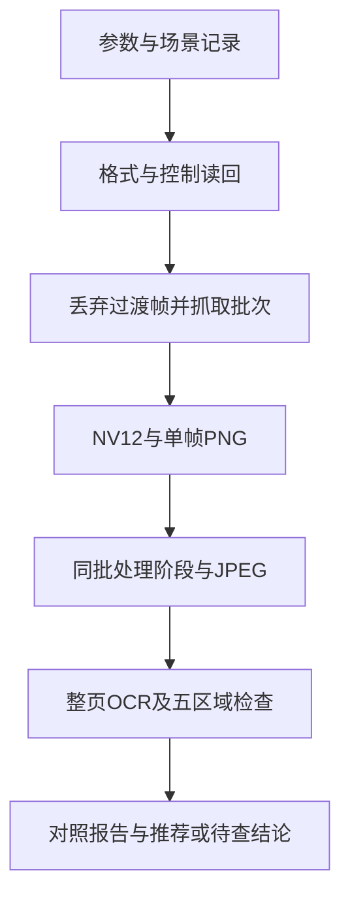
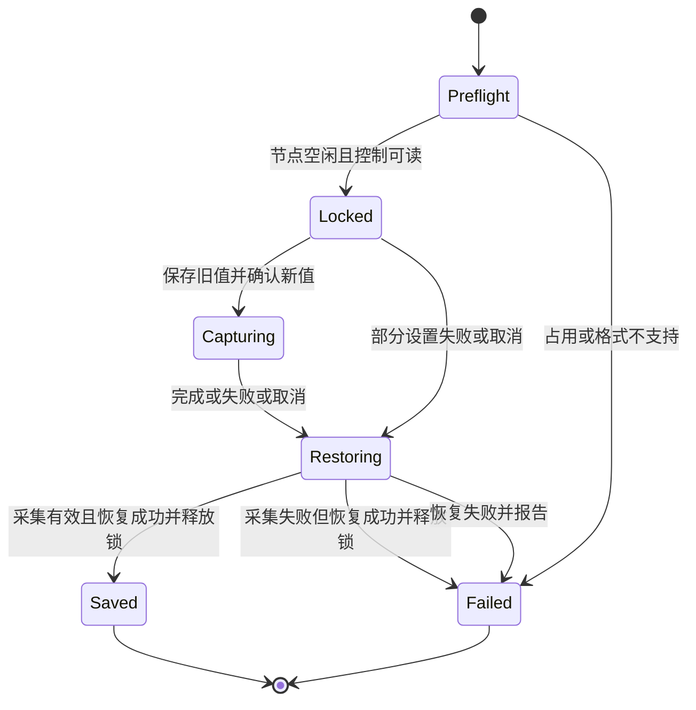
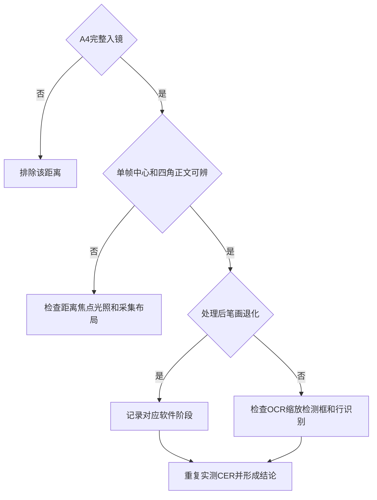

# OV13855 A4 整页画质诊断 - Plan

## Goal Capsule

- **Objective:** 开发者能用可复现的样张和 OCR 对照，判断 A4 正文识别不佳发生在成像、软件处理还是 OCR 输入环节，并据此选择推荐拍摄配置或明确下一步排查方向。
- **Means:** 独立命令行诊断工具与固定场景对照实验（KTD1、KTD5）。
- **Authority:** 用户已确认的 Product Contract 优先；Planning Contract 决定实现方式；Implementation Units 不改变前两者。
- **Execution profile:** 先完成主机上的工具和离线验证，再开展板上实验；不预设硬件或软件是根因。
- **Stop conditions:** 无板上访问或物理场景无法布置时，保留工具和已完成证据，明确报告硬件验证未完成。发现需要改变产品边界的修复时，记录依据并另行讨论。
- **Tail ownership:** 本计划交付诊断工具、实验记录和推荐配置，不自动改正式采集管线、不推送或开 PR。执行时的提交要求遵循用户指令和仓库惯例。

---

## Product Contract

### Summary

建立独立抓图与离线对照能力，在固定 A4 正文场景下比较距离、曝光、增益和软件处理，形成可复现的诊断结论。

### Problem Frame

OV13855 的照片质量影响 OCR，但目前缺少同一批原始采集帧与最终图片的分阶段对照。Debian Server 没有桌面查看应用，开发者需要通过命令行抓图并传到电脑检查。

现行代码在 ISP 输出之后进行多帧合并、双边滤波、数字补偿和 JPEG 编码。部署文档记录官方 rkaiq 引入失败、主路径仍使用软件控制；这些历史结果不能证明当前笔画损失的来源。板上 OCR 将整图缩至 480×480 做检测，也必须作为诊断边界记录。

### Key Decisions

- **固定场景先行。** (session-settled: user-directed — chosen over 手持或移动场景: 用户选择先按固定场景测试。) Governs R1.
- **整页覆盖作为距离筛选条件。** (session-settled: user-directed — chosen over 靠近分区域拍摄: 用户要求最终一张拍完整页。) Governs R1, R2.
- **先诊断，再决定正式修复。** (session-settled: user-approved — chosen over 本轮直接修改正式管线: 用户确认先定位问题并形成推荐配置的范围。) Governs R7.

### Requirements

**测试场景**

- R1. 摄像头、纸张和光照固定，以 A4（210×297 mm）普通正文为目标；每张候选图必须完整覆盖页面。
- R2. 允许调整拍摄距离；在完整覆盖页面的位置比较中心和四角文字的原尺寸细节。

**抓图与证据**

- R3. 开发者能手动设置曝光与模拟增益，查看实际读回值，并保存与图片对应的采集格式、场景条件和错误信息。
- R4. 每次有效采集保留未经过项目软件后处理的单帧无损图片，并从同一批帧产生合并、降噪、提亮及最终 JPEG 的对照图片。
- R5. 结果能传到电脑查看，失败或中断不会被标记为有效对照样本，也不会覆盖先前实验结果。

**诊断与边界**

- R6. 使用同一份已知正文、同一 OCR 后端和模型比较重复拍摄的错字、漏字；记录实际 OCR 输入和检测结果以区分采集与识别损失。
- R7. 本轮交付工具、实验结论及有证据支持的推荐配置；不修改正式采集和 OCR 行为。
- R8. 实验结束或失败后恢复受控的传感器设置，并报告恢复结果；与其他摄像头控制程序冲突时不得生成有效实验结果。

### Success Criteria

诊断交付成功不等于画质一定改善。必须形成可重复的证据链，说明哪些假设被支持、被排除或仍待验证。

只有候选配置完整覆盖 A4、中心与四角正文可辨，且重复拍摄的 OCR 错漏比当前基准稳定减少，才标记为推荐改善配置。没有更优候选时，交付明确的失败边界和下一步检查依据，不把更高亮度、字符数量或锐度分数当作成功。

### Acceptance Examples

- AE1. Covers R3, R5. 请求参数被驱动钳制时，样本记录请求值与读回值；参数无法读取时该组不可用于受控比较。
- AE2. Covers R4. 同一批帧生成所有处理阶段的输出，每个输出可追溯至源帧和处理配置，不为不同阶段重新拍摄。
- AE3. Covers R1, R2. 靠近后正文更清楚但页面裁切，该位置被排除，不作为推荐配置。
- AE4. Covers R6. 原尺寸照片正文清楚而检测输入丢失细节或漏行时，结论保留 OCR 输入环节嫌疑，不直接认定摄像头不合格。
- AE5. Covers R5, R8. 采集中断时保存失败记录、终止子进程并尝试恢复控制值；无法恢复时明确告知，不输出成功状态。

### Scope Boundaries

不新增实时预览或控制台页面，不安装桌面系统，不更换镜像或内核，不继续适配 rkaiq，不使用分区拍摄代替整页验收。

#### Deferred to Follow-Up Work

依据实测修改正式曝光策略、修复多帧配准、调整降噪或 JPEG 参数；OCR 分块检测、模型转换和镜头或照明改造均单独评估。诊断工具可发现并记录这些问题，但本轮不改变生产行为。

---

## Planning Contract

### Key Technical Decisions

- KTD1. **独立 CLI，分离板上采集与离线分析。** 在 `device/lira/diagnostics/` 提供入口，沿用 Python、OpenCV、NumPy 和 v4l2-ctl，不引入桌面或 Web 服务。离线处理无需板上权限，RKNN 依赖仅在启用板上 OCR 时加载。实现 R3–R7。
- KTD2. **按驱动实际格式解析 NV12。** 通过拓扑核对并允许指定采集与传感器节点，不把节点编号视为永久标识。记录格式协商后的宽高、平面、bytesperline、sizeimage 和可用色彩元数据；只支持已明确验证的线性 NV12 布局，拒绝含糊的布局或截断帧。必须核实 v4l2-ctl 输出文件的逐帧序列化规则和有效负载边界，不能把 sizeimage 缓冲容量直接当作有效帧字节数；帧数不足拒绝有效样本。行填充按实际跨度处理，不能直接复用现 HAL 固定宽高切帧逻辑。[V4L2 格式结构](https://cdn.kernel.org/doc/html/latest/userspace-api/media/v4l/pixfmt-v4l2.html) 支持这一约束。
- KTD3. **控制值和采集生命周期可追溯。** 查询范围、步进与当前值，在驱动依赖约束下先设置 vblank 再设置曝光与增益，读回确认。曝光保留驱动原始单位，未经时序验证不换算成毫秒。采用每次运行独立目录和排他锁；工具检查外部占用和 rkaiq 控制者，明确要求人工暂停相关服务，不自行杀掉服务。快照完成后所有变更均进入无条件恢复保护，包括部分设置失败。超时或取消必须终止并等待子进程退出，再恢复采集格式与控制值并释放锁。恢复依赖顺序以原控制范围为准，必要时先降低曝光再缩短 vblank。采集与恢复分别记录状态，二者均成功才标为有效样本。
- KTD4. **保存 ISP 原生输出，不称为传感器 RAW。** 保留 NV12 数据及解码后 BGR PNG；它已经过 ISP，但未经过项目合并和数字补偿。离线处理复用 `camera_isp.py` 的现有纯函数，以诊断代码组合各阶段，并输出最终 JPEG 解码后的 PNG 以检查压缩损失。记录旋转、翻转和配准是否走回退。
- KTD5. **单变量筛选，再同场景验证候选。** 先用能辨字且不过曝的固定曝光组合筛选三个完整入镜距离，再在选定距离扫描少量参数组合，最后以同批帧比较处理阶段。每次变更先丢弃启动或参数切换后的过渡帧，连续抓取三帧；重复运行不能把同一批三帧当作三个独立实验。
- KTD6. **OCR 用字符错误率与漏行定位。** 直接调用 `RknnOcrEngine` 的 `OcrEngine.read` 排序与识别路径，不启动语音或 LLM 阅读流程；基准与候选使用相同模型。主指标 CER=(替换+删除+插入)/参考字符数，同时记录编辑计数、预期行数和识别行数。统一参考与识别文本的 Unicode、空白处理，保留原文本与规范化版本，标点保留；空参考文本拒绝评分。人工标注的五区域辅助检查不替代整页评分。
- KTD7. **基准分为生产基准与同参数处理基准。** 先留存现行 `Camera.capture()` 的输出和控制读回，作为最终改善参照。生产基准在同一排他锁与格式、控制快照保护内，通过独立子进程调用原 HAL；超时或取消时回收整个采集进程组后恢复，避免现有 HAL 的子进程缺陷污染后续实验。诊断期间的手动参数固定，不运行生产自适应控制；同批处理对照用于归因，不能冒称完全复现生产自动控制。生产基准与候选交替重复采集，减少光照漂移影响。

### High-Level Technical Design

数据流：

采集生命周期：

结果判断：

### Research and Constraints

`device/lira/hal/board/camera_isp.py` 是现行采集与纯函数参照：曝光 6400、vblank 3300、增益自适应、三帧处理、JPEG 质量 88。固定帧大小、控制写入失败被忽略、启动帧无丢弃等是待验证因素，不据此预先宣告根因。

`device/lira/vision/ocr_rknn.py` 的检测输入为 480×480，行识别输入为 48×320；`device/lira/vision/engine.py` 负责检测、排序、裁剪与识别，`reading.py` 负责 JPEG 解码。诊断应保留这条真实路径的证据，而非更换 OCR 算法后归因于摄像头。

`deploy/SETUP.md` §2.4 和验收表记录 rkaiq AE 反馈环失败，以及长曝光与合并降噪曾改善字符数量。后者没有已知文本的错误率，不能替代本轮评分。`device/tests/test_camera_isp_quality.py` 提供纯函数测试惯例。

### Deferred Runtime Questions

- **Deferred:** 板上实际节点、控制范围、协商格式、帧跨度、过渡帧数量和曝光时长，由 U1/U4 查询与实测。
- **Deferred:** 镜头是否支持电子对焦、当前最佳距离及能否覆盖 A4 时对焦，由 U4 核实；不假设 OV13855 模组一定有自动对焦。
- **Deferred:** 最佳曝光组合、配准平移方向是否正确、降噪是否损伤笔画，由 U2/U4 对照判定，不在本计划中预设修复。

---

## Implementation Units

### U1. Controlled capture and sample records

**Goal:** 抓取可追溯、可恢复的手动参数样本。

**Requirements:** R1, R3, R5, R8；KTD1–KTD3、KTD5。

**Dependencies:** 无。

**Files:** 新建 `device/lira/diagnostics/__init__.py`、`device/lira/diagnostics/camera_quality.py`、`device/tests/test_camera_quality_diagnostics.py`。

**Approach:**

1. 实现节点与控制预检、排他采集和每次运行独立输出目录，输出场景标签、距离、时间、请求值、读回值及工具版本。
2. 按 KTD2 解析格式和逐帧数据，保留源缓冲、PNG、原始查询输出和有效性标记。
3. 按 KTD3 管理超时、取消及恢复。恢复失败与采集失败分别报告，不隐去子进程错误。

**Patterns to follow:** HAL 的异步子进程方式、`device/tests/test_camera_isp_quality.py` 的主机可测纯函数边界；不要继承 HAL 固定临时文件。

**Test scenarios:**

1. Covers AE1. 驱动钳制曝光时记录请求值和读回值，查询失败时不生成有效对照样本。
2. 紧密 NV12 与带行填充 NV12 的已知缓冲解码一致；截断、错误帧数和不支持的布局明确失败。
3. Covers AE5. 控制写入失败、超时或取消后子进程被回收，恢复顺序满足控制依赖；恢复失败单独报告。
4. 两次运行互不覆盖，第二个并发采集被锁拒绝；外部设备占用或控制守护进程运行时预检拒绝实验。
5. 生产基准子进程超时后其采集进程组已回收，恢复格式及控制成功后下一轮采集能启动；部分控制已设置但尚未开流时失败也执行恢复。

**Verification:** 主机桩与缓冲夹具覆盖以上行为；板上冒烟确认 PNG、控制读回和实际格式一致。

### U2. Offline processing-stage comparison

**Goal:** 用同一批帧定位处理阶段的笔画损失。

**Requirements:** R2, R4, R5；KTD1、KTD4、KTD7。

**Dependencies:** U1。

**Files:** 修改 `device/lira/diagnostics/camera_quality.py`、`device/tests/test_camera_quality_diagnostics.py`；只读复用 `device/lira/hal/board/camera_isp.py` 与 `camera_raw.py`。

**Approach:**

1. 输出各单帧、合并结果、双边滤波结果、数字补偿结果及 JPEG，对每个阶段输出可追溯配置。
2. 让每个阶段按顺序处理同一输入批次；保留纯单帧和完整处理链对照，并导出人工指定的五区域原尺寸裁剪。距离变化时重新标注页面位置，裁剪对应相同纸面文字，而非沿用相机像素坐标。
3. 记录亮度、暗部与高亮比例、区域锐度及配准状态作为辅助指标；不自动用锐度最高选出最终推荐。

**Test scenarios:**

1. Covers AE2. 所有阶段来自相同源帧，离线重跑不用打开摄像头，输入文件保持不变。
2. 已知平移的文字夹具验证配准后是否对齐；若现有函数反向平移，诊断报告退化并保留原行为，不悄悄修复生产函数。
3. 超界或空裁剪区域拒绝处理；单帧批次不伪造三帧合并。
4. JPEG 解码图与对应 PNG 均保留，缺失或损坏源数据不会生成完整成功报告。

**Verification:** 主机离线夹具证明阶段身份和文件追溯正确；人工能在电脑查看全图及五区域裁剪。

### U3. OCR evidence and comparison scoring

**Goal:** 以可复核的整页错误率比较样本，并记录 OCR 输入损失。

**Requirements:** R6, R7；KTD1、KTD6、KTD7。

**Dependencies:** U2。

**Files:** 新建 `device/lira/diagnostics/ocr_compare.py`、`device/tests/test_ocr_compare.py`；只读调用 `device/lira/vision/engine.py`、`ocr_rknn.py`、`layout.py`。

**Approach:**

1. 接受参考正文及样本列表，固定 OCR 后端、模型、字典和排序方式；记录身份与输入文件校验值。
2. 导出真实检测预处理输入、检测框及逐行识别裁剪，避免修改模型输入契约。对人工标注的原尺寸正文区域提供辅助识别对照，并明确其不属于整页验收。必要的采集诊断包装局限在 diagnostics。
3. 保存原始 OCR 文本与规范化评分文本，按 KTD6 输出逐样本和逐组统计，保留失败样本并报告分母。

**Test scenarios:**

1. 相同、替换、删除、插入和全空识别文本获得正确编辑计数及 CER；空参考文本报错。
2. 中文标点与 Unicode 规范化规则在参考和识别两侧一致，空白处理不改变字符顺序。
3. Covers AE4. 假引擎漏检文字行时，检测框、输入尺寸与 CER 均保留，不输出摄像头根因结论。
4. 未启用 OCR 时主机能使用采集与离线模块而不导入 RKNN；模型缺失或 OCR 推理失败时输出失败样本而不按零错误评分。

**Verification:** 主机纯评分测试和假引擎集成验证通过；板上同一后端处理基准与候选，输入证据可复核。

### U4. Board experiments and diagnosis report

**Goal:** 用真实 A4 样张形成复现步骤、诊断结论和推荐配置或明确失败边界。

**Requirements:** R1–R8；KTD5–KTD7。

**Dependencies:** U1、U2、U3；需要板上访问与人工布置固定场景。

**Files:** 新建 `docs/camera-quality-experiment.md`；修改 `deploy/SETUP.md` 添加诊断入口与结论链接。

**Approach:**

1. 准备无敏感内容的已知 A4 普通正文，记录字号、方向、灯光和机位，标出中心与四角检查区域。留存当前生产基准，再暂停其摄像头控制。
2. 按 KTD5 筛选距离。找不到兼顾整页覆盖和清晰对焦的位置时停止参数穷举，记录光学边界。
3. 在选定距离测试约 3 个曝光档与 3 个增益档；值从实际范围选择，限制饱和和过渡帧影响。有大面积文字区域过曝的组合直接排除。
4. 对候选的同批处理阶段做离线对照，再选少量候选与生产基准交替各重复 3 次独立采集。报告逐次 CER、编辑计数、漏行、区域笔画观感及拍摄耗时。
5. 根据结果给出带适用场景的推荐配置，或指向对焦、光照、采集布局、处理阶段、OCR 检测或行识别的待查证据。恢复设置和原先服务状态，记录样本位置及校验值。

**Test expectation:** 不新增文档单元测试；使用 U1–U3 工具开展真实硬件验收，不能以主机测试代替。

**Verification:** Covers AE3、AE4、AE5. 完整入镜检查、真实 OCR 对照与恢复记录齐全；不把不可访问板子或未开展实验写成已完成。

---

## Verification Contract

- **Host gate:** 在 `device/` 的已配置 Python 环境运行 `python -m pytest tests/test_camera_quality_diagnostics.py tests/test_ocr_compare.py tests/test_camera_isp_quality.py`。本计划阶段不运行这些测试。
- **Dependency gate:** 新诊断入口的帮助和离线评分在无 RKNN 的主机环境可用；使用已有相机/OCR 环境所需的 OpenCV 与 NumPy，文档说明依赖，不引入 GUI 依赖。
- **Board gate:** U4 使用真实格式读回与样张完成三轮实验，证明捕获、处理、OCR 证据和恢复状态一致。
- **Comparison gate:** 同一页、同一后端模型、同一评分规范；以独立拍摄为重复单位。候选只有三次 CER 均优于基准组中位数且五区域无明显笔画退化时才标记稳定改善；该规则用于本轮筛选，不宣称跨场景统计保证。
- **Boundary gate:** 正式 `Camera.capture()`、阅读流程和 OCR 模型行为无修改，历史 rkaiq 失败记录保留。
- **Failure gate:** 没有稳定更优候选可形成有效诊断结论；缺少板上证据只能报告工具交付与硬件验证待完成。

---

## Definition of Done

- U1：受控采集、格式解析、独立样本记录及失败恢复通过主机与板上冒烟验证。
- U2：同批阶段对照与原尺寸裁剪能在电脑查看并追溯。
- U3：OCR 输入证据和 CER 评分可复核，失败样本不污染评分。
- U4：A4 距离、参数和处理对照均有实测记录；推荐或失败边界由证据支持。
- 实验后控制值与服务状态得到恢复确认；恢复失败得到明确报告。
- 未修改正式管线，未遗留废弃实验代码；大体积样张保存在实验目录而非提交到仓库。
- 所有未完成的硬件检查明确列出，不将工具可运行等同于目标已达成。
