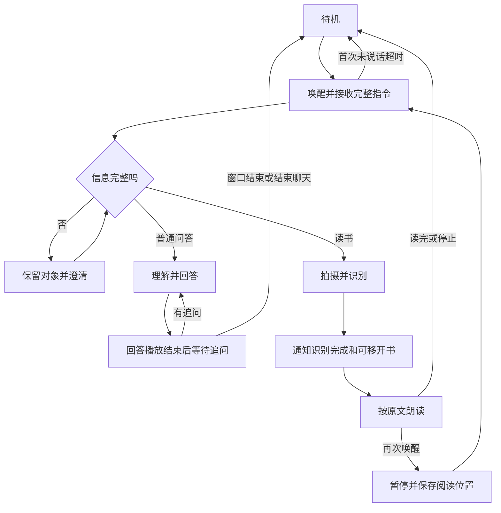
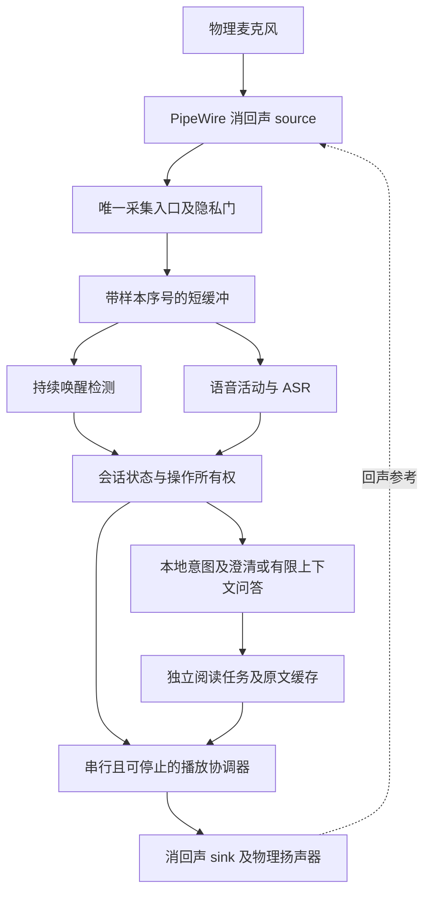
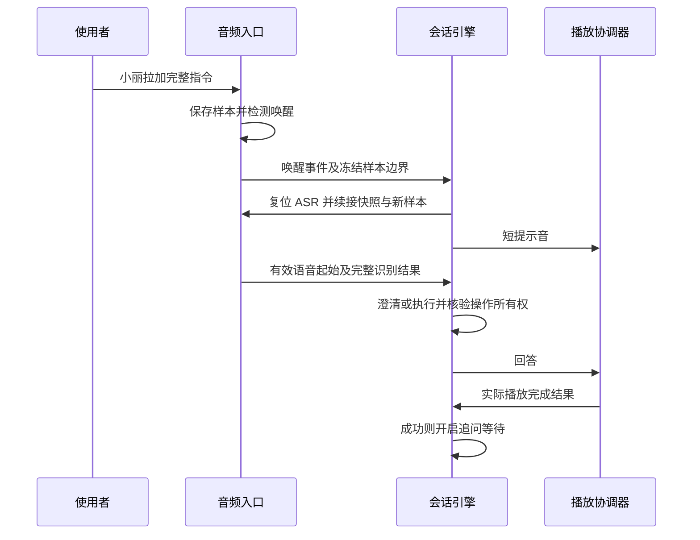
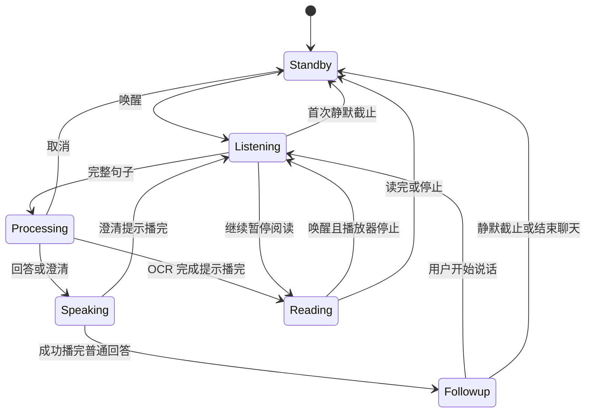
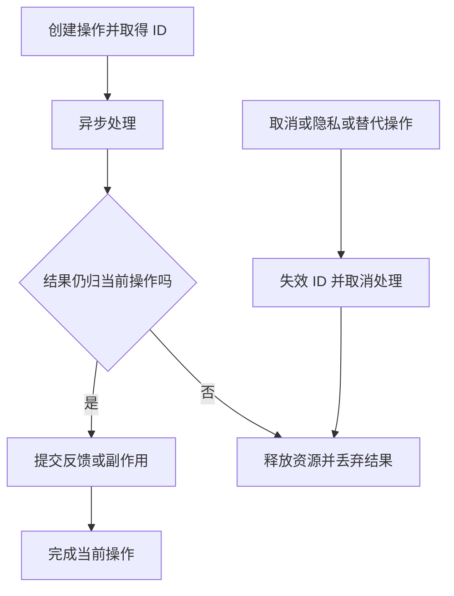
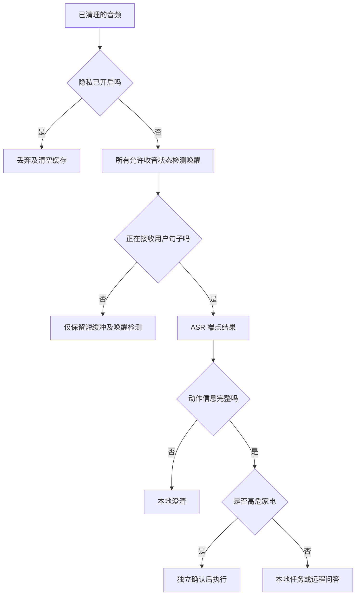

# LIRA 语音交互连续性与恢复 - Plan

## Goal Capsule

- **Objective:** 用户能自然地唤醒并说出完整指令、围绕当前话题连续追问，并在交互中断后恢复当前任务。
- **Product authority:** 2026-10-05 用户确认的语音流程及本文 Product Contract；涉及会话与唤醒反馈的旧规则以本文为准，其余已有阅读、隐私与家电安全要求继续适用。
- **Means:** 单一收音链路、回声消除与唤醒前缓冲，配合会话所有权和可取消播放（KTD1–KTD5）。
- **Authority:** 用户当前指令优先，其次本文 R-IDs，再次 KTDs 与各单元；原项目约束在不冲突时继续适用。
- **Stop conditions:** 若实机无法满足 R1、R2，报告测量证据并停止正式发布；不得改成要求用户等待反馈后再讲话。
- **Execution profile:** 先完成本地实现与模拟验证，再进行设备受控试运行和声学验收；本次计划编写不修改运行代码或设备。
- **Tail ownership:** 实施者负责验证、更新使用说明、设备备份及部署回滚；不自动推送或创建 PR，遵循用户后续指令。
- **Open blockers:** 无阻止开始实现的问题；设备声学验收是发布门槛，不是已经取得的结果。

---

## Product Contract

### Summary

本方案覆盖已确认的全部语音流程，通过连续收音、会话上下文和可中断播放实现自然追问与阅读恢复。
验证包含用户报告的连续读书指令，以及设备实际回声环境下的漏听和误触发检查。

Product Contract 的 R1–R14、A1–A2、F1–F4、AE1–AE10 及已确认决策保持原意和编号；本次补充实现与验证约定。

### Problem Frame

用户报告：叫“小丽拉”后，在延迟到来的“我在听”播报期间已经说了“帮我读下这本书”，设备只识别到“这本书”，后续处理偏离预期。
源码确认普通语音在 TTS 占用期间被丢弃且 ASR 被复位；这支持语音截断的可能机制，但该次实机录音与具体因果尚未独立复现。
现有问答回复后立即回待机，远程问答仅携带当前一句，连续追问容易断开或丢失指代。

### Actors

- A1. 设备使用者：以低视力老年人的自然语音操作为主，本次具体问题由设备实际使用者反馈。
- A2. 维护者：在实机上验证收音、播报与恢复流程，查看运行状态定位失败环节。

### Key Decisions

- **允许短时直接追问。** 减少同一话题中反复唤醒的负担；Governs R6, R7。（session-settled: user-directed — chosen over 每次追问都重新唤醒: 用户选择连续交流并保留本轮上下文。）
- **首次静默与对话停顿分别处理。** 保留无人说话时退出的要求，同时容纳已经开始的交流；Governs R3, R4, R6。（session-settled: user-approved — chosen over 所有聆听阶段共用固定截止时间: 用户确认首次等待与追问窗口分开。）
- **会话记忆限定在本轮。** 控制持续收音与跨会话指代混淆；Governs R7, R8。（session-settled: user-approved — chosen over 持续收音与长期对话记忆: 用户确认有限追问窗口和本轮上下文。）

### Requirements

**唤醒与完整收音**

- R1. 用户可连续说“小丽拉，帮我读下这本书”，无需等待唤醒反馈结束。
- R2. 唤醒反馈期间须保留用户指令，并避免把设备自身声音当成用户指令；优先采用简短提示音。
- R3. 首次唤醒后未开始说话时，从设备可接收指令起等待 8 秒，届满安静回待机。
- R4. 用户已经开始说话时应等待该句说完，不得因首次等待或追问窗口到期截断正在说出的句子。
- R5. 残句或缺少必要信息时只询问缺失部分，保留当前对象与任务，未澄清前不猜测执行。

**连续问答与会话边界**

- R6. 普通回答播放结束后开放 15 秒直接追问窗口，无新语音时安静回待机，不主动续聊。
- R7. 本轮追问结合之前的用户问题、助手回答与当前任务理解，“为什么”“再解释一下”等指代不应脱离前文。
- R8. 用户说“结束聊天”或追问窗口结束时关闭本轮对话并释放问答上下文，下一次唤醒不自动引用上一轮话题。

**任务反馈与中断恢复**

- R9. 收到可执行任务后给出简短进度反馈，失败时说明当前失败环节及可行的恢复操作。
- R10. 读书按识别到的当前书页原文朗读，OCR 成功后先播完识别完成与可移开材料的提示，再开始正文。
- R11. 会话中再次叫“小丽拉”须有明确回应；朗读时先暂停并保留阅读位置，再接收新指令。
- R12. 阅读控制继续支持暂停、继续、停止、再读一遍和音量调整，恢复原阅读任务时无需重新拍摄。
- R13. 取消或会话结束后，在途处理的迟到结果不得自行开播、执行操作或重新开启会话。
- R14. 隐私模式继续关闭收音，高危家电继续独立确认，阅读内容不得被当成操作指令。

### Key Flows

- F1. **连续唤醒与读书。** A1 一句说出唤醒词和读书指令，LIRA 按 R1–R5 接收与理解，按 R9、R10 拍摄、识别、通知和朗读。
- F2. **围绕同一话题追问。** 回答播完后，A1 在 R6 的窗口内提出追问，按 R7 理解前文；安静或结束聊天按 R8 关闭会话。
- F3. **朗读中断后恢复。** A1 再次唤醒，按 R11 暂停并接受新指令；“继续”按 R12 回到保留的阅读位置。
- F4. **失败与取消。** 残句按 R5 澄清，执行失败按 R9 指引恢复；取消后按 R13 丢弃迟到结果。

### Acceptance Examples

- AE1. **Covers R1, R2, R10.** 分别在唤醒反馈前、期间、之后开始说“帮我读下这本书”，均得到完整读书意图；不得只接收末尾并错误回答。
- AE2. **Covers R3.** 仅叫“小丽拉”并保持安静，一个首次等待窗口结束后回待机，无催促或主动聊天。
- AE3. **Covers R4.** 在聆听窗口即将结束时开始说一句完整指令，设备等待语句结束，不在中途切回待机。
- AE4. **Covers R5.** 在没有完整动作信息时收到“这本书”，设备询问是否希望读书；收到确认才进入阅读，不编造已看见或已识别的内容。
- AE5. **Covers R6, R7.** 用户询问一个问题，听完回答后直接说“为什么”，设备围绕刚才的问题回答，无需再次唤醒。
- AE6. **Covers R6, R8.** 回答本身播放较长时间，追问窗口仍从播放结束起计时；窗口结束后下一次唤醒不继承上一轮指代。
- AE7. **Covers R10.** OCR 成功后，用户听到完成提示即可移开书本；随后正文仍按已识别的原文播放，不依赖书本继续留在镜头前。
- AE8. **Covers R11, R12.** 朗读中再次唤醒得到回应，朗读暂停；说“继续”后从保存的位置恢复，拍摄次数不增加。
- AE9. **Covers R9, R13.** 处理等待中取消，之后即使原请求返回也不朗读或执行；失败反馈说明发生在收音、理解还是执行阶段。
- AE10. **Covers R2, R14.** 在安静与有扬声器回声的环境中，唤醒反馈和朗读正文均不触发自身问答、读书或家电操作。

### Scope Boundaries

- 本次覆盖语音入口、短时连续问答、任务反馈和中断恢复；保留现有摄像头画质工作，不将其纳入本次改造。
- 长期记忆、跨会话主动接话、主动发散聊天和持续无限收音不在本次范围。
- 读书对象为当前拍摄书页，不增加整本书自动翻页识别。

### Dependencies / Assumptions

实机麦克风与扬声器的重叠语音识别能力尚需验证；取消播报期保护并不等同于满足 R2。
本计划的交互目标已确认，具体硬件方案不能可靠满足目标时须反馈证据，不得静默改为要求用户等待提示后再说话。
原有需求中的一次唤醒一条指令及朗读期关闭唤醒，与 R6、R11 存在冲突，相关交互规则由本文替代。
隐私与家电安全要求依 R14 保留；问答上下文释放不意味着丢弃尚未停止的阅读位置，阅读控制依 R12。

### Outstanding Questions

上述规划问题分别由 KTD1–KTD5、KTD8 和 Verification Contract 解决。
尚需实机确定的非阻塞参数为回声路由对应的物理节点、缓冲长度和语音活动阈值；其验证条件见 U2，失败处理见 Goal Capsule。

### Sources / Research

- `device/lira/dialog/route_dispatch.py:35`：TTS 占用期间普通语音被丢弃并复位 ASR；实机具体截断结果属于用户报告，尚未复现。
- `device/lira/dialog/state_machine.py:174`：唤醒回调安排反馈后即进入聆听并开始计时。
- `device/lira/dialog/state_machine.py:241`：问答回复回待机；异步路由等待与计时并行，存在迟到结果风险。
- `device/lira/llm/client.py:104`：远程调用每次创建当前问题的消息列表，不含前轮问答。
- `device/lira/vision/reading.py:264`：完成提示先于正文，活动阅读会话保存分块和游标。
- `docs/brainstorms/2026-09-26-lira-requirements.md:87`：原会话、朗读、确认与超时规则，本文明确的改动优先。

---

## Planning Contract

### Key Technical Decisions

- KTD1. **单一采集与系统回声消除。** 采用设备已安装的 PipeWire 0.3.65 WebRTC echo-cancel 模块，应用只采集虚拟消回声 source，全部音频输出进入对应 sink。绑定实际麦克风与扬声器节点，避免自动选设备绕开回声参考。官方版本源码支持这条路径，但模块文件存在不证明声学效果，必须通过实机验收。保留当前扬声器隔离会违反 R1、R2；简单放开播报期输入会放大误触发风险。[版本源码](https://raw.githubusercontent.com/PipeWire/pipewire/0.3.65/src/modules/module-echo-cancel.c)、[官方模块说明](https://pipewire.pages.freedesktop.org/pipewire/page_module_echo_cancel.html)。
- KTD2. **采集边界保存短暂音频并只回放一次。** 清理回声后的输入使用有界、带样本序号的内存环形缓冲；唤醒切换时冻结边界，将快照交给已复位的 ASR，再续接新样本。起步上限 3 秒，按实际唤醒延迟调小或证明需要调整；16 kHz 单声道 float32 约 192 KB。只移除识别文本开头的唤醒词，不删除正文中的同名内容。隐私切换、采集断流和会话结束清空缓冲，不保存录音。R1、R2 需要覆盖唤醒回调调度前的语音，故不能只提前启动提示后收音。
- KTD3. **语音活动与独立计时。** 在清理后的音频上判断用户语音起止，沿用现有 ASR 端点完成句子；单调时钟计时任务独立于麦克风读取，落实 R3、R4、R6。检测到有效语音即停止空闲截止计时，不以迟到的文字结果代替起始证据。长句以有界识别片段持续累积文本，不因固定时长中止有效用户讲话。无持续有效用户语音且输入或端点判定停滞时，采用初始 30 秒保护上限，说明未听清并重新等待；阈值须用慢速说话和持续噪声验证。会话计时机制取代共用固定截止时间，以区分首次等待与追问。（session-settled: user-approved — chosen over 所有聆听阶段共用固定截止时间: 用户确认 R3、R4、R6 的不同窗口。）
- KTD4. **单一播放所有者。** 所有提示音、进度反馈、问答和阅读通过同一播放协调器，返回成功、失败或取消的完成结果。播放器具备可确认的 abort，分段写入或可停止音频流；取消协程不能视为停止 `to_thread` 内的硬件写入。过期的合成结果不得提交播放。普通回答只有播放成功结束才按 R6 开窗；播报失败按 R9 恢复。依据 `audio/tts.py` 和 `hal/board/audio.py` 的现有异步与阻塞边界。
- KTD5. **会话与任务分别持有所有权。** 每个异步理解、拍摄、识别、合成和进度回调携带会话代次及操作 ID；VAD、ASR 端点和计时事件同样绑定来源代次与音频边界。取消、隐私、结束聊天及替代请求使旧操作失效并取消可取消任务，同时移除旧所有者的播放队列项。所有权检查和提交副作用须串行且中间不异步让出；排队的 IR 在实际发送前再次核验操作及确认凭据，不能仅在安排发送时检查。暂停的阅读持有独立任务 ID 和缓存，不随问答上下文超时销毁；明确停止或新阅读替代时才释放。停止旧播放所有者不得停止其后继；关闭 LLM 流并取消等待，线程迟到结果由播放入队前校验拦截（R8、R11–R14）。
- KTD6. **会话对象管理有限上下文。** 保留成对的用户问题与已完整播出的助手回答，向远程处理器显式传入不可变快照；初始限制为最近 6 对、合计 4,000 字符，按整对淘汰，系统指令和当前问题单独保留。任务事实只投影同一阅读对象的任务类型、实际状态和是否可继续，不含未观察到的场景判断或完整 OCR 页。等待反馈绑定当前操作并随路由参数传递，不临时修改全局客户端回调或历史。取消或未播出的回答不写成已完成对话；再次唤醒未关闭的会话保留上下文。R8 关闭时清空历史，阅读位置按 KTD5 单独保存。避免把记忆放在全局 LLM 客户端导致跨会话泄漏。（session-settled: user-directed — chosen over 每次追问都重新唤醒: 用户选择 R6、R7 的本轮连续交流。）
- KTD7. **本地澄清先于通用问答。** 独立的待澄清对象处理“这本书”等无动作书本残句，肯定后才生成原文 READ 意图；否定清除，完整新指令替代。澄清提示成功播完后等待 15 秒，用户开始讲话依 KTD3 等待句子结束；静默截止安静回待机并释放待澄清对象与本轮历史，取消同样释放。与高危家电待确认对象分开，不复用其安全语义或超时时间（R5、R14）。LLM 只解释与回答，不因回复文本自动操作摄像头或家电；OCR 内容是数据，不自动注入全页到问答或作为系统指令。
- KTD8. **阅读按未完成块恢复。** 阅读任务分别保存活动块、下一块、最后完成块和播放代次。中断块不计为完成，“继续”从该块开头播放；“再读一遍”使用活动中断块或最后完成块。现有约 60 字分块不支持精确到字的音频位置，本次采用少量重复、避免漏读的恢复精度（R11、R12）。保留原文缓存，完成提示成功播放后才读正文；提示失败仍保留缓存并说明可重试，不启动正文（R9、R10）。

### High-Level Technical Design

以下草图约束职责、次序和生命周期，具体类名与接口由实现者按项目惯例确定。

组件与数据流：

连续唤醒协议：

会话状态：

状态名称为概念名；隐私事件在任意状态关闭输入并使相关操作失效，失效检查采用 KTD5。
普通问答播放中再次唤醒同样先终止当前播放再响应，既有上下文按 KTD6 保留。

操作生命周期：

输入决策与模式边界：

朗读中 ASR 只保留现有受限阅读控制路径，持续 KWS 接受再次唤醒；一般任务路由须先经过唤醒暂停流程。
清理回声不改变上述权限边界，阅读与播报文本不得进入操作路由。

### System-Wide Impact

`main.py` 管理采集、独立计时和关闭；`route_dispatch.py` 管理连续音频交接；状态机接收真实播放结果与语音起止事件。
HAL、Mock 与开发调试入口须同步实现播放停止和完成语义，不能只有设备端能正常结束会话。
远程问答新增历史快照，阅读润色调用仍无会话历史；摄像头与家电动作保持本地路由和既有确认门。
设备断流、队列溢出与输出设备断开按 R9 明确失败，不得重复回放旧样本或继续挂在响应状态。

### Risks & Dependencies

- 回声消除对路由、音量和房间反射敏感：U2 校验所有输出路径，实机门槛失败则阻止发布，不回退到丢弃用户语音。
- 停止异步任务不保证硬件静音：U1 的完成结果必须由播放器实际停止确认，U5 据此更新游标。
- 新旧操作同时返回会污染任务：U3 为每个提交点校验所有权，旧阅读结束回调不得清空新阅读对象。
- 隐私模式与缓存有冲突风险：进入隐私先关输入、清缓存和失效操作，再释放资源；运行日志仅记事件、耗时与失败阶段，不增加原始音频或对话正文日志。
- 当前工作区含此前已部署的语音改动和独立摄像头工作：实施前记录基线，保留用户已有变更，禁止整体回退或混入摄像头改造。

---

## Implementation Units

### U1. 可停止且串行的音频播放

- **Goal:** 播报完成与停止都能被会话、阅读和回声参考可靠观察。
- **Requirements:** R2、R6、R9、R11、R13；F3、F4；AE6、AE8、AE9；KTD1、KTD4。
- **Dependencies:** 无。
- **Files:** `device/lira/audio/tts.py`、`device/lira/hal/base.py`、`device/lira/hal/board/audio.py`、`device/lira/hal/mock/audio.py`、`device/tests/test_audio_stack.py`、`device/tests/test_hal_mock.py`。
- **Approach:** 扩展 HAL 停止契约和可控 Mock；统一提示音及 TTS 播放入口，返回带所有者的完成结果，关闭时等待输出停止。
- **Test Scenarios:**
  - 两条反馈排队不重叠，短提示音也经过同一输出路径。
  - Covers AE8. 持有中的硬件写入被停止后不再输出，再次唤醒的回应随后播放。
  - Covers AE9. 合成线程在取消后返回不播放。
  - 多条进度及阅读请求已排队时取消旧所有者，再创建新所有者，旧项被移除而新回应可播放。
  - 输出异常返回失败并释放占用。
- **Verification:** 用可阻塞播放器证明停止与完成语义，所有下游调用方能区分成功、失败和取消。

### U2. 连续收音、消回声及唤醒交接

- **Goal:** 保留连续指令的开头，播报重叠时仍能识别用户。
- **Requirements:** R1–R4、R14；F1；AE1–AE3、AE10；KTD1–KTD3。
- **Dependencies:** U1。
- **Files:** `device/lira/audio/mic.py`、`device/lira/audio/asr.py`、`device/lira/dialog/route_dispatch.py`、`device/lira/main.py`、`device/lira/config.py`；新增语音活动模块与部署音频配置；`device/tests/test_audio_stack.py`、`device/tests/test_main_loop.py`。
- **Approach:** 执行时先读取设备音频节点和配置，选择确切物理节点并备份用户级 PipeWire 配置；建立 KTD1 路由及 KTD2 交接，移除播报占用时丢弃并重置 ASR 的机制。队列溢出或断流清理缓冲并报告输入失败。
- **Execution note:** 用延迟唤醒回调的模拟样本先证明首字不丢、每个样本只提交一次；设备声学验收留到 U6 受控试运行。
- **Test Scenarios:**
  - Covers AE1. 唤醒词和读书指令同块到达，或唤醒回调延迟期间指令已开始，均得到完整动作。
  - 缓冲边界连续输入无重复，句中“小丽拉”不被全局删除。
  - 隐私开启立即清缓存，断流清理后可重新接收。
  - Covers AE10. 用户语音与提示重叠的实机样本得到完整动作，自身播报不进入一般操作路由。
- **Verification:** 模拟采样序列无遗漏或重复，明确设备输入输出均经过消回声节点；满足实机 AE1、AE10 后方可发布。

### U3. 会话状态、独立计时与过期操作隔离

- **Goal:** 等待、处理、播报和追问边界准确，旧任务无法影响新会话。
- **Requirements:** R3、R4、R6、R8、R9、R11、R13、R14；F2–F4；AE2、AE3、AE6、AE9；KTD3–KTD5。
- **Dependencies:** U1、U2。
- **Files:** `device/lira/dialog/state_machine.py`、`device/lira/dialog/phrasebook.py`、`device/lira/main.py`、`device/lira/llm/client.py`、`device/tests/test_state_machine.py`、`device/tests/test_main_loop.py`、`device/tests/test_llm_client.py`。
- **Approach:** 在现有引擎加入处理和播放完成阶段、语音起止事件、会话及操作所有权；独立计时任务纳入启动与关闭。新唤醒停止当前播报后回应；任务反馈只属于当前操作，远程流在取消后关闭。
- **Test Scenarios:**
  - Covers AE2. 无麦克风块时静默计时仍到期。
  - Covers AE3. 截止前开始讲话不被切断，超过 30 秒的有效长句仍能完成。
  - Covers AE6. 长回答播完才开窗，再唤醒可接新指令。
  - Covers AE9. 取消后立刻新唤醒，旧 LLM/OCR/进度回调不能播放或执行。
  - IR 已排队但未发送时取消，确认凭据与操作失效，发送被拒绝。
  - 取消或隐私后再次唤醒，旧 ASR 端点、语音活动及计时事件不作用于新聆听代次。
  - TTS 失败、没有持续用户语音的端点停滞及采集断开不永久等待。
  - 隐私切换关闭全部输入。
- **Verification:** 可注入时钟与延迟结果证明状态重入时仍隔离旧操作，所有副作用提交点有有效所有权。

### U4. 追问上下文与书本残句澄清

- **Goal:** 追问使用本轮内容，缺少动作先询问。
- **Requirements:** R5–R8、R14；F1、F2、F4；AE4–AE6、AE10；KTD6、KTD7。
- **Dependencies:** U3。
- **Files:** `device/lira/dialog/intents.py`、`device/lira/dialog/router.py`、`device/lira/dialog/state_machine.py`、`device/lira/llm/client.py`、`device/lira/llm/prompts.py`；`device/tests/test_intents.py`、`device/tests/test_router.py`、`device/tests/test_llm_client.py`、`device/tests/test_state_machine.py`。
- **Approach:** 会话持有历史和简要任务事实，远程问答参数显式接收快照；书本残句进入专用澄清对象，读取确认和高危确认分别处理。保留阅读润色接口的无历史调用。
- **Test Scenarios:**
  - Covers AE5. “为什么”请求带前轮用户及已播回答。
  - 历史超额按完整对淘汰，被取消回答不污染新会话。
  - 并发路由持有不同上下文与等待反馈，互不交换；远程快照能报告暂停阅读及可恢复状态，不含完整 OCR。
  - Covers AE6. 结束聊天或窗口结束后下一次请求无旧历史。
  - Covers AE4. “这本书”无确认不调用摄像头或网络；肯定进入原文阅读，否定或完整新指令清除澄清。
  - 澄清提示播完后静默 15 秒清对象与历史，截止前开始回答仍接收完整句子。
  - Covers AE10. OCR 中出现操作文本不触发家电。
- **Verification:** 检查构造的远程消息而非仅检查自然语言答案，证明上下文范围、清理和工具权限边界。

### U5. 阅读缓存、暂停与恢复游标

- **Goal:** 朗读中唤醒立即暂停，之后继续无需重新拍摄。
- **Requirements:** R9–R14；F1、F3、F4；AE7–AE10；KTD4、KTD5、KTD8。
- **Dependencies:** U1、U3、U4。
- **Files:** `device/lira/vision/reading.py`、`device/lira/dialog/state_machine.py`、`device/lira/main.py`、`device/tests/test_reading.py`、`device/tests/e2e/test_ae2_reading.py`、`device/tests/e2e/test_ae4_playback.py`。
- **Approach:** 阅读对象持有原文、块列表与独立播放游标；明确停止与暂停的不同释放行为。在 LISTENING 及重新唤醒后的路由中，将阅读控制关联到保留的任务，替换现有仅 READING 接收控制的分发限制。旧阅读结束回调仅清理所属任务，完成提示失败不直接开始正文。
- **Test Scenarios:**
  - Covers AE7. OCR 提示播完后移走材料，正文仍读缓存原文。
  - Covers AE8. 正文块中再次唤醒先停止再提示，“继续”不增加拍摄次数。
  - 暂停后立即“再读一遍”不被旧完成回调跳过。
  - 追问超时后重新唤醒再说“继续”，仍恢复原任务。
  - 活跃及暂停任务在新聆听状态分别接受暂停、继续、停止、再读一遍、音量增大和减小；无保留任务时不误拍摄或执行其他动作。
  - 新阅读取代旧任务时旧回调不清空新对象。
  - Covers AE9. OCR 失败、提示失败和停止后的迟到结果不启动正文。
- **Verification:** 带阻塞播放的确定性测试验证未完成块不前移，音量、暂停、停止和复读保持兼容。

### U6. 跨层验证、使用说明与设备发布

- **Goal:** 用用户实际场景验证完整体验，保留可回滚发布。
- **Requirements:** R1–R14；F1–F4；AE1–AE10；KTD1–KTD8。
- **Dependencies:** U1–U5。
- **Files:** `device/tests/e2e/harness.py`、`device/tests/e2e/test_ae1_privacy.py`、`device/tests/e2e/test_ae3_appliance.py`、`device/tests/e2e/test_ae4_playback.py`；新增语音连续交互集成用例、声学验收记录；`README.md`、设备部署音频配置及操作说明。
- **Approach:** 更新已被 R6、R11 替代的旧交互测试，保留 OCR 内容隔离及高危确认测试；使用带采样边界、受控时钟和可延迟回调的 harness。按 Verification Contract 完成模拟检查及实机验收后部署。
- **Test Scenarios:**
  - Covers F1 / AE1 / AE7. 连续读书到 OCR 提示再朗读。
  - Covers F2 / AE5 / AE6. 长回答后追问再结束聊天。
  - Covers F3 / AE8. 阅读中唤醒问答再继续。
  - Covers F4 / AE9. 每个异步阶段取消后立即新任务，旧结果无副作用。
  - Covers AE10. 隐私和高危确认在连续交流中仍有效。
  - 服务重启后干净待机且节点路由正确。
- **Verification:** 所有发布门通过并记录样本、失败分布与设备配置；保留应用与音频配置成对回滚包。

---

## Verification Contract

### Local Gates

以下为执行阶段命令，本次规划不运行测试。
在 `device` 目录用可工作的 Linux/设备虚拟环境运行；Windows 可通过已有 WSL 环境进入同一目录。

| Gate | Command / method | Pass signal |
|---|---|---|
| 播放与采集 | `python -m pytest tests/test_audio_stack.py tests/test_hal_mock.py tests/test_main_loop.py -q` | U1、U2 的停止、样本交接及断流场景通过 |
| 会话与理解 | `python -m pytest tests/test_state_machine.py tests/test_intents.py tests/test_router.py tests/test_llm_client.py -q` | U3、U4 的计时、上下文及过期操作场景通过 |
| 阅读 | `python -m pytest tests/test_reading.py -q` | U5 的缓存、提示顺序及游标场景通过 |
| 跨层回归 | `python -m pytest tests/e2e -q` | AE1–AE10 的模拟路径及隐私、高危确认通过 |
| 完整回归 | `python -m pytest tests -q` | 全部现有测试通过；失败必须解释并修复，不以删除约束替代 |

### Device Acoustic Gates

这些是本次发布的验收门槛，有限样本通过不代表所有环境永久可靠。
维护者 A2 在用户常用距离与音量下记录测试，不默认保存私人对话或原始音频；固定测试句可在明确测试目的下采集。

- **连续读书指令：** “小丽拉，帮我读下这本书”在反馈前、期间、之后开始说，各做 10 次；安静与通常背景噪声分别一组，共 60 次。至少 57 次得到完整动作；任一次只剩“这本书”必须走 AE4，不得猜着执行。
- **自身播报隔离：** 安静与常见回声环境各播 10 分钟，包含唤醒词、读书词和家电动作词；零次自身唤醒引发任务或家电操作。读书唤醒另做 10 次，至少 9 次成功暂停并回应。
- **中断反馈：** 从唤醒被确认到扬声器实际停止，10 次测量均不超过 500 ms；停止后才播放回应。单独记录唤醒检测延迟，避免把软件停止耗时当作整体用户延迟。
- **会话边界：** AE2、AE3、AE5、AE6 各 5 次，使用可观察的播完时刻与慢速句子；全部遵守 R3、R4、R6、R8。
- **阅读与安全：** AE7–AE9 各 5 次；移开材料可继续、恢复不拍摄、取消后旧结果无副作用。隐私模式与高危家电确认分别重复 5 次，零误操作。

### Rollout / Recovery

1. 记录当前工作区变更和设备应用版本，备份应用文件、用户级音频配置及 `lira.service` 设置；本地模拟检查通过后才进入受控设备试运行。
2. 读取物理节点和模块状态，使用 PipeWire 原生配置落地 KTD1；设备缺少 `pactl`，不得将它设为部署前提。配置失败或绑定错误停止试运行并恢复备份。
3. 受控试运行同时部署配套应用与音频配置，检查服务、摄像头、麦克风、播放和 UI；完成上述声学门槛前不宣布正式发布成功。
4. 失败时将应用与音频配置成对回滚，检查服务恢复及原有读书路径；记录不满足的门槛，按 Goal Capsule 反馈阻塞，不将旧漏听行为算作完成。
5. 发布后检查服务稳定、资源占用和错误阶段日志；保留回滚包，移除临时录音和已弃用实验配置。

---

## Definition of Done

- U1–U6 的 Test Scenarios 与 Verification 均满足，R1–R14、F1–F4、AE1–AE10 有对应证据。
- 所有 Local Gates 和 Device Acoustic Gates 通过；验证报告区分模拟证明、设备实测和未覆盖环境。
- 用户能连续说完整读书指令，听到 OCR 完成提示后移开材料，按原文核对；追问、再次唤醒和阅读恢复符合 Product Contract。
- 正式发布包含服务健康记录、确切音频节点配置、应用与配置配套备份及可用回滚步骤。
- 使用说明更新窗口、残句澄清与阅读恢复精度，保留隐私和高危确认边界。
- 清理弃用实现、调试音频和实验配置，保留用户原有独立变更；没有靠隐藏失败或删掉有效安全用例取得通过。
