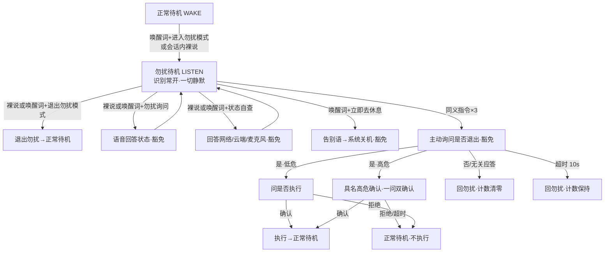

# feat: 语音退出、勿扰与控制机制

## Summary

计划把 origin 的 17 条需求落成 10 个实现单元：先建统一的退出/喊停词表与容错匹配层（U1），加一路常驻命令 KWS 通道让播报中喊停可达（U2），状态机态前分支统一退出语义（U3），真关机走告别语+系统级 poweroff（U4）；勿扰做成模式标志 + 待机路由切 LISTEN + 播报谓词门（U5）加三次逃生舱对话（U6）；三个补充机制（重复上答/全局音量/状态自查）各成一小单元（U7-U9）；最后板端实测与声学验收收口（U10）。全部为既有模块扩展，回声三闸门（f39f84c）不回归是全程红线。

---

## Problem Frame

老人想让 LIRA「闭嘴/退出/安静/关掉」时，现有手段只有精确说「取消/算了」或干等 8~30 秒超时；播报中喊停无效；想彻底安静无语音入口；「关机」一词被家电语义占用。完整叙述见 origin（see origin: docs/brainstorms/2026-10-06-voice-exit-dnd-mechanisms-requirements.md）。

计划期研究补了三个关键事实：唤醒 KWS 本就全路由常喂（播报中打断唤醒词的既有先例）；与 LIRA 同款流式 ASR 模型在 RK3588 实测 RTF 0.22（勿扰识别常开有量化基线）；KWS 关键词文件支持逐词 `:boost #threshold` 行内参数（喊停词可独立调敏感度）。

---

## Requirements

计划需求沿用 origin R1-R17 编号（完整表述见 origin），此处按实现视角归组速记：

**退出与结束会话**
- R1. 会话中任何状态，退出说法（封闭词表）立即结束会话回待机，不等超时（→ origin R1）
- R2. 退出/喊停说法封闭候选集内容错匹配，不做开放式 LLM 语义判断（→ origin R2）
- R3. 待机态不监听退出说法（→ origin R3）

**真关机**
- R4. 唤醒词+「立即去休息」→ 告别语后系统关机，无二次确认（→ origin R4）
- R5. 除 R4 短语外「关机」不构成关闭 LIRA：会话语境按结束会话处理（U1 词集 + U3 分支承接），家电语境不变（→ origin R5）

**播报打断**
- R6. 任何出声时刻喊停立即停播回待机，走本地关键词通道（→ origin R6）
- R7. 打断一律回待机不进聆听；「暂停/继续」仅朗读白名单保留（→ origin R7）

**勿扰模式**
- R8-R14. 进入/静默/三次逃生舱/退出/查询/会话内裸说/不持久化（→ origin R8-R14）

**补充交互机制**
- R15. 追问窗内「再说一遍」原文重报上答（→ origin R15）
- R16. 「声音大点/小点」活跃会话态可用，全局持久化；活跃会话态＝SPEAKING 播报中以外——对 origin R16/AE11「任何/任意会话态」的显式收窄（回声红线优先）（→ origin R16）
- R17. 语音状态自查播报网络/云端/麦克风状态（→ origin R17）

**计划新增（研究产生的实现级红线）**
- R18. 回声三闸门不回归：ASR 喂流门（ignored-states / tts.occupied / settle 窗）语义不变；新播报源全部并入既有播放协调纪律
- R19. 板端实测收口：勿扰 ASR 常开 RTF/温度、喊停词误触发率、逐词阈值定稿，全部落档 SETUP.md 验收表
- R20. 命令 KWS 与 ASR 文本双通道重复投递幂等：同一话音只产生一次状态迁移（代次守卫）
- R21. 高危指令执行沿用既有家电具名高危确认话术与流程，fail-closed 不跳过（含逃生舱执行问句的高危折叠场景）

**Origin actors:** A1（老人用户，全部机制的服务对象），A2（子女/管理者，状态自查的远程排障受益方、勿扰期被动播报被压制的相对方）
**Origin flows:** F1（勿扰全周期），F2（播报打断），F3（真关机）
**Origin acceptance examples:** AE1-AE11（AE1/AE3/AE4→U3/U4，AE2→U2，AE5-AE9→U5/U6，AE10/AE11→U7/U8；e2e 落地见 U10）

---

## Scope Boundaries

（承 origin，全部维持）

- 定时勿扰 / 自动恢复——勿扰只手动进出
- 「别吵我」作为勿扰入口——维持 = 结束会话
- 语音开机——关机后靠物理电源键
- 退出/勿扰/喊停说法的后台可配置化——先本地固定词表
- LLM 开放式退出/勿扰意图判断——封闭词表 + 本地意图等价
- 家电控制语义变更——「关电视/关机」等家电指令行为保持现状

### Deferred to Follow-Up Work

- 三个 KWS 实例（唤醒/播放白名单/命令）合并为单实例单文件：可省一份 3M 模型内存与一个线程，属稳定性无关的优化，不与本次功能混做
- USB 麦失聪看门狗（M7 残留项 R4）：勿扰会放大「静默失聪不可察觉」的影响，但属独立加固项，单独立项
- 勿扰状态在 Web 管理界面展示/可控（origin Deferred to Planning 遗留决策项）

---

## Context & Research

### Relevant Code and Patterns

- **对话状态机**：`device/lira/dialog/state_machine.py`——10 态、`OperationOwner` 代次、`on_asr_text` 态前取消分支（退出词接入点）、`_speak_answer` 完成回调链、`_enter_standby`/`_invalidate_operation` 清理纪律（含 `_abort_capture` F1 防线）
- **音频路由分发**：`device/lira/dialog/route_dispatch.py`——三路 AudioRoute、`_ASR_IGNORED_STATES` + `tts.occupied` + settle 窗三闸门、唤醒 KWS 全路由常喂先例、PLAYBACK 白名单命中→`_deliver` 先例
- **意图词表层**：`device/lira/dialog/intents.py`——词表常量 + 精确匹配（fail-closed）、`PLAYBACK_WHITELIST_KEYWORDS_FILE` 资源文件模式、`match_local` 分发顺序
- **KWS**：`device/lira/audio/kws.py`——`WakeWordKws`（每实例一模型一 keywords 文件，`keywords_threshold=0.25` 默认）、`KwsStream.poll()` 命中自动 reset；`assets/keywords/` 词文件格式（token 串 + `@原词`）
- **装配层**：`device/lira/main.py`——`DeviceCallbacks` 装配、可选回调注入先例（`reading_task_facts`）、`DeviceRuntime.status()`（网络探针/熔断/隐私态，R17 原料）、`_wakeword_text()` 唤醒词解析、`deploy/system/lira.service`（`Restart=always`——关机必须系统级）
- **音量链路**：`device/lira/settings.py`（`DeviceSettings.volume` 内存态无持久化）+ `device/lira/appliances/store.py` `get_meta/set_meta`（持久化先例 camera_rotation）+ `device/lira/vision/reading.py`（朗读会话级音量现状）
- **话术层**：`device/lira/dialog/phrasebook.py`——全部 TTS 文案唯一出处
- **勿扰参照模式**：`device/lira/privacy.py`——运行时状态 + 订阅广播 + `attach_announcer` 被动播报源（勿扰谓词门需要覆盖的绕行路径）
- **测试**：`device/tests/test_state_machine.py`（Recorder + 虚拟时钟）、`test_intents.py`（词表/文件一致性断言）、`test_voice_capture.py`（回声三闸门回归测试所在）、`test_main_loop.py`（Fake 装配）、`tests/e2e/`（wav 夹具 + `say_text/advance/wait_state` 驱动）

### Institutional Learnings

- **f39f84c 三闸门**（唯一成文回声教训）：新状态若需识别静默必须进 `_ASR_IGNORED_STATES`；新播报源必须置 `tts.occupied`；KWS 从不关门——本计划新增的勿扰待机是**唯一反例**（ASR 常开），其回声安全性靠「设备静默期无自音频」论证成立，开口后 settle 窗覆盖，需专项回归测试钉死
- **连续性计划 KTD4/KTD5**（`docs/plans/2026-10-05-1337-feat-voice-interaction-continuity-plan.md`）：单一播放协调器 + 会话代次所有权纪律——逃生舱计数、告别语、状态播报全部沿用
- **声学验收门槛先例**（`docs/voice-continuity-validation.md`）：自身播报隔离 10 分钟×2 环境零触发——U10 沿用同规格
- **M7 残留项**（`docs/residual-review-findings/1222d13-m7-main-loop-wiring.md`）：TTS 并发未串行化（R3）——新播报源禁开裸 `speak`；`/status` 可观测建议与 R17 合流
- **调参纪律**（Phase 1 计划先例）：keywords threshold 从默认起板上实测；唤醒词「多音节、实测误触率后定稿」——「停」类一字词适用同一教训，词表规避

### External References

- sherpa-onnx KWS 文档（keywords 文件格式、逐词 `:boost #threshold`、text2token）：https://k2-fsa.github.io/sherpa/onnx/kws/index.html
- 同款 ASR 模型 RK3588 实测 RTF 0.22（CPU 路径）：https://github.com/k2-fsa/sherpa-onnx/issues/2515
- KWS 命中返回 `@` 后标签文本；官方免训练边界（"只需要换 keywords-file"）：https://k2-fsa.github.io/sherpa/onnx/kws/pretrained_models/index.html
- KWS 常开设计佐证（1.5s 尾静音自复位）：sherpa-onnx `csrc/keyword-spotter-transducer-impl.h`

---

## Key Technical Decisions

- **独立命令 KWS 实例**（第三路）：承载「退出词 ∪ 喊停词」统一词集，全路由常喂。不动唤醒词文件与唤醒分发路径（回声红线隔离）；敏感度用 keywords 文件逐词行内 `:boost #threshold` 调，词表规避一字词。合并单实例的省内存优化去 Deferred。
- **词表统一原则**：R1 退出词与 R6 喊停词是同一集合、同一匹配——否则同词不同态有效性随机，老人体验为失灵。ASR 活跃态走文本层匹配，播报态走 KWS 声学层，两端同集。
- **勿扰 = 模式标志 + 路由条件化 + 播报谓词门**：非隐私模式式的独立子系统。标志权威持有者在状态机；待机路由条件切 LISTEN（识别常开，回声安全论证见 Open Questions 已决项）；静默经播报装配层谓词门实现，豁免集 = 老人主动问询的直接应答（勿扰查询/状态自查/逃生舱对话/告别语/退出确认），被动播报源（隐私公告、sync 公告）一律静音。
- **勿扰中裸指令计数**（维持 origin 确认案）：识别常开正是为听裸重复；环境音误触由「同义×3」门槛 + 明确拒绝清零兜底。不可归一话语不累加不清零。
- **文本层容错 = 拼音归一 + 封闭候选集**：引入 pypinyin（纯 Python 无二进制依赖）做 ASR 文本归一；候选集外一律不命中（fail-closed）。KWS 声学层容错由阈值承担。
- **单一全局音量**：语音词、朗读白名单词、Web 写同一个持久化值（store meta，camera_rotation 先例）；朗读白名单调音量从会话级临时改为同步写全局——**语义变更点**，测试钉死。SPEAKING 播报中音量词明确不支持（收窄，回声红线优先）。
- **真关机意图即提交**：特定短语识别即提交关机，告别语仅礼节性播报、可被喊停截断；经新回调执行系统级 poweroff（`Restart=always` 决定不能只退进程）。
- **逃生舱对话复用确认纪律**：10s 窗（CONFIRM_WINDOW 同款）、classify_confirmation 应答分类、高危折叠为具名单问（R21 具名确认话术，fail-closed 不跳过）。

---

## Open Questions

### Resolved During Planning

- KWS 能否多关键词/逐词阈值？→ 能：文件多行 + 每行 `:boost #threshold`，行内优先、回退全局（官方文档 + 源码直证）；命中返回 `@` 后标签
- 勿扰 ASR 常开是否撞回声三闸门？→ 不撞：三闸门防的是设备自音频；勿扰静默期无自音频，豁免播报走常规 `speak` 自动置 occupied + settle 窗。论证配专项回归测试
- 勿扰识别常开算力？→ 同款模型 RK3588 实测 RTF 0.22（约 22% 单核持续）作参考基线；板上实测是 U10 验收项，降级预案（仅唤醒前缀计数）已备、触发则回 origin 修订
- 关机执行路径？→ 系统级 poweroff（user unit `Restart=always` 会拉起退出的进程）；仓库无现成 exec 点，新增回调
- 「相同意思」判定？→ 本地规则层 (device, action) 归一（别名命中 + 动作词既有结构）；LLM 层指令不计入（勿扰不上云约束的自然结果）

### Deferred to Implementation

- 各喊停/勿扰词的最终阈值数值：U10 板上实测定稿
- 拼音归一的距离判定（全等 vs 编辑距离≤1）：按 ASR 实际误转写样本定，fail-closed 优先
- 逃生舱对话态的命名与落位（新增轻量枚举态 vs 复用机制）：实现按最小迁移复杂度定，倾向新增
- 音量确认话术与告别的最终措辞：phrasebook 定稿
- READING 中「结束聊天」→ 暂停的既有语义保留、新退出词 → 停止：两分支并存细节实现定
- 勿扰待机中命令 KWS 的退出词命中被「STANDBY 丢弃」规则拦下（ASR 漏转写时退出仅剩 ASR 文本通道）——裁定是否为勿扰待机放行 KWS 退出命中（与 origin R13 字面张力、前缀管线一并定）
- 会话语境「关机」是否同时进命令 KWS 声学集（播报中喊「关机」也可停——涉及家电语义误触发面）

---

## High-Level Technical Design

> *This illustrates the intended approach and is directional guidance for review, not implementation specification. The implementing agent should treat it as context, not code to reproduce.*

**音频通道 × 状态可见性矩阵（改造后）：**

| 通道 | 喂流条件 | 承载内容 | 命中去向 |
|---|---|---|---|
| 唤醒 KWS（不动） | 全路由常喂 | 小丽拉 | on_wake（勿扰中静默开窗） |
| 命令 KWS（新增） | 全路由常喂 | 退出 ∪ 喊停词集 | STANDBY 丢弃；其余 → 统一退出语义 |
| 播放白名单 KWS（不动） | 仅 READING | 暂停/继续/停止/再读一遍/大声点/小声点 | 播放控制（音量词改写全局值） |
| 流式 ASR | LISTEN 路由且过三闸门 | 自由文本 | 态分发（勿扰待机也走 LISTEN，普通指令计数忽略） |

**勿扰生命周期：**

---

## Implementation Units

### U1. 词表扩展与容错匹配组件

**Goal:** 建立统一退出/喊停词集与全部新短语，提供拼音归一 + 封闭候选集匹配，供所有后续单元消费。

**Requirements:** R1, R2；为 R4/R8-R13/R15-R17 供词

**Dependencies:** 无

**Files:**
- Modify: `device/lira/dialog/intents.py`（新词表常量 + 匹配函数）
- Create: `assets/keywords/commands_raw.txt`、`assets/keywords/commands.txt`（生成产物）
- Modify: `device/pyproject.toml`（pypinyin 依赖）
- Test: `device/tests/test_intents.py`

**Approach:**
- 新词表：统一退出∪喊停集（退出/别吵我/行了/闭嘴/别念了/别说了/行了行了/够了/关机等——多音节、区分度高，规避「停」类一字词；「关机」仅在会话语境命中即结束会话，不匹配 SHUTDOWN、不进家电分支）、「立即去休息」、勿扰进入/退出/询问短语候选集（询问含同义问法，如「你是不是在睡觉」类）、「声音大点/小点」、「再说一遍/没听清」、状态自查问法候选集
- 匹配组件：strip + 标点剔除（既有）→ pypinyin 拼音归一 → 封闭候选集比对；候选集外一律不命中
- commands 词文件：raw 源（含逐词 `:boost #threshold`）→ `sherpa-onnx-cli text2token`（`--tokens-type phone+ppinyin --lexicon en.phone`）→ 生成产物入库；多音字人工核对拼音行；commands.txt 断言用独立分支（解析校验 `:boost #threshold` 数值范围与 raw 一致性）——既有 `assert "#" not in ln` 严格断言仅适用于 wakeword/whitelist 两文件
- 既有纪律：白名单式「文件/常量/测试三处一致」断言模式扩展到新词文件

**Patterns to follow:**
- `intents.py` 词表常量 + 精确匹配；`test_intents.py` 词文件一致性断言（`test_intents.py:170-183` 模式；commands 文件按 Approach 用独立断言分支）

**Test scenarios:**
- Happy path: 每个词表成员逐词命中（退出类/喊停类/关机短语/勿扰三短语各候选变体/音量词/重复词）
- Edge case: 标点与空白归一后命中（「行了，」）；勿扰询问同义变体归一命中（「你是不是在睡觉」→ 询问类）
- Error path: 候选集外近似词一律不命中（「吵架」不命中退出、「休息休息」不命中关机、「退出吧呗」不命中）；无关长句不命中任何表
- Edge case: 统一退出集与既有 `CANCEL_WORDS`/`PLAYBACK_COMMANDS` 无交集（词集不相交断言，防双语义）
- Happy path: 会话语境「关机」命中统一退出集且不命中 SHUTDOWN

**Verification:** 词表判定函数全绿；commands.txt 与 raw 源同步；pypinyin 入依赖锁定

---

### U2. 常驻命令 KWS 通道

**Goal:** 让喊停/退出词在 LIRA 任何出声时刻、任何路由下物理可达。

**Requirements:** R1, R6, R18, R20

**Dependencies:** U1, U3

**Files:**
- Modify: `device/lira/main.py`（streams holder 增命令流实例）
- Modify: `device/lira/dialog/route_dispatch.py`（命令通道喂流 + 命中分发）
- Test: `device/tests/test_voice_capture.py`、`device/tests/test_main_loop.py`

**Approach:**
- 新 `WakeWordKws` 实例加载 U1 的 commands 词文件；与 wake_stream 同位置喂流（全路由、不受 occupied/settle/ignored-states 门——KWS 不关门是既有结构）
- 命中分发：标签在退出∪喊停集 → STANDBY 态丢弃（无可停之物）；其余态 `_deliver` 进 `on_asr_text`（态前取消分支统一处理，U3 消费）；命中标签用 `@` 后原词比对（KWS 返回格式既有约定）
- 前缀标记：`_deliver` 携带唤醒前缀标记（源于 `_wake_pending`），供 SHUTDOWN 等前缀门控分支区分裸说/带前缀投递（勿扰待机的关机短语依赖此标记，U5）
- 实现注意：唤醒命中与命令命中落在同一音频块时，唤醒分支的提前返回会跳过同块命令投递——确认命令流喂放位置，避免系统性单块丢失
- 不新增 AudioRoute 枚举——命令通道与路由正交

**Patterns to follow:**
- 唤醒 KWS 全路由常喂（`route_dispatch.py` feed 内 wake_stream 段）；PLAYBACK 命中→`_deliver` 先例

**Test scenarios:**
- Happy path: SPEAKING 播报中命令命中「别念了」→ 播报停止、回 STANDBY
- Happy path: READING 朗读中命令命中「别念了」→ 朗读停止回待机（Covers AE2）
- Happy path: LISTENING 中命中 → 结束会话回待机
- Edge case: STANDBY 中命中 → 无投递（丢弃断言，Covers R3 对喊停词的扩展）
- Integration: 同一话音双通道（命令 KWS + ASR 文本）先后到达 → 只产生一次状态迁移，第二次被代次守卫丢弃（Covers R20）
- Error path（回归红线）: 既有回声三闸门测试全绿——命令通道加入不改变 ASR 喂流门语义（Covers R18）

**Verification:** 命令通道全路由可达；回声回归组全绿；装配层 Fake 注入路径通

---

### U3. 状态机统一退出语义

**Goal:** `on_asr_text` 态前分支扩充，一处改动覆盖全部非待机态的退出/喊停。

**Requirements:** R1, R3, R5, R7

**Dependencies:** U1（词与匹配）；与 U2 组合成完整打断链路

**Files:**
- Modify: `device/lira/dialog/state_machine.py`
- Test: `device/tests/test_state_machine.py`

**Approach:**
- 态前分支判定从「取消词 ∪ 结束聊天」扩为「∪ 统一退出喊停集」（经 U1 匹配组件）
- 分态出口：READING → `playback_stop`（喊停=停止，非暂停；「结束聊天」既有暂停语义保留）；CONFIRMING → 现有拒绝路径话术 + `_finish_command`（挂起动作必然不执行，fail-closed 出口统一）；CAPTURING → `_enter_standby`（既有清理含 `_abort_capture` F1 纪律）；其余非待机态 → `_enter_standby`
- STANDBY 天然不触发（分支既有守卫，R3 自动满足）

**Patterns to follow:**
- 既有态前取消分支结构；`_on_asr_confirming` 拒绝出口

**Test scenarios:**
- Happy path: LISTENING 说「别吵我」→ 立即 STANDBY，不再走识别失败引导（Covers AE1）
- Happy path: SPEAKING 中直灌退出文本（分支完整性）→ STANDBY
- Edge case: CONFIRMING 说「行了」→ 取消确认话术 + 挂起高危动作不执行
- Edge case: READING 说「别念了」→ `playback_stop` + STANDBY（断言非 pause）
- Edge case: CAPTURING 说「够了」→ STANDBY + 在途拍摄任务中止（迟到 `on_capture_done` 被态守卫丢弃）
- Edge case: STANDBY 说「退出」→ 无响应
- Edge case: LISTENING 说「关机」→ STANDBY 且无识别失败引导（R5 会话语境承接）

**Verification:** 全态退出词分支覆盖；既有取消词行为无回归

---

### U4. 真关机

**Goal:** 唤醒词+「立即去休息」→ 告别语后系统级关机。

**Requirements:** R4, R5

**Dependencies:** U1

**Files:**
- Modify: `device/lira/dialog/intents.py`（SHUTDOWN 意图类型，`match_local` 序前置）
- Modify: `device/lira/dialog/state_machine.py`（SHUTDOWN 分支）
- Modify: `device/lira/dialog/callbacks` 协议与 `device/lira/dialog/phrasebook.py`（poweroff 回调 + 告别语文案）
- Modify: `device/lira/main.py`（DeviceCallbacks.poweroff 实现：系统级 poweroff 子进程）
- Test: `device/tests/test_state_machine.py`、`device/tests/test_main_loop.py`（Recorder 补 poweroff 记录）

**Approach:**
- 「关机意图即提交」：仅唤醒前缀投递的 SHUTDOWN 短语提交关机（origin R4；前缀标记见 U2），先播告别语（新播报源，走既有播放协调），completion 完成后触发 `cb.poweroff()`；告别语播放中被喊停截断不影响关机提交；poweroff 触发脱离 owner 代次独立调度（completion 挂 owner 会被 `_invalidate_operation` 取消，与「截断不影响关机」相悖）；非前缀投递的「立即去休息」按普通指令处理（R5 语义）
- SHUTDOWN 按新会话语义处理：触发 `_new_operation` 清理链，挂起高危确认一律不执行（既有 fail-closed 结构覆盖）
- poweroff 实现为系统级命令子进程（user unit `Restart=always` 约束）；回调异常只记日志不崩溃主循环
- 「关机/关电视」不匹配 SHUTDOWN（词表隔离，R5）

**Patterns to follow:**
- `_finish_command` 的 completion 等待纪律；`reading_task_facts` 式回调扩展（`invoke_callback` kwargs 过滤兼容旧 Recorder）

**Test scenarios:**
- Happy path: STANDBY 说「小丽拉，立即去休息」→ 唤醒前缀分发 → 告别语话术 + poweroff 回调恰一次且在告别语完成之后（Covers AE3；勿扰中变体见 U5）
- Edge case: CONFIRMING 挂起高危确认时 SHUTDOWN → 挂起丢弃、IR 不发送
- Edge case: 告别语播放中命令 KWS 喊停 → 音频截断但 poweroff 仍触发
- Error path: 「关机」「关电视」不触发关机（Covers AE4/R5）；会话中裸说「立即去休息」（无前缀标记）→ 不触发关机、按普通指令路由（R4 前缀要求）
- Error path: poweroff 回调抛异常 → 日志记录、主循环存活、设备留在待机

**Verification:** 关机链路状态机/装配两层测试绿；Recorder 不真关机

---

### U5. 勿扰模式核心

**Goal:** 手动进出的静默模式：识别常开、一切语音反馈静默（豁免集除外）、被动播报压制。

**Requirements:** R8, R9, R11, R12, R13, R14

**Dependencies:** U1（短语）、U4（勿扰中关机短语）

**Files:**
- Modify: `device/lira/dialog/state_machine.py`（勿扰标志 + 路由表条件化 + 勿扰文本处理分支 + 豁免播报标记）
- Modify: `device/lira/dialog/route_dispatch.py`（勿扰待机路由下的 ASR 喂流可达性确认——既有 LISTEN 路径复用）
- Modify: `device/lira/main.py`（播报装配层勿扰谓词门；勿扰标志对 dev 控制台 / DeviceRuntime.status() 可见的最小接线——明确不含 Web 管理界面，维持 Deferred 决策）
- Modify: `device/lira/dialog/phrasebook.py`（勿扰查询应答/退出确认文案）
- Test: `device/tests/test_state_machine.py`、`device/tests/test_main_loop.py`

**Approach:**
- 进入：勿扰进入短语（唤醒前缀经唤醒路径，会话内裸说经 ASR——R13）→ 走 `_invalidate_operation` 同构清理（含 `_abort_capture`，F1 勿扰复现防线）→ 标志置位、无任何提示音
- 勿扰待机路由：条件化 STANDBY → LISTEN（识别常开）；回声安全性论证写入代码注释：静默期无自音频，豁免播报置 occupied + settle 窗覆盖
- 勿扰中 ASR 文本处理：退出短语（裸说生效）→ 退出 + 简短确认（豁免）；询问短语 → 语音回答当前状态，勿扰内外皆答（豁免，R12）；关机短语 → U4 链路，**仅唤醒前缀投递生效**（origin R4；裸说「立即去休息」视同不可归一话语，不计数不触发）；普通指令 → 忽略不出声，交 U6 计数
- 豁免播报完成路由：勿扰标志置位时，所有豁免播报（状态应答/退出确认/逃生舱询问/执行问句/告别语）完成后一律回勿扰待机，不进 FOLLOWUP——`_speak_answer` 完成链加勿扰分支（否则停滞「没听清」会破静默、追问窗会路由云端破 R9）
- 聆听再武装点：勿扰待机在一切 dispatcher clear 路径（隐私恢复、mic_resume、AudioInputError 重连）之后同步 listening generation（不迁移态），保证勿扰内 ASR 投递持续可达；回归测试钉死「clear 后勿扰仍可达」
- 勿扰中裸唤醒词：无 chime 无应答（唤醒路径静默分支，仅为唤醒前缀短语的 replay 开窗）
- 播报谓词门：装配层查勿扰谓词；豁免播报经显式标记放行；被动源（隐私 announcer、sync announcer）不加标记自动被压（勿扰 × 隐私/sync 裁定）
- 勿扰不持久化（引擎生命周期内标志）；隐私门在上游切音频，勿扰标志不受隐私开关影响

**Patterns to follow:**
- `privacy.py` 运行时状态模式（参照，不复用——勿扰门在播报侧不在音频侧）；`_ROUTE_BY_STATE` 条件化

**Test scenarios:**
- Happy path: 会话内裸说「进入勿扰模式」→ 标志置位 + 会话清理 + 零播报（Covers R8/R13）
- Happy path: 勿扰待机路由断言 LISTEN（对照正常待机 WAKE）
- Happy path: 勿扰中裸说「退出勿扰模式」→ 标志复位 + 确认话术（豁免）（Covers R11）
- Happy path: 勿扰中问「你现在是在勿扰模式吗」→ 回答在勿扰；正常模式问 → 回答不在（Covers R12/AE8）
- Happy path: 勿扰中「小丽拉立即去休息」→ 告别语 + poweroff（勿扰×关机裁定）
- Edge case: CAPTURING 在途时进入勿扰 → 拍摄任务中止、迟到完成不出声（F1 勿扰复现专项回归）
- Edge case: 勿扰中隐私开关公告/sync 禁用公告 → 静音（被动播报压制）
- Edge case: 勿扰中裸唤醒词 → 无 chime、无应答（Covers AE5）
- Edge case: 引擎重建（模拟重启）→ 标志默认 False（Covers R14/AE9）
- Integration: 勿扰 + 隐私同开 → 隐私关麦后恢复，勿扰标志保持、继续静默

**Verification:** 勿扰进出/查询/静默门/路由条件化全绿；被动播报压制专项测试绿

---

### U6. 逃生舱（三次同义指令）

**Goal:** 勿扰中被无视的同义指令连续 3 次触发主动询问，老人可语音退出并选择执行，不存在「被困勿扰」路径。

**Requirements:** R10

**Dependencies:** U5

**Files:**
- Modify: `device/lira/dialog/state_machine.py`（计数器 + 逃生舱对话态与应答语法）
- Modify: `device/lira/dialog/phrasebook.py`（询问/执行问句话术）
- Test: `device/tests/test_state_machine.py`

**Approach:**
- 计数器：最后一条可归一指令 (device, action)（本地规则层别名+动作词归一，既有结构）+ 连续次数；不可归一话语不累加不清零；不同可归一指令清零重计；进入勿扰清零；裸指令与唤醒前缀指令同等计数（origin 确认案）
- 三次同义 → 主动开口询问（豁免播报）→ 对话窗 10s（CONFIRM_WINDOW 纪律）
- 应答语法：确认词 → 退出勿扰；待执行指令为高危 → 执行问句直接用具名高危确认话术（一问完成双确认，R21 具名要求，fail-closed 不跳过）；低危 → 简单执行问句；拒绝词 → 回勿扰 + 计数清零；无关应答 → 按拒绝处理；答「退出勿扰模式」→ 同意退出并跳过执行问句；超时 → 回勿扰静默、计数保持（下次同义立即重问）；同意退出但拒绝执行 → 维持退出、正常待机；高危折叠问句（E3）被拒或超时 → 正常待机不执行（用户已答「是」同意退出，与低危执行问句拒绝出口一致）

**Patterns to follow:**
- `_on_asr_confirming` 的确认/拒绝/复述/超时语法；`classify_confirmation`

**Test scenarios:**
- Happy path: 勿扰中「开电视」×3（第三次换说法「看电视」）→ 主动询问；答「是」→ 问执行；答「开吧」→ 执行 + 正常待机（Covers AE6）
- Happy path: 高危设备三次 → 询问退出→确认→具名高危确认话术出现→确认→执行；任一步拒绝/超时 → 不执行且落点为正常待机（Covers 高危折叠裁定 + R21）
- Edge case: 询问超时 10s → 回勿扰静默；再一条同义指令 → 立即重问（计数保持）
- Edge case: 答「不用」→ 回勿扰 + 计数清零（重攒三次才再问）（Covers AE7）
- Edge case: 无关应答「现在几点」→ 按拒绝处理（静默回勿扰）
- Edge case: 询问中答「退出勿扰模式」→ 退出、跳过执行问句
- Edge case: 同意退出、拒绝执行 → 正常待机不执行、勿扰不回
- Edge case: 计数序列「开电视」→「今天几号」→「打开电视」→ 次数为 2（不归一话语既不累加不清零）
- Edge case: 勿扰中裸指令（无唤醒词）计数累加生效（Covers AE5）

**Verification:** 逃生舱应答语法矩阵全绿；高危折叠 fail-closed 断言齐

---

### U7. 追问窗内「再说一遍」

**Goal:** 老人听漏回答时原文重报，不重新生成。

**Requirements:** R15

**Dependencies:** U1（重复词）

**Files:**
- Modify: `device/lira/dialog/context.py`（ConversationHistory 最近完成回答读接口）
- Modify: `device/lira/dialog/state_machine.py`（FOLLOWUP 前置分支）
- Test: `device/tests/test_state_machine.py`

**Approach:**
- FOLLOWUP 中重复词 → 取 history 最近**成功完成**回答原文重播（引导话术不入史，故重报对象恒为最近成功回答）；播完重新武装 15s 追问窗；窗内不限次数
- 无历史成功回答 → 按普通指令处理（交路由）；窗已过 → 既有落空语义（符合一次唤醒=一条指令模型）
- 重报不重复写入历史（避免自我污染对话上下文）

**Patterns to follow:**
- `_speak_answer` 完成回调链（重报后回 FOLLOWUP 而非 STANDBY）

**Test scenarios:**
- Happy path: 回答播完追问窗内说「再说一遍」→ 原文重报（Covers AE10）
- Edge case: 连续两次「再说一遍」→ 两次同文重报、窗重置
- Edge case: 历史无成功回答（如刚经历识别失败引导）→ 按普通指令路由
- Edge case: 追问窗已过说「再说一遍」→ STANDBY 忽略（既有落空）

**Verification:** 重报/窗重置/无历史边界全绿

---

### U8. 全局音量语音控制

**Goal:** 「声音大点/小点」活跃会话态可用（SPEAKING 播报中不支持——对 origin R16/AE11 的显式收窄），单一全局值 + 持久化；朗读白名单音量词归并到同一值。

**Requirements:** R16

**Dependencies:** U1（音量词）

**Files:**
- Modify: `device/lira/dialog/state_machine.py`（活跃会话态音量分支）
- Modify: `device/lira/main.py`（音量回调：settings 调整 + store meta 持久化 + 启动恢复）
- Modify: `device/lira/vision/reading.py`（白名单音量词改写全局值并同步会话音量——语义合并点）
- Modify: `device/lira/dialog/phrasebook.py`（确认话术，以新音量播出）
- Test: `device/tests/test_state_machine.py`、`device/tests/test_main_loop.py`

**Approach:**
- 单一全局值：`DeviceSettings.volume` 为唯一权威；语音调整 ±0.2 夹取既有区间；持久化落位 DeviceSettings（构造时注入 persist 钩子，main() 中 store 先于 settings 构建可直接注入），使语音/白名单/Web 三个调用点自动全部持久化（不逐一改调用点）
- 朗读白名单「大声点/小声点」改为同时写全局值并同步当前会话 speaker 音量——**语义变更**（从会话级临时变全局持久），测试钉死
- SPEAKING 播报中音量词明确不支持（ASR 被门 + 命令 KWS 词集不含音量词——收窄是结构性的，不需要专门守卫）
- 确认话术以调整后的音量播出（自然演示效果）

**Patterns to follow:**
- camera_rotation 的 store meta 持久化先例；`ReadingSession.volume_up` 既有夹取逻辑

**Test scenarios:**
- Happy path: LISTENING 说「声音大点」→ 全局值上调、持久化写入、确认话术（Covers AE11）
- Edge case: 已在上限再调 → 夹取不越界
- Edge case: READING 内白名单「大声点」→ 会话音量即时变 + 全局持久值同步变
- Edge case: 启动时从 store meta 恢复上次音量
- Edge case: SPEAKING 中音量词不可达（词集与通道结构断言——收窄验证）

**Verification:** 单一值三写点（语音/白名单/Web 既有）一致；持久化恢复绿

---

### U9. 语音状态自查

**Goal:** 「你连上网了吗」类问句播报网络/云端/麦克风状态，老人能懂的话，勿扰中豁免可用。

**Requirements:** R17

**Dependencies:** U1（问法候选集）、U5（豁免播报通道）

**Files:**
- Modify: `device/lira/dialog/intents.py`（状态自查意图类型 + 问法候选集）
- Modify: `device/lira/dialog/state_machine.py`（分支：经可选回调取状态事实）
- Modify: `device/lira/main.py`（事实注入：`DeviceRuntime.status()` 原料映射——网络探针/熔断态/隐私标志/模型就绪/麦克风推导）
- Modify: `device/lira/dialog/phrasebook.py`（老人友好话术——「网络正常/连不上网」级表述，不报技术细节）
- Test: `device/tests/test_state_machine.py`、`device/tests/test_main_loop.py`

**Approach:**
- 本地规则意图 → 状态机经可选回调取 facts（`reading_task_facts` 先例）→ `_speak_answer` 播报（非勿扰时完成回 FOLLOWUP；勿扰中完成回勿扰待机，见 U5 豁免播报完成路由）
- facts 提供方带缓存/超时（既有网络探针 10s 缓存复用），探针不可用时降级话术，不卡播报
- 勿扰中豁免（A2 电话排障路径依赖，与 R12 同类）

**Patterns to follow:**
- `reading_task_facts` 可选回调注入模式；`DeviceRuntime.status()` 既有字段

**Test scenarios:**
- Happy path: 说「你连上网了吗」→ 播报含网络状态话术、facts mock 断言映射正确
- Happy path: 勿扰中问 → 照常回答（豁免）
- Edge case: 网络探针未知/超时 → 降级话术、播报不阻塞
- Edge case: facts 映射单测——注入麦克风关闭事实 → 话术含对应表述（语音路径在隐私开启时按设计不可达：隐私门上游丢弃输入，不写语音可达断言）

**Verification:** facts 映射与话术断言绿；勿扰豁免绿

---

### U10. 板端实测与声学验收收口

**Goal:** 板上实测补齐规划期无法验证的数值，调参定稿，验收表落档。

**Requirements:** R19；origin Success Criteria 的实机回归线

**Dependencies:** U1-U9

**Files:**
- Modify: `deploy/SETUP.md`（验收表追加行；ASR RTF/温度「待填」项补数）
- Modify: `docs/voice-continuity-validation.md`（追加勿扰/喊停声学验收项与结果）
- Test: `device/tests/e2e/`（AE 用例补齐：AE1-AE11 对应 e2e 落地）

**Approach:**
- 勿扰 ASR 常开实测：RTF/温度/长时间稳定性（参考基线 RTF 0.22）；**不达标即触发降级预案评审**（仅唤醒前缀计数），回 origin 修订——这是本计划唯一预置的回退分支；负载门槛按唤醒 KWS + 命令 KWS + ASR 三路常开合计评估（含第三实例内存余量）
- 喊停词误触发实测：朗读回声 + 电视音频环境各 10 分钟零误触发（沿用连续性计划声学验收规格）；逐词阈值调参记录并定稿入库（commands_raw.txt 行内参数）
- 实机走查：勿扰进出/逃生舱/真关机/音量持久化（AE5-AE9、AE11、AE3）
- e2e 用例按 AE 归属补齐（模型夹具缺失自动 skip 既有机制）；AE11 限定非 SPEAKING 会话态（对应 R16 显式收窄）

**Patterns to follow:**
- `docs/voice-continuity-validation.md` 分级口径（自动测试 ≠ 声学实测）；SETUP.md 里程碑验收表格式

**Test scenarios:**
- Test expectation: 本单元即验证活动本身——产出为实测数据、定稿阈值与落档文档；e2e 用例即其测试交付物

**Verification:** SETUP.md 验收表新行全勾；阈值定稿入库；e2e AE 用例齐

---

## System-Wide Impact

- **Interaction graph:** 新播报源（告别语/勿扰应答/逃生舱询问/执行问句/音量确认/状态播报）全部经既有 `speak` 协调纪律，勿扰谓词门在装配层拦截被动源（privacy announcer、sync announcer 两条既有绕行路径被显式覆盖）
- **Error propagation:** poweroff 子进程失败只降级为日志（设备留待机）；状态自查探针失败降级话术；命令 KWS 实例加载失败按既有 HAL fail-fast 惯例（启动期暴露）
- **State lifecycle risks:** 勿扰标志与隐私标志、会话 epoch、逃生舱对话窗的叠加态是最大状态面——U5/U6 测试矩阵覆盖勿扰×隐私×在途操作；勿扰进入的清理纪律复用 `_invalidate_operation` 单一入口，不另写清理路径
- **API surface parity:** DialogCallbacks 协议新增方法（poweroff/勿扰相关）——Recorder 与 e2e harness 两套测试替身同步补齐；`invoke_callback` kwargs 过滤机制保证旧签名兼容
- **Integration coverage:** 双通道（KWS/ASR）重复投递幂等、勿扰×隐私、告别语×喊停截断、逃生舱×高危确认折叠——均跨层，单测外补 e2e
- **Unchanged invariants:** 回声三闸门语义、唤醒词文件与唤醒路径、家电控制语义（含高危确认流程）、朗读白名单六词的既有五词行为（音量词语义合并是唯一显式变更）、隐私模式全部行为、一次唤醒=一条指令会话模型（追问窗既有语义不变）

---

## Risks & Dependencies

| Risk | Mitigation |
|------|------------|
| 喊停词经命令 KWS 被 TTS 回声/电视音频误触发（尤其朗读内容含近似音） | 多音节区分度词表 + 逐词阈值上调空间 + U10 声学验收（10 分钟×2 环境零误触发门槛）；不达标词移除或升阈值 |
| 勿扰 ASR 常开板上算力/温度不达标 | 参考基线 RTF 0.22 已有；U10 实测门槛；预置降级预案（逃生舱退化为仅唤醒前缀计数）并回 origin 修订 |
| 回声三闸门回归（产品级事故） | R18 红线 + 既有三闸门回归测试组扩展 + 勿扰静默期安全论证专项测试 + U10 声学验收 |
| 双通道重复投递造成双重状态迁移 | 代次守卫幂等（R20）+ 专项回归测试 |
| 逃生舱被电视同义台词误触 | 同义×3 连续性门槛 + 明确拒绝清零；残留风险接受（误触后果仅一句询问，答否即静默） |
| 全局音量语义合并改变老人既有体感（朗读内调音量从此持久） | 显式语义变更已记录；测试钉死；话术确认以新音量播出给予即时反馈 |
| pypinyin 归一误命中（fail-open 滑坡） | 封闭候选集 + 候选集外一律不命中断言；距离判定实现期按 ASR 误转写样本收紧 |

---

## Documentation / Operational Notes

- `deploy/SETUP.md`：验收表追加勿扰/喊停/关机行；ASR RTF 与温度待填项由 U10 补数
- `docs/voice-continuity-validation.md`：追加勿扰进出、逃生舱、播报中喊停的声学验收记录段
- 词文件维护：`assets/keywords/commands_raw.txt` 为唯一人工编辑源，改词后跑 text2token 重生成并核对多音字拼音行（一行命令写入文件头注释）
- 部署纪律不变：`deploy/start-lira.sh` 重启，勿 nohup 双开；真关机为系统级，远程排障时注意设备可能真的不在了

---

## Sources & References

- **Origin document:** [docs/brainstorms/2026-10-06-voice-exit-dnd-mechanisms-requirements.md](docs/brainstorms/2026-10-06-voice-exit-dnd-mechanisms-requirements.md)
- 基座计划: [docs/plans/2026-10-05-1337-feat-voice-interaction-continuity-plan.md](docs/plans/2026-10-05-1337-feat-voice-interaction-continuity-plan.md)（KTD4/KTD5 纪律、声学验收门槛）
- 回声修复: 提交 f39f84c（三闸门）、`device/lira/dialog/route_dispatch.py`
- 残留项登记: [docs/residual-review-findings/1222d13-m7-main-loop-wiring.md](docs/residual-review-findings/1222d13-m7-main-loop-wiring.md)
- sherpa-onnx KWS 文档: https://k2-fsa.github.io/sherpa/onnx/kws/index.html
- RK3588 ASR RTF 实测: https://github.com/k2-fsa/sherpa-onnx/issues/2515
