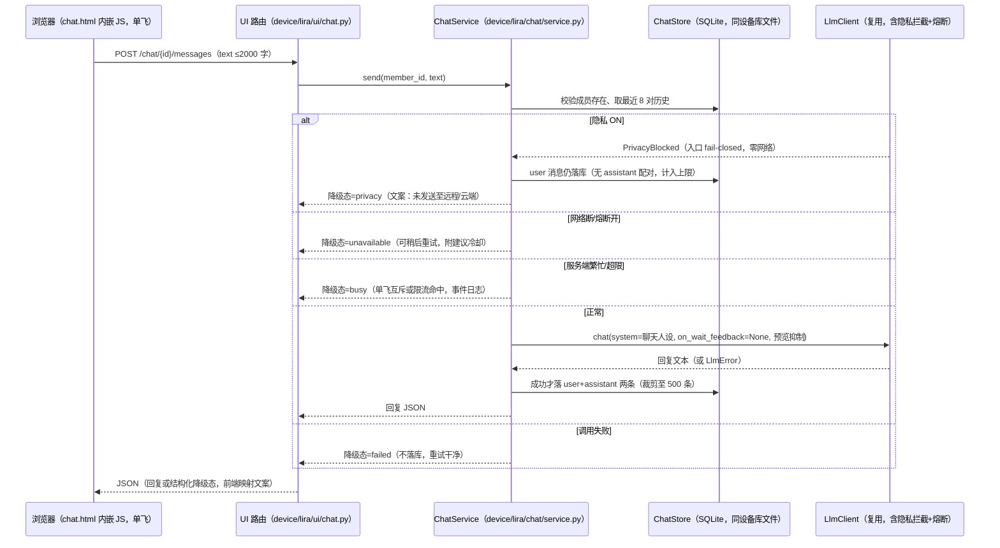

# feat: 家庭助手首页改版与按人文字聊天（批次一）

## Summary

新增 `device/lira/chat/` 模块（ChatStore + ChatService）承接按人文字聊天，UI 层在 `device/lira/ui/` 增加选人页与会话页（fetch-JSON + 内嵌 JS，无构建链），`base.html` 改造为温馨家庭助手设计基底后重排首页（问候 + 聊天入口 + 快捷控件 + 调试折叠收纳）；聊天复用既有 LlmClient/熔断/隐私拦截，零新增依赖，最后主循环装配并按既定清单部署上板。

---

## Problem Frame

见 origin 文档 Problem Frame：`/` 面是运维风"设备面板"，家人无使用感；语音是唯一交互通道且"一唤醒一指令"，多轮交流与按人了解没有容器。本计划只实施 origin 的批次一（R1-R10）。

---

## Requirements

R-IDs 沿用 origin（批次一范围 R1-R10）：

- R1. `/` 首页改版为温馨家庭小助手风格：问候、聊天入口、常用功能为主视觉；大字号高对比，适配手机/平板/电脑浏览器；设计经 ui-ux-pro-max 流程产出并截图对照验证
- R2. 音量/语速改为顺手快捷控件，保存路径不劣于现状
- R3. 调试与运维信息（状态卡、家电只读表、开发者控制台链接）从首屏移入折叠区，默认不展示但仍可达
- R4. 现有能力行为等价不回退：隐私开关（口令校验/fail-closed 引导）、口令设置页、`/status` 只读 JSON
- R5. 聊天入口进入先选人（成员以 emoji 头像 + 名字区分）；成员增改由家人在页面完成；成员数据设备本地
- R6. 多轮对话上下文连续；复用远程 LLM，人设与语音端同源（小丽拉）
- R7. 聊天历史按人存设备本地、可翻看；不同步后台、不写日志；隐私 ON 不阻止本地历史保存
- R8. 隐私 ON 一律返回明确的降级提示，不发起任何 LLM 调用，不静默失败（批次一不实现本地 LLM 应答——见 Scope Boundaries；origin F2 的本地分支显式后置）
- R9. 聊天入口无口令；批次一纯对话，不触发家电、不影响隐私状态
- R10. 聊天请求/响应仅以事件与耗时进日志（source=web-chat），内容不落日志

**Origin actors:** A1（老人，间接受益）, A2（家人，主用）, A3（孩子，聊天使用者）, A4（远程 LLM 服务）, A5（开发者，调试收纳后仍可达）
**Origin flows:** F1（选人聊天）, F2（隐私降级）；F3/F4 属批次二/三，不在本计划
**Origin acceptance examples:** AE1（首屏收纳）, AE2（选人）, AE3（多轮上下文）, AE4（历史归属与内容纪律）, AE5（隐私降级）, AE6（现有能力等价）

---

## Scope Boundaries

- 批次二/三全部内容：按人档案与双通道注入、聊天控家电、首页家电快捷开关、一键阅读（origin R11-R16）
- 流式输出 / SSE：批次一为同步 POST 等待完整回复
- 聊天的语音播报与语音输入：不做，聊天永不发声
- 聊天数据上后台/公网/多设备漫游：不做
- 语音通道说话人认定：批次二问题
- 全家聊天历史对局域网内任何可达 8080 的设备可读、成员 ID 经选人页公开——R9"无口令进入"的必然代价，按既有局域网明文边界接受；批次二档案数据上线使敏感度上升时，须重新决策此边界
- 批次一聊天为纯远程通道：隐私 ON 一律返回 privacy 降级文案，origin F2 的本地 LLM 应答分支显式后置（`Router` 的 local_llm 生产未接线，本地应答随其接线批次再评估）
- `device/lira/ui/dev.py` 现存未提交的 3 行摄像头说明文案：另一工作流的改动，本计划不触碰其内容

### Deferred to Follow-Up Work

- 聊天与语音的熔断器按通道隔离：本期接受共享熔断并记录，后续批次再评估
- 会话页"加载更多"之外的完整历史管理（搜索/导出/清空）：按需后置

---

## Context & Research

### Relevant Code and Patterns

- `device/lira/appliances/store.py` — SQLite 约定：`check_same_thread=False`、WAL + `synchronous=FULL`、FK ON、幂等 `CREATE TABLE IF NOT EXISTS`（板上老库自动生效，无迁移框架）、`with self._conn:` 事务、单进程无内部锁；`meta(key,value)` 为小状态 KV 先例
- `device/lira/ui/dev.py` — 交互页模式：fetch-JSON + 内嵌 vanilla JS、`vlEscape` XSS 转义、数据端点错误返回 JSON 而非 302、文本参数走 POST body、script 标签平衡回归测试
- `device/lira/ui/app.py` — `UiServices` 注入 + `create_app` 闭包路由；错误重渲染模板带状态码；`_run_ui`（`device/lira/main.py`）为装配点；`Router` 的 `local_llm` 注入口已存在（生产未接线）
- `device/lira/llm/client.py` — `chat()` 异步流式；`PrivacyBlocked` 在客户端入口 fail-closed（零网络）；`LlmError` 仅连接/5xx 计入熔断；`max_retries=0`；`is_available()` = 网络探测 + 熔断；`on_wait_feedback` 回调（装配层接 TTS）；回复预览写入 VOICE_LOG
- `device/lira/llm/prompts.py` / `device/lira/dialog/phrasebook.py` — 提示词与用户可见文案的单一出处纪律
- `device/lira/dialog/context.py` — `ContextSnapshot`/`ConversationHistory`（6 对/4000 字符）多轮上下文形态
- 测试：同步 `TestClient` + 真库（`tmp_path` 建库/reopen 验持久化、`:memory:` 用于 UI 测试）；`asyncio_mode="auto"`；`device/tests/test_ui.py`、`test_dev_console.py`、`test_llm_client.py` 为代表

### Institutional Learnings

- 内嵌 JS 无测试覆盖的历史事故（丢一个 `</script>` 全页静默挂而 Python 测试全绿）：改动后必须提取跑 `node --check`，并把 script 标签平衡回归扩展到新模板
- 路由级未鉴权扫测模式（遍历已注册路由断言未登录行为）用于防新路由绕过鉴权——聊天路由无鉴权（R9），扫测目标改为"任何路由不改变安全状态"
- 板上 db 路径按仓库根相对解析（`data/device.db`）；`device/data/` 是过期副本；避免制造第三份数据
- 部署纪律：备份 → rsync → venv 安装 → `--dry-run` 装配检查 → 重启 systemd user unit → journal + `/status` 验证
- 测试环境：WSL `/mnt/d` py3.11 venv（`wsl.exe -e bash -lc "cd /mnt/d/Projects/LIRA/device && .venv/bin/python -m pytest tests/ -q"`，输出过 `tr -d '\0'`）；改文件用 Edit/Write 工具
- "运行时可变状态不入 config"：成员/会话类状态不入 config.yaml（本计划成员入 SQLite 表，天然符合）

### External References

- 无（Phase 1.2 决策跳过外部研究：全部技术层为仓库既有模式 + 成熟通识）

---

## Key Technical Decisions

- **新增独立 `ChatStore` 类，打开与现有设备库相同的 db 文件**：沿用幂等建表约定，板上零迁移；不并进 `ApplianceStore`（职责分离），不新建 db 文件（避免第三份数据副本）
- **成员表用代理整数 ID，不抄家电库的名字主键**：改名不断历史（消息按 id 外键）；删除成员级联删除其全部消息（数据最小化，家庭规模下无保留需求）
- **选人无会话化**：`GET /chat` 选人页 + `GET /chat/{id}` 会话页，无 cookie/session；从首页进入必经选人，刷新停留当前成员（URL 即状态）
- **回复交互 = 同步 POST 等待完整回复**：前端 fetch 单飞（发送中禁用）+ "思考中"态；不做流式/SSE；服务端全局单飞——任何成员的在途调用期间，所有二次发送（含同成员）得 busy 态（镜像 dev_mutex 单锁先例；历史为追加日志，不存在交错损坏）
- **上下文窗口 = 最近 8 对（16 行），服务端从库组装**：库是唯一事实源，不依赖内存会话；复用既有上下文组件形态而非新造机制
- **聊天版 system prompt 独立成文（`CHAT_SYSTEM_PROMPT`）**：与语音端人设同源（小丽拉）但适配文字多轮（允许追问、可不简短），并明确批次一不承诺控家电/阅读；文案出处仍在 `prompts.py`
- **聊天调用约束两条铁律**：`on_wait_feedback=None`（聊天永不触发设备发声）；回复预览与"交互中"状态条目均不进 VOICE_LOG（`LlmClient` 若无现成参数则加默认行为不变的可选参数，语音路径行为不变）
- **聊天绕过 Router 直调 LlmClient（记录理由，非图方便）**：Router Tier-1 命中家电意图即执行（文字通道触发家电直接违反 R9），且语音适配器把 `PrivacyBlocked` 折叠为单一降级态，聊天需要独立的多态降级语义；批次三接入意图路由时从这一正确框架出发
- **聊天使用独立超时（约 30 秒，经默认不变的可选参数）**：共享客户端默认 10 秒按语音回复长度调校，长回复中途卡顿即计一次熔断失败；聊天放宽但不改语音行为
- **服务端单飞 + 速率护栏**：前端单飞可被第二标签页/脚本绕过——服务端互斥为设备级全局单锁（同时最多 1 个在途聊天 LLM 调用，镜像 dev_mutex）+ 每成员固定窗口限流，均纯内存、重启重置（家庭规模接受）；超限返回结构化繁忙态并记事件，unavailable 态附带建议冷却（前端禁发，限制重试在熔断探测窗口反复计败）
- **聊天装配失败降级，不拖垮面板**：ChatStore/ChatService 构造失败 → 警告日志 + chat=None，隐私开关等面板功能不受影响；聊天入口显式"暂不可用"（不隐藏、不静默）
- **降级文案五态区分（privacy / unavailable / busy / failed / member-gone，另有"未保存"标记与超长提示）**：隐私开启（断言"未发送至远程/云端"——不断言"未离开设备"，局域网明文 HTTP 与本地存储使更强承诺不实，沿 `client.py` 既有措辞精度）/ 网络或熔断不可用（可稍后重试）/ 调用失败；文案进 `phrasebook.py`
- **失败不落库，隐私拦截例外**：user+assistant 两条在成功后才持久化，失败回滚——重试天然干净，无重复消息；隐私拦截轮例外：单独落 user 消息（忠于 R7"自己打的字仍保存"，滑窗组装跳过未配对尾部；隐私期重试会留重复文本，接受）
- **边界数值**：单条消息 ≤2000 字（超限显式拒绝）；滑窗字符预算 4000 字符（沿用既有上下文组件默认）；每成员保留最近 500 条（追加时裁剪）；会话页首屏 50 条 + "加载更多"分页
- **设计基底先行的改造顺序**：`base.html` 令牌化（色板/圆角/字体/间距 CSS 变量）→ 三页共用；保留既有语义类名（`.card`/`.pill`/`.tag`/`form.inline`）使现有页面平滑过渡；具体视觉经 ui-ux-pro-max 流程产出

---

## Open Questions

### Resolved During Planning

- 聊天页交互形态：同步 POST + fetch-JSON 单飞（无轮询/长连接），符合无构建链纪律
- 成员身份模型：代理 ID + 页面管理；删除级联
- 降级区分与日志纪律：五态文案 + 预览抑制 + source=web-chat 事件日志
- 上下文窗口：8 对滑窗 + 4000 字符预算、库组装
- 边界数值：2000 字 / 500 条 / 首屏 50 条
- 共享熔断/超时的聊天侧缓解：聊天独立超时（默认不变的参数）+ 服务端单飞与限流 + unavailable 建议冷却
- 聊天装配失败与 chat=None 行为：面板不受影响，入口显式"暂不可用"
- 存储失败与成员删除竞态的映射：回复返回 + 未保存标记；写事务复查成员存在 → member-gone 态
- 评审裁决（2026-10-14 六视角审查）：隐私拦截轮落 user 消息（忠于 R7）、批次一纯远程（本地应答显式后置）、emoji 头像入列（origin R5 字面保留）、设备级全局单飞、U3 依赖 U4 的执行序、熔断风险改写为 HALF_OPEN 探测窗口

### Deferred to Implementation

- 设计令牌具体值（色板/字体/圆角）：经 ui-ux-pro-max 设计流程产出后落码
- `CHAT_SYSTEM_PROMPT` 具体措辞：U2 实现时撰写，人设约束见 origin R6
- `LlmClient` 预览抑制的参数形态：实现时按现有签名选最小改动（可选参数，默认行为不变）
- 问候语时段划分与措辞：U5 实现时定

---

## High-Level Technical Design

> *以下为方向性示意，供评审验证思路，不是实现规格。*

---

## Implementation Units

### U1. 成员与聊天历史存储（ChatStore）

**Goal:** 设备本地家庭成员表与按人聊天历史表，含全部访问方法与保留策略。

**Requirements:** R5, R7

**Dependencies:** None

**Files:**
- Create: `device/lira/chat/__init__.py`
- Create: `device/lira/chat/store.py`
- Test: `device/tests/test_chat_store.py`

**Approach:**
- `ChatStore` 独立类，构造参数为 db 路径（与现有设备库同文件，路径解析沿用仓库根相对约定）；幂等建表追加到自身 `_init_schema`
- 表：成员（id 代理主键自增、name UNIQUE 非空、emoji 头像 NOT NULL 带默认值、created_at epoch 秒）；消息（id 自增、member_id 外键 `ON DELETE CASCADE`、role 限 user/assistant、content 非空、created_at epoch 秒）
- 方法面：创建成员（重名显式报错）、按 id 取/列表、改名、删除（级联）；追加消息、按成员取最近 N 条、`before_id` 分页取更早、追加时裁剪至每成员 500 条
- 事务纪律：user+assistant 两条落库与裁剪为单个事务（"失败不落库/重试干净"语义的载体）；写事务内复查成员存在，兜底"发送中成员被删"的竞态；路径由调用方传入已解析的配置路径（不自行按 cwd 重解析）
- WAL + `synchronous=FULL` + FK ON；`with self._conn:` 事务风格；时间一律 epoch 秒（渲染时设备本地时区，沿 `voice_log.py` 先例）

**Patterns to follow:**
- `device/lira/appliances/store.py`（建表/事务/连接约定）
- `device/tests/test_appliance_models.py`（真库 tmp_path + reopen 验持久化）

**Test scenarios:**
- Happy path: 创建成员→追加 user/assistant 消息→按成员取历史，顺序与内容正确
- Happy path: 改名后历史仍归属该成员（按 id 关联不断链）
- Happy path: 创建成员默认 emoji 头像落库，改名不改动头像
- Edge case: 重名成员创建被显式拒绝；空成员列表、无消息成员返回空
- Edge case: 追加超过 500 条后最旧消息被裁剪，每成员总量守恒
- Edge case: `before_id` 分页只返回更早一批，不含更新消息
- Error path: 删除成员级联删除其全部消息，其他成员消息不受影响
- Integration: 关闭重开（tmp_path 重开）后成员与消息仍在（WAL 持久化）

**Verification:**
- pytest 全绿；对含旧表的 db 文件二次构造无报错（幂等建表）

---

### U2. 聊天服务（ChatService）

**Goal:** 组装上下文、调用 LLM、五态降级与日志纪律的唯一业务层。

**Requirements:** R6, R8, R10（R9 的"不承诺控家电"由 prompt 承担）

**Dependencies:** U1

**Files:**
- Create: `device/lira/chat/service.py`
- Modify: `device/lira/llm/prompts.py`（`CHAT_SYSTEM_PROMPT`）
- Modify: `device/lira/dialog/phrasebook.py`（聊天五态降级文案 + 超长提示）
- Modify: `device/lira/llm/client.py`（预览抑制可选参数，默认行为不变——如现有签名已支持则跳过）
- Test: `device/tests/test_chat_service.py`

**Approach:**
- `ChatService(store, llm, privacy, remote_available)` 注入式构造（可全面单测）；`send(member_id, text)` 为唯一入口
- 流程：成员存在性 → 消息长度校验（≤2000，超限返回结构化错误）→ 服务端护栏检查（全局单飞互斥 + 每成员固定窗口限流，均内存实现）→ 取滑窗 → 调 `chat(system=CHAT_SYSTEM_PROMPT, on_wait_feedback=None, 预览/状态条目抑制, 独立超时)` → 成功则单事务落 user+assistant 两条并裁剪；护栏未过或校验失败不调 LLM、不落库；隐私拦截轮单独落 user 消息（无 assistant 配对，仍计入 500 上限）——忠于 R7"自己打的字仍保存"语义
- 滑窗双界：最近 8 对 + 字符预算 4000 字符（沿用既有上下文组件默认；复用其超限丢弃语义——最新一对超预算则本轮窗口为空，不带过期上下文）；组装时跳过未配对的尾部 user 消息（隐私拦截轮遗留）；快照钉死任务字段为空（阅读任务事实绝不进入聊天调用）
- 降级态映射：privacy（`PrivacyBlocked`——user 消息仍落库，回复以降级文案呈现）/ unavailable（可用性信号为假，不发起调用）/ busy（全局单飞或限流命中）/ failed（`LlmError`、超时）/ member-gone（写事务复查发现成员已删）；LLM 成功但落库失败 → 回复仍返回并结构化标记"未保存" + 事件日志，不静默；各态文案取自 phrasebook
- 内容纪律机械保证：异常与日志只携带类型/长度/ID，禁止把消息文本拼进异常字符串或错误响应；事件 `chat event=send|ok|fail|rate_limited source=web-chat`，只记事件、字数、耗时

**Patterns to follow:**
- `device/lira/llm/client.py` 的 `make_remote_handler` 适配器（异常吞掉转降级、由调用方决策）
- `device/lira/dialog/phrasebook.py` 文案单一出处纪律

**Test scenarios:**
- Happy path: 正常对话返回回复文本，user+assistant 各落一条且顺序正确
- Integration: stub LLM 捕获调用参数——`on_wait_feedback` 为 None、system 为 `CHAT_SYSTEM_PROMPT`、预览参数为抑制；第二轮 prompt/上下文包含上一轮内容
- Edge case: 空消息/纯空白被拒绝且不调 LLM；超长（>2000 字）被显式拒绝且不调 LLM
- Error path: 隐私 ON → privacy 态文案、user 消息已落库（无 assistant 配对）、零网络调用（stub 断言）
- Error path: `remote_available` 为假 → unavailable 态且 LLM 未被调用
- Error path: `LlmError` → failed 态、两条消息均未落库；重试成功后历史完整且无重复
- Integration: 失败与成功调用均只产生事件+耗时日志（caplog 断言无内容文本）
- Integration: 超限/并发发送命中护栏 → busy 态 + rate_limited 事件，LLM 未被调用
- Integration: 成员 A 调用在途期间成员 B 发送 → busy（全局单飞断言，非按成员）
- Edge case: 最新对话对超字符预算 → 窗口为空仍正常调用（不带过期上下文）；调用消息中无阅读任务事实
- Error path: LLM 成功但落库失败 → 回复返回 + 未保存标记 + 事件日志（非 500、非静默）
- Error path: 发送期间成员被另一请求删除 → member-gone 态而非未映射异常
- Integration: 校验失败路径的异常与响应不回显消息文本（仅长度/类型）

**Verification:**
- pytest 全绿；`CHAT_SYSTEM_PROMPT` 不含对家电控制/阅读能力的承诺表述

---

### U3. 聊天路由与页面

**Goal:** 选人页、会话页、成员管理与消息收发的完整 UI 通道。

**Requirements:** R5, R6, R7, R8, R9

**Dependencies:** U1, U2, U4

**Files:**
- Create: `device/lira/ui/chat.py`（聊天路由注册，由 app.py 挂载）
- Create: `device/lira/ui/templates/chat.html`（选人视图 + 会话视图，小段内嵌 JS：单飞/思考中/加载更多/错误态映射/转义）
- Modify: `device/lira/ui/app.py`（`UiServices` 增加 chat 服务字段——默认 None 保持既有测试构造兼容；挂载聊天路由）
- Test: `device/tests/test_ui_chat.py`

**Approach:**
- `GET /chat`：成员卡片列表（emoji 头像 + 名字）+ 新建成员表单（名字 + emoji 预设选择器）；零成员时仅呈现"创建第一位家人"表单（首成员引导，覆盖口令未设场景——聊天不依赖口令）
- `GET /chat/{member_id}`：会话页（头部含成员 emoji 与名字；最近 50 条、发送表单、加载更多、改名/删除入口，删除需页内确认）
- `POST /chat/members`（名字走 body）→ 303 进该成员会话；`POST /chat/{id}/rename`、`POST /chat/{id}/delete`（删除成功后 303 回 `/chat` 选人页，与创建对称）
- `POST /chat/{id}/messages`：JSON 请求/响应，调 ChatService；降级态以结构化字段返回，前端映射 phrasebook 文案
- `GET /chat/{id}/messages?before=`：JSON 分页（加载更多）
- 转义边界（测试化要求，非建议）：三类存储内容（消息文本、成员名、LLM 回复——间接提示注入可使模型输出载荷，role 不可信）只经转义边界进浏览器——服务端渲染走共享 Jinja 自动转义且聊天模板禁用 safe 过滤器，脚本内嵌 JSON 仅经 `tojson`；JS 转义助手仅用于元素内容位置，动态值不拼进属性字符串（数值 ID 走 dataset/元素属性）
- 同源守卫：全部状态变更 POST 校验 Origin——存在且非本机 host 则拒绝（缺失放行 = 既有局域网边界）；消息端点 Content-Type 限定 `application/json` 为纵深防御
- 线程纪律：全部聊天路由 `async def`（ChatStore 连接的单事件循环线程写约定不可破）
- 成员生命周期事件：`chat event=member_created|renamed|deleted member_id=N`（只记 ID 不记名字）
- chat=None 装配行为：聊天入口显式"暂不可用"，聊天端点不 500、不静默
- 前端交互：提交即乐观渲染"待定"气泡；任一降级态返回时保留气泡、标注"未发送"并附降级文案，气泡上一键重试原文本；仅成功响应后清空输入框
- 会话空态与尽头态：零消息渲染 phrasebook 引导语（U2 收录文案）且不渲染"加载更多"；上一批返回不足 50 条即永久隐藏"加载更多"；prepend 更早消息时保持滚动锚点不跳
- 惯例：数据端点错误回 JSON 不 302；文本参数一律 POST body（GET 唯一查询参数为数值 `before`）；错误显式重渲染/JSON，不静默

**Patterns to follow:**
- `device/lira/ui/dev.py`（fetch-JSON + 内嵌 JS + 数据端点惯例）
- `device/tests/test_dev_console.py`（script 标签平衡回归、路由遍历扫测形态）

**Test scenarios:**
- Covers AE2. Happy path: 创建成员"妈妈"→303 进会话页；`GET /chat` 显示成员卡片
- Covers R5（首成员引导空态）. Happy path: 零成员时 `GET /chat` 呈现首成员创建表单
- Covers AE3. Integration: 会话页发消息（stub service）→ 响应含回复；连续两轮路由接线正确
- Covers AE5. Integration: 真实 `PrivacyState` 置 ON 后发消息 → 结构化降级态而非异常/静默
- Covers AE4. Happy path: 50+ 条时首屏 50 条，`before` 翻页取更早；历史仅按所选成员呈现
- Edge case: 不存在的 member_id → 404；改名重名 → 显式错误；删除后其会话页 404 且消息已级联删除
- Happy path: 页内删除确认成功后跟随重定向到达 `/chat` 选人页
- Integration: 路由扫测——遍历全部 `/chat*` 路由，断言任何请求不改变隐私状态与口令状态（R9）
- Integration: `app.py` 改动后既有 `test_ui.py` 全绿（`/`、`/status`、口令流程不回退）
- Integration: chat.html script 标签平衡（扩展既有回归模式）；JS 提取后 `node --check` 通过
- Integration: XSS 载荷回归——消息与成员名含 `<script>`/`` 载荷，服务端渲染与 JS 插入两路径均呈现为惰性文本
- Integration: 跨源 Origin 的状态变更 POST → 显式拒绝；路由扫测扩展为同源 + "不改安全状态"双断言
- Integration: chat=None 装配下聊天端点行为明确——端点不 500、不静默（首页入口断言见 U5）
- Happy path: 成员创建/改名/删除各产生一条事件日志且仅含数字 ID

**Verification:**
- pytest 全绿；`node --check` 通过；手动浏览三视图（选人/会话/管理）无破版

---

### U4. 设计基底（base.html 温馨风格改造）

**Goal:** 建立家庭助手视觉语言（令牌化 CSS），三页共用，为首页重排打底。

**Requirements:** R1（设计目标部分）

**Dependencies:** None

**Files:**
- Modify: `device/lira/ui/templates/base.html`

**Approach:**
- 先经 ui-ux-pro-max 设计流程产出风格方案（暖色家庭助手调性、圆角卡片、柔和层次），再落码为 `:root` CSS 变量令牌（色板/圆角/间距/阴影/字号阶）
- 大字号高对比不降：正文字号 ≥ 现状 20px 基准，中文字体栈保持 system-ui + Noto Sans CJK
- 保留既有语义类名（`.card`/`.pill`/`.tag`/`form.inline`）并按新令牌重绘；移动端优先断点

**Execution note:** 设计令牌必须经 ui-ux-pro-max 流程产出后落码，非直接手拍。

**Test expectation:** none — 纯样式改造，视觉验证在 U5 截图走查；现有测试不断言样式。

**Verification:**
- 既有 UI 测试全绿；setup/index 两页中途状态不破版（本地渲染目检；chat 页视觉检查由 U3 走查覆盖）。执行序：本单元先于 U3 落地（U3 依赖本单元）

---

### U5. 首页改版（index.html）

**Goal:** 温馨家庭助手首页：问候 + 聊天入口 + 快捷控件 + 调试折叠收纳，现有行为等价。

**Requirements:** R1, R2, R3, R4

**Dependencies:** U3（聊天入口可达）, U4（设计基底）

**Files:**
- Modify: `device/lira/ui/templates/index.html`
- Modify: `device/lira/ui/app.py`（首页上下文：时段问候、成员入口数据）
- Test: `device/tests/test_ui.py`（更新适配 + 新增断言）

**Approach:**
- 首屏：时段问候语 + 聊天入口大卡（`/chat`）
- 快捷区：音量/语速步进控件（−/+ 固定步长提交或滑条+保存，沿用既有 `POST /volume`/`POST /speed`，不新增端点）
- 折叠区（`
`）：设备状态卡、家电只读表、开发者控制台链接（dev 启用时），默认收起仍可达
- 隐私开关保留既有表单/口令流程，融入新视觉；位置保显著但不压首屏第一位（具体排布随设计走查定）
- 严格呈现层重排：所有既有端点与行为不变（R4）

**Test scenarios:**
- Covers AE1. Happy path: `GET /` 首屏含问候与聊天入口；状态卡/家电表/dev 链接位于折叠标记内（默认收起）
- Covers AE6. Integration: 隐私开关（口令正确/错误/未设口令引导）行为与改版前断言等价；`/status` 响应字段不变
- Happy path: 音量/语速步进提交后数值生效并持久（现有端点语义）
- Edge case: dev 控制台关闭时首页无开发者链接；家电为空时折叠区保留空态文案
- Integration: chat=None 装配下首页聊天入口显示"暂不可用"而非缺失或报错

**Verification:**
- pytest 全绿；~390px 与 ~768px 两断点截图走查无破版（改版对照存档）

---

### U6. 装配与部署

**Goal:** 主循环装配聊天服务，板上部署并完成端到端走查。

**Requirements:** R5-R10 的生产接线

**Dependencies:** U2, U3, U5

**Files:**
- Modify: `device/lira/main.py`（`_run_ui` 构造 `ChatService` 并注入 `UiServices`）
- Modify: `README.md`、`deploy/SETUP.md`（聊天功能说明 + 走查步骤）
- Test: `device/tests/`（装配冒烟：mock HAL 下 UI 构建含聊天路由）

**Approach:**
- `ChatService` 在 `_run_ui` 内由既有 runtime 成员构造（store 路径、`self._llm`、`self._privacy`、可用性信号），与 Router 装配同源；构造包降级——任何初始化失败记警告并以 chat=None 继续（面板含隐私开关入口必须可用，沿端口绑定失败的降级先例）；`ChatStore.close()` 挂入 `_run_ui` 的 finally
- 部署按既定清单：备份（应用 + config.yaml）→ rsync → 板上 venv 安装（无新依赖，确认 extras 不变）→ `--dry-run` 装配检查 → 重启 systemd user unit → `journalctl --user -u lira` + `/status` 验证 → 浏览器走查 F1（选人→对话→历史）与 F2（隐私 ON 降级），并核查降级文案为"未发送远程"式承诺（无"未离开设备"式过度承诺）
- db 路径核对：确认聊天表落在 `/home/orangepi/lira/data/` 的既有库（勿出现第三份副本）

**Test scenarios:**
- Integration: 以 mock HAL 构造 DeviceRuntime（沿 `test_main_loop.py::test_ui_mount_serves_status_page` 的 rig 模式），断言构建出的 UI 应用含聊天路由、既有装配不变（`--dry-run` 不构造 app，仅保留在部署清单作配置/模型校验）
- Happy path: 板上走查——选人→多轮对话→刷新停留→隐私 ON 得降级提示→journal 仅事件日志

**Verification:**
- 全套 pytest（WSL venv）绿；板上服务正常、聊天走查通过、日志无内容泄露

---

## System-Wide Impact

- **共享 LlmClient/熔断:** 熔断 OPEN 期间聊天与语音均被可用性闸门挡下、不产生新失败（重试刷屏不重置冷却——已对照 `breaker.py` 验证）；真实剩余风险在 HALF_OPEN 探测窗口：无在途探测预留，聊天长调用与语音探针同批放行、失败同批连坐，重试恰逢探测窗口会反复计败。缓解：聊天独立超时 + 全局单飞 + unavailable 态附建议冷却（前端禁发）——定位为限流与探测窗口保护；按通道隔离后置
- **同一 asyncio loop:** 聊天 LLM 调用与语音流水线并存于主循环，均为异步等待、无阻塞；聊天不触碰任何播放/拾音组件（`on_wait_feedback=None` 铁律）；聊天路由全部 `async def`——非 async 端点会落入线程池、破坏共享库连接的单线程写约定
- **VOICE_LOG 显示通道:** 聊天路径抑制回复预览，dev 控制台语音日志不新增内容面
- **`/status` 与 kiosk 轮询:** 不变（R4）
- **sync 下行链路:** 聊天表不进 `protocol.py`，后台零感知（内容数据不出设备）
- **`UiServices` 扩展:** 新增 chat 字段默认 None，既有测试构造无需全改；fake 补充仅在新测试内
- **不变式:** 隐私开关口令流程、口令设置页、`/status` 语义、家电库与同步行为全部不动

---

## Risks & Dependencies

| Risk | Mitigation |
|------|------------|
| 内嵌 JS 无测试覆盖，历史上有丢标签全页静默挂的事故 | script 平衡回归扩展到 chat.html；每次 JS 改动提取跑 `node --check`（U3 验证项） |
| 共享熔断 HALF_OPEN 探测窗口被聊天长调用同批连坐，语音远程随探测失败延长不可用 | 聊天独立超时 + 全局单飞 + unavailable 建议冷却（前端禁发，探测窗口少受重试计败）；隔离后置 |
| 板上出现第三份数据副本/建表失败 | ChatStore 强制同库文件 + 幂等建表；U6 部署清单含 db 路径核对 |
| LLM 长等待期间重复提交/中途关页 | 前端单飞 + 思考中态；失败不落库语义使重试干净无重复 |
| 改版破坏现有 UI 行为 | U5 等价性测试（AE6）；TestClient 全量回归 |
| 存储内容注入（消息/成员名/LLM 回复，含间接提示注入） | 转义边界为测试化要求 + XSS 载荷回归（U3）；聊天模板禁用 safe 过滤器 |
| 跨源页面经家人浏览器中继写入/删除（盲中继） | 状态变更 POST 的 Origin 校验 + 路由扫测断言（U3） |
| 聊天装配失败拖垮整个面板（含隐私开关入口） | 构造降级 chat=None + 入口显式"暂不可用"（U6/U3） |
| 移动端破版 | U4/U5 两断点截图走查 |
| LLM 端点费用/时延不可控（家庭规模） | 滑窗 8 对 + 字符预算双界；2000 字上限；全局单飞 + 每成员限流；等待有"思考中"反馈，不静默 |

---

## Documentation / Operational Notes

- README：测试命令不变（WSL venv 形式）；补聊天功能一句话说明
- deploy/SETUP.md：追加聊天走查步骤（F1/F2）与 db 路径核对项；隐私降级文案核查——文档与 UI 文案一律断言"未发送至远程/云端"，不使用"未离开设备"式过度承诺
- 提交主题沿用中文 conventional 惯例（如 `feat(home-console): ...`）
- 验证命令环境：WSL `/mnt/d` py3.11 venv；改文件用 Edit/Write 工具

---

## Sources & References

- **Origin document:** [docs/brainstorms/2026-10-14-home-console-chat-requirements.md](../../docs/brainstorms/2026-10-14-home-console-chat-requirements.md)
- 复用模式：`device/lira/appliances/store.py`、`device/lira/ui/dev.py`、`device/lira/ui/app.py`、`device/lira/llm/client.py`、`device/lira/llm/prompts.py`、`device/lira/dialog/phrasebook.py`、`device/lira/dialog/context.py`
- 装配点：`device/lira/main.py`（`_run_ui`）
- 测试基准：`device/tests/test_ui.py`、`device/tests/test_dev_console.py`、`device/tests/test_llm_client.py`
