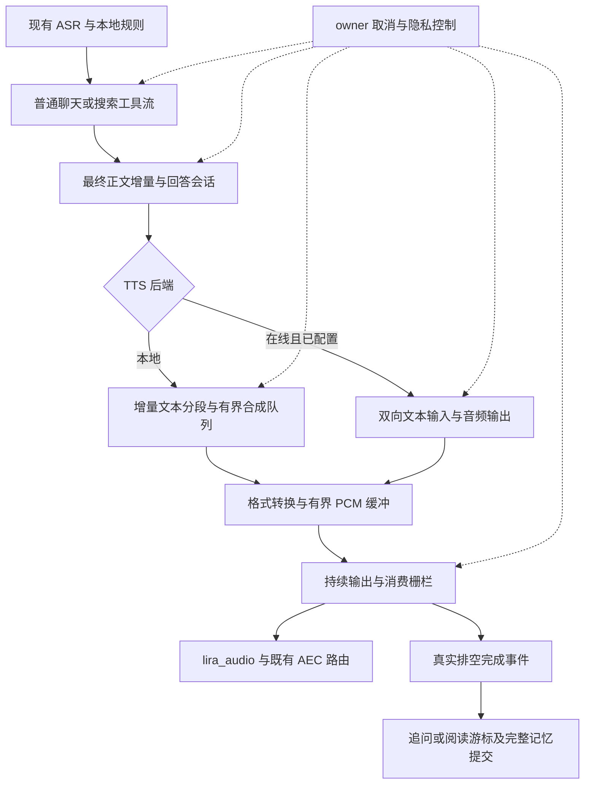
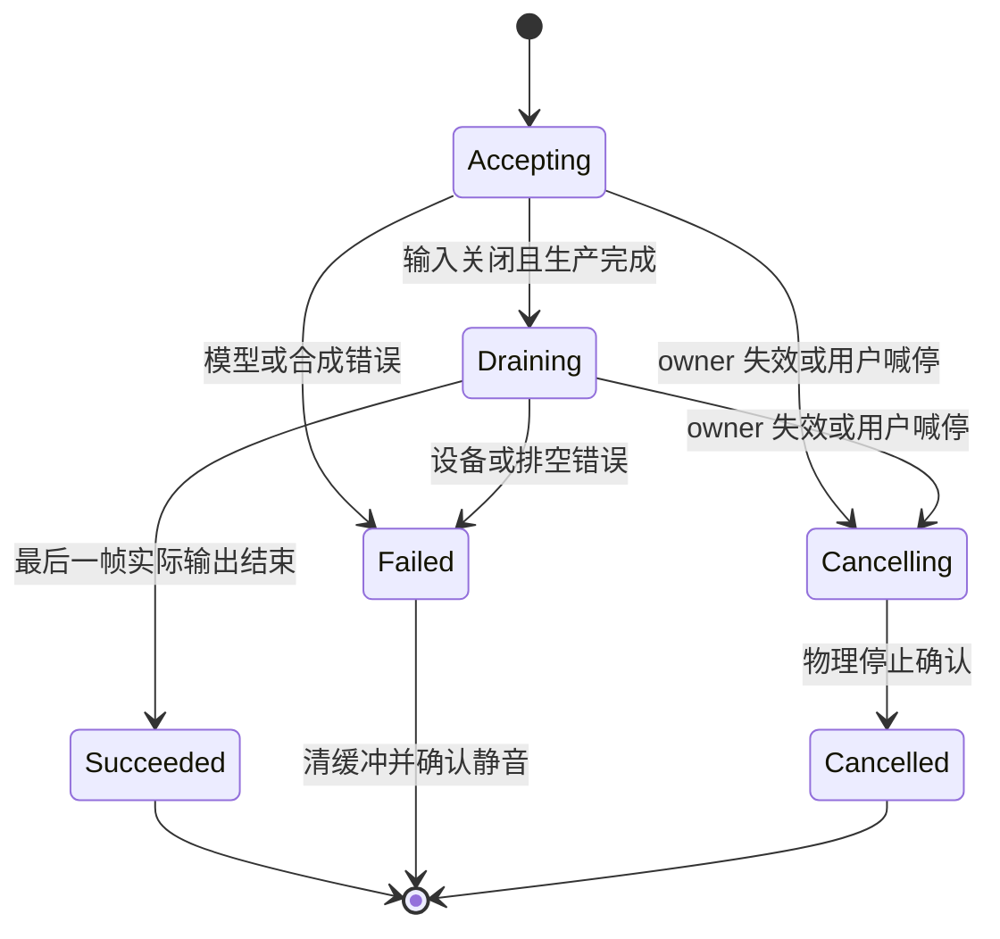
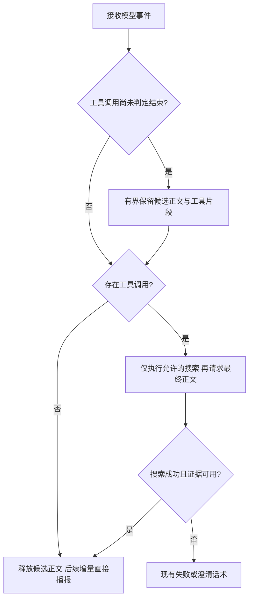

# LIRA Streaming Voice Pipeline - Plan

## Goal Capsule

- **Objective:** 用户与 LIRA 对话时更早听到有效回答，长回答和阅读连续播放，喊停后不会继续播出旧回答。
- **Means:** 在现有 Python/Linux 架构内借鉴小智的队列、流式合成和播放代次设计，分阶段改造（KTD1）。
- **Authority:** 本计划 R-ID 定义行为，KTD-ID 定义实现机制，U-ID 定义交付单元；现有隐私、勿扰、高危确认和阅读恢复约束继续有效。
- **Execution profile:** 先补跨层行为证据，再改造；U1–U8 按依赖推进，每个阶段保持可运行与可回退。
- **Stop conditions:** 自身播报触发设备动作、过期回答复活、隐私开启仍发起远程请求、阅读漏块时停止实机试运行；回到上个已验证版本。
- **Tail ownership:** 本计划授权范围是设计；后续实施负责本地实现、回归及证据整理。开通付费服务、配置真实密钥、切换板上默认后端、部署及 PR 发布由届时明确授权决定，不能因计划存在而推定已获授权。

---

## Product Contract

### Summary

贯通模型增量、语音合成和连续播放，优先修复现有链路的等待与分块停顿，再加入默认关闭的在线双向流式 TTS。沿用 LIRA 的设备能力、统一播放入口和本地后备，以同机对比决定各阶段是否推广。

### Problem Frame

用户报告 TTS 卡顿、大模型交互慢、回答逐句停顿。源码显示普通聊天只收集模型流而不触发播报增量，播放器每次播放一个 PCM 块就重新打开输出流，合成预取仅覆盖单次播报请求内部。

搜索语音分支已有句级输出，但不需搜索时也先请求工具判断，再请求正文。现有日志不能准确区分合成计算、预取等待与实际开播，尚不能确定各因素在实机上的占比。

### Requirements

**回答与连续播放**

- R1. 普通非工具语音聊天须在完整生成结束前开始播报，搜索最终正文确认后同样增量播报；工具协议无法提前确认正文时按 KTD8 安全缓冲，并保留完整返回文本供 UI 和完成后的历史提交使用。
- R2. 已准备好的连续音频不能因文本片段边界而反复开关输出流或引入人为停顿。
- R3. 文本、合成与音频缓冲都有容量上限，慢合成或慢网络不得导致无限排队或阻塞收音与喊停。
- R4. 工具参数、隐藏推理和工具判断内容不得进入播报；实时信息查询与缺少条件时的澄清行为继续有效。

**生命周期与兼容性**

- R5. 取消后旧 owner 的待播音频全部失效，硬件停止得到确认后才能让后继回答播放。
- R6. 播放完成以实际输出排空为准；只有完整且成功播出的回答才提交完整聊天回合和长期记忆。
- R7. 播报期间维持现有回声三闸门和唤醒/受限喊停路径，不以输出流常开替代逻辑占用判断。
- R8. 阅读暂停、继续、重读和停止保持既有语义，阅读游标仅在对应块实际播完后推进。
- R9. 所有播报经过统一的音量、语速、owner、勿扰和隐私控制；断网保留本地 OCR 原文朗读与本地控制。

**可观测性与渐进接入**

- R10. 每轮能关联识别提交、模型首内容、首段音频和实际输出的耗时，普通日志不新增用户文本、PCM 或密钥。
- R11. 在线 TTS 可单独配置和关闭，未配置凭证时仍可完整使用本地路径。
- R12. 每阶段记录同机性能与听感证据，未完成真人声学测试时不得报告实机验收通过。

### Acceptance Examples

- AE1. **Covers R1, R6.** 模型已给出一段可播内容、后续生成被测试桩挂起时，扬声器开始输出；生成结束前不提交完整回合，尾音排空后才进入追问。
- AE2. **Covers R2, R3.** 多段 PCM 连续到达时使用同一输出流；供应不足被记为断供，缓冲达到上限时生产者等待且喊停仍可响应。
- AE3. **Covers R5, R7.** 用户在生成、合成、播放或等待下一段时喊停；旧段不再播放，延迟到达的结果也不能影响下一轮。
- AE4. **Covers R8, R9.** 阅读中暂停再继续，从未完成块恢复且不重新拍照；断网仍能朗读原文。
- AE5. **Covers R9, R11.** 在线 TTS 未启用时零 TTS 网络连接；进行中开启隐私后关闭会话、清待播数据并丢弃迟到结果。

### Scope Boundaries

本轮覆盖现有模型链路、TTS、播放 HAL、状态机接线、配置与必要测试。现有文档仅作为兼容约束，不重写整个产品需求，也不修改既有脑图 HTML/Markdown 文件对。

#### Deferred to Follow-Up Work

- 自由语音全双工打断、开放播报期普通 ASR、替换 AEC 算法或麦克风硬件。
- 替换 ASR 模型、迁移全部 LLM 服务商、修改 OCR/红外业务、接入完整小智服务器或 ESP32 固件。
- 将在线 TTS 设为默认、自动购买服务，以及未经同机测量的模型参数调优。

---

## Planning Contract

### Context and Research

- `device/lira/llm/client.py`：`chat` 接受 `on_reply_chunk`，普通 `_stream_chat` 却仅向观察器发送 delta；不能把遥测当业务流。
- `device/lira/llm/search_agent.py`：已有 `stream_answer`、分句与末尾 flush；语音无工具路径目前至少两次模型请求。
- `device/lira/audio/tts.py`：单 worker 串行请求，同一请求内预合成下一块；跨请求没有统一回答流水线，预取路径的 `chunk_ready elapsed` 不是合成全耗时。
- `device/lira/hal/base.py`、`device/lira/hal/board/audio.py`：`play` 返回代表实际完成；现实现每次创建 `RawOutputStream`。
- `device/lira/dialog/state_machine.py`、`device/lira/vision/reading.py`：完成事件控制历史、记忆、追问与阅读游标。
- `docs/plans/2026-10-06-1654-feat-voice-exit-dnd-plan.md` 与当前 `route_dispatch.py` 的回声三闸门优先于 10 月 5 日旧计划的连续 ASR 设想。
- `device/deploy/audio/README.md`：板上音频必须经过专用 `lira_audio` PCM 与 `lira_echo_source/sink`；不能按旧示例直接打开 ES8388 的 22050Hz 输出。
- `docs/voice-continuity-validation.md`：声学样本仍有待验证项，不把旧自动测试数量当作现有声学通过证据。
- 本次未发现 `docs/solutions/`、根目录 `STRATEGY.md`、`CONCEPTS.md` 或 CE 配置；Compound Pack 解析为空。

### Key Technical Decisions

- KTD1. **内部渐进改造。** 保留现有路由器、设备业务和统一播报入口，按下列单元更换语音内部实现。（session-settled: user-approved — chosen over full Xiaozhi replacement: 复用已有业务与离线能力，并逐阶段验证改善。）Governs R1–R12。
- KTD2. **一个回答对应一个逻辑输出会话。** 会话绑定现有 owner、turn 和递增片段序号，结束输入、合成结束、设备排空分别记录；只有全部成功才能满足 R6。旧单次 `speak` 调用作为有限输入会话兼容，禁止保留两套互相竞争的播放器。
- KTD3. **文本切分按后端能力分工。** 普通聊天和搜索共用增量正文入口；本地后端用一个增量分段器，合成层不再对同一小片段重复切句。双向在线后端直接接收清理后的增量文本，由服务端组织韵律，不在其前面再次等待完整句子。
- KTD4. **持续 PCM 输出与消费栅栏。** HAL 用持续输出流消费有界缓冲，每片段完成栅栏和回答末尾排空事件保留 R6 的完成语义；空缓冲不等于会话结束。回调只拷贝准备好的 PCM、补零和更新轻量计数，不执行网络、合成、日志 I/O 或阻塞等待。
- KTD5. **合成与播放独立调度。** 本地模型保持单一执行通道，跨相邻片段预合成；同步本地推理放在线程中，取消只能撤销输出资格，不能声称已终止线程计算。大文本按需切分，不能先无限生成全文波形。
- KTD6. **背压不进入观察通道。** 文本和 PCM 的容量等待属于业务生产者，模型观察器仍只读且可丢事件。流式回调升级时同步审查 `router.py` 的签名适配、测试替身和异常传播，禁止同步 `put_nowait` 满后丢正文。
- KTD7. **占用与输出流寿命分离。** 会话接受首个播报请求后保持逻辑占用，跨生成间隙与设备排空持续成立，终态后释放；空闲常开流不占用。取消先使 owner 失效、唤醒所有背压等待，再停止物理输出；延迟 stop 只能作用于捕获的旧输出身份。
- KTD8. **搜索判断与正文流合并。** 在同一次支持工具调用的流中累计工具调用片段，只在确认本轮是正文后送给语音流水线；若同轮同时含正文与工具调用，则本轮正文不播。保留当前搜索次数上限、实时查询政策、工具证据和失败降级，不通过关键词猜测跳过搜索。
- KTD9. **在线后端先实现火山双向流式适配，默认关闭。** 参考小智适配层，但协议与鉴权以火山官方当前文档为准；通过独立音频可选依赖提供，明确 PCM 格式并在输出前统一重采样。实现和模拟协议测试不要求真实账号，服务开通与默认切换不在自动执行权限内。
- KTD10. **不从半句话盲目自动续播。** 在线首声尚未实际输出时失败，可对本轮转本地一次；首声已输出后断流则本轮标记失败，停止余音并给出一次本地简短提示，后续轮次降级本地。无可靠文本到音频对齐时，不猜已读位置、不从头重复完整回答。阅读仍按 R8 从未完成块恢复。
- KTD11. **不改设备动作权限。** 语音性能改造不新增 MCP 或模型设备控制工具，首页文字聊天仍保持现有语音输出开关与成员上下文规则；搜索只能查询，不绕过本地高危确认。
- KTD12. **复用代码必须可追溯。** 默认按架构思想重写适配；若复制上游代码，在交付中记录仓库、精确 commit、文件及修改，并保留对应 MIT 声明。ESP32 音频驱动、FreeRTOS 任务与 Opus 网络传输不是 LIRA 本地 PCM 播放的依赖。

### High-Level Technical Design

组件和数据流：

会话生命周期与取消：

正文与工具流决策：

工具流的“无工具”确认必须依据协议允许的明确阶段；若目标服务无法在流结束前确认，则允许保留候选内容到本轮结束，以正确性优先，不声称所有服务都能单请求提前播报。普通非工具聊天不受此缓冲限制。

### Assumptions and Performance Targets

以下是本计划提出的初始工程目标，未经板上基线证明，不能当作已达到的性能承诺。U1 先固定测量方法；若必须改变门槛，应记录瓶颈和原因，不能以更换样本或只排除失败请求获得通过。

- 同板、同模型配置、同网络时，普通非搜索聊天“ASR 提交至有效首声”p95 相比基线降低至少 30%；若基线已不超过 1.5 秒，则满足不退化且 p95 不超过 1.5 秒。
- 在音频已及时准备好的确定性输入下，片段边界零人为插入的静音、零设备 underflow；实机连续长播样本零设备 underflow，供应不足单独计数，不能隐藏在正常标点停顿中。
- 连续性另以“每分钟实际播出内容中的生产者断供总时长”和“每样本最长非语义停顿”验收；排除音频内容自带韵律静音。初始目标为两项相对基线各降低至少 50%，基线为零则保持零；同时统计断供次数。U1 测量后、开始优化前冻结口径和目标，未达标只能报告软件阶段完成与瓶颈，不能以零设备 underflow 代替连续性通过。
- 唤醒/喊停确认到真实扬声器静音沿用旧声学目标：10 次均不超过 500ms；检测本身的延迟另外记录。
- 初始缓冲预算：每会话待合成本地文本最多 256 字，PCM 最多 2 秒，目标启动预缓冲 100ms；同时报告输入、在途片段和重采样临时缓冲的总上限。单词等不可切分单元设置显式硬上限，超限走有说明的失败路径。
- 本地分段初值：优先句界，首段满足 12 字后可在子句边界放行，48 字软上限，已有可播内容等待最多 250ms；实际定时 flush 独立于下一个 token 到达，不能靠新 token 才检查时间。数字、小数、英文单词与未闭合链接保持完整。
- 若本地合成 RTF（计算耗时/音频时长）持续达到或超过 1，缓冲不能解决长期断供，U7 为后续在线体验路径；本地离线能力继续保留，但不伪称其已达在线连续性目标。

### Sequencing and Rollout

先交付 U1 基线，再分别推进 U2 与 U3；U4 在两者基础上建立统一回答流水线，U5 完成跨层取消与提交语义后才允许板上阶段试用。随后推进 U6，执行 U8 本地对照验收；U7 是可单独交付的后续在线路径，其完成后再追加 U8 在线验收。

U2/U3 可独立合入和回退，但不能将跨层门尚未通过的中间版本设为板上默认。新流水线可用一个集中配置开关灰度，在线 TTS 用后端配置选择；避免多个独立布尔开关形成无法测试的组合。通过 U8 后删除临时实验路径，保留配置化本地后端。

### Risks and Dependencies

- **本地线程无法抢占：** R5 的静音不等于计算取消；U1 记录旧合成残留对新轮次的等待。若持续超预算，再单独评估进程隔离，当前不引入未经证明必要的多进程模型副本。
- **搜索服务协议差异：** U6 用实际配置服务确认工具增量与结束原因；不支持时保留安全路径并在报告标明等待原因，不静默降级为无搜索回答。
- **常开播放器与 AEC：** 确认空闲补零不会把声卡流寿命误用为播报占用，也不会改变既有采集路由与隐私关闭行为。
- **网络 TTS：** 超时、鉴权失败、重复事件、乱序片段、重采样尾巴和连接关闭均须落到 KTD9/KTD10 的确定终态；连接与输入缓冲受 R3 约束。
- **实际设备不可用：** 可以完成代码与模拟验证，但 U8 的真人声学验收保持未完成，交付清楚区分两类证据。

### Open Questions

无阻止本地实现启动的产品问题。

- **Deferred / U1：** 板上当前实际模型、环境变量后端、线程数、连接配置与 RTF，需执行时读取非敏感配置并测量；不能用仓库默认值替代部署事实。
- **Deferred / U7：** 账号权限、音色、价格与配额由实际账号决定；只阻塞真实云服务验收与启用，不阻塞默认关闭的适配实现和本地阶段。
- **Deferred / U8：** 真人样本、通常使用距离与噪声环境需用户在场配合；无人测试不能用测试桩替代。

---

## Implementation Units

### U1. Establish comparable latency evidence

**Goal:** 定位首声等待和断供的具体环节。

**Requirements:** R10, R12；KTD1。**Dependencies:** 无。

**Files:** 修改 `device/lira/llm/client.py`、`device/lira/audio/tts.py`、`device/lira/hal/board/audio.py`、`device/lira/dialog/route_dispatch.py`、`device/lira/dev_telemetry.py`；新增 `device/lira/audio/voice_metrics.py`、`device/tests/test_voice_metrics.py`；修改 `device/tests/test_dev_telemetry.py`；新增 `docs/voice-streaming-validation.md`。

**Approach:** 使用单调时间记录端点提交、LLM 请求/首个非空正文、首段提交、合成开始/结束、首 PCM、输出消费/排空及取消确认。按 turn/owner/片段绑定，音频线程只传递有界计数或时间信息到事件循环。记录真正合成用时、RTF、缓冲水位、device underflow 与生产者断供，区分提示音和有效回答。

**Patterns:** `safe_add_event` 旁路隔离和 `_ModelObserve` 轮次绑定；不扩展为第二套持久化音频日志。

**Test scenarios:**

1. role-only 增量不记首内容，提示音不记有效首声，预取不把剩余等待计作完整合成时间。
2. 两轮交错及迟到事件仍归属原 owner，缺失事件标记缺失而非伪造零延迟。
3. 遥测未装配或抛错不改变播放结果；隐私清理后不回填旧事件。

**Verification:** 可生成分环节基线表，报告样本、模型与音频配置，不泄露文本和密钥。

### U2. Connect incremental answers to speech

**Goal:** 普通聊天可提前开口，共用正文增量规则。

**Requirements:** R1, R3, R4；AE1；KTD1–KTD3, KTD6。**Dependencies:** U1。

**Files:** 修改 `device/lira/llm/client.py`、`device/lira/llm/search_agent.py`、`device/lira/dialog/router.py`；新增 `device/lira/audio/text_stream.py`、`device/tests/test_text_stream.py`；修改 `device/tests/test_llm_client.py`、`device/tests/test_search_agent.py`、`device/tests/test_stream_answer.py`。

**Approach:** 把普通与搜索最终正文送入同一增量消费者，保留最终完整文本返回。分段定时器使用会话生命周期，结束时尾段仅 flush 一次；消费者支持容量等待和取消。文本清理以跨增量状态处理链接与标记，保留现有 `spoken_text` 规则且不把半个标记读出。

**Execution note:** 先用“后半段模型流仍挂起，首段已经交给播报”的跨层测试锁定断点。

**Patterns:** `search_agent.stream_answer`、`speech_text.py` 与已有取消时关闭 stream 的纪律。

**Test scenarios:**

1. Covers AE1. 普通非搜索回答未结束时可交付首段，返回全文不缺字、不重字。
2. 中英文、小数、日期、长单词、链接跨多个 delta 时不误切；空结果和末尾无标点正确结束。
3. token 暂停后定时放行安全前缀；没有安全前缀时不切坏内容，超过硬上限确定失败。
4. 背压等待时取消会关闭模型流、终止定时器且无迟到播报；观察回调不参与背压。

**Verification:** 普通与搜索路径通过同一文本边界行为测试，文字聊天仍使用其原有输出策略。

### U3. Keep output continuous with real drain barriers

**Goal:** 连续 PCM 无需按文本块重开声卡。

**Requirements:** R2, R3, R5–R8；AE2；KTD4, KTD7。**Dependencies:** U1。

**Files:** 修改 `device/lira/hal/base.py`、`device/lira/hal/board/audio.py`、`device/lira/hal/mock/audio.py`；新增 `device/tests/test_continuous_player.py`；修改 `device/tests/test_hal_mock.py`、`device/tests/test_audio_stack.py`。

**Approach:** 扩展 HAL 的流式写入、片段消费栅栏和末尾排空能力，兼容既有 `play` 完成语义。持续回调读取有界 PCM，区分空闲、生产中断供和输入关闭后的最终排空。结合 PortAudio 时间信息与输出延迟估算排空，不能把最后一帧复制进回调当作扬声器已静音。

**Patterns:** `_Output` 身份快照、现有 stop 错误不吞并的逻辑、`lira_audio` 路由预检。

**Test scenarios:**

1. Covers AE2. 多块输入只建一次流，未消费完时栅栏不完成，空闲开流不置 occupied。
2. 部分帧、采样率转换尾部、恰好块边界与空音频均正确排空，持续数据无人工补零间隙。
3. 回调报告 underflow、设备断开或 stop 失败时会话失败，不能误报 success。
4. buffer 满时写入等待，取消唤醒等待者；旧 stop 与新播放交错时不误停新输出。

**Verification:** 模拟设备覆盖实际消费时序，板上另按 U8 验证物理排空与停止。

### U4. Pipeline synthesis across answer fragments

**Goal:** 相邻句子共享预合成能力与有界音频队列。

**Requirements:** R1–R3, R6；AE2；KTD2–KTD6。**Dependencies:** U2, U3。

**Files:** 修改 `device/lira/audio/tts.py`；新增 `device/lira/audio/speech_session.py`、`device/tests/test_speech_session.py`；修改 `device/tests/test_tts_chunks.py`、`device/tests/test_tts_bilingual.py`、`device/tests/test_audio_stack.py`。

**Approach:** 会话串接文本消费者、单通道本地合成 worker、格式转换和持续播放器；合成下一片段与当前播放重叠。原单次长文本和提示音复用该协调器，阅读以块为边界提交，保留每块消费完成事件。

**Patterns:** `PlaybackCompletion`、`speech_chunks` 的数字/英文保护、本地 melo/kokoro 语种分配。

**Test scenarios:**

1. 不同正文增量对应的后续合成在当前音频播放中开始，顺序始终正确。
2. 本地合成慢于实时、很长阅读和高语速下内存仍受限，断供真实上报。
3. 合成异常、混合语言不同模型采样率及取消中的不可抢占推理均不遗留可播放旧数据。
4. 全文结束、文本队列空、合成未完成、PCM 未排空分别出现时，不提前完成会话。

**Verification:** 证明跨片段流水线确实重叠且缓冲有界；不能只验证内部队列调用次数。

### U5. Preserve interruption, echo gates and reading progress

**Goal:** 流式回答接入现有状态机而不破坏喊停、追问和阅读恢复。

**Requirements:** R5–R9；AE1, AE3, AE4；KTD2, KTD7, KTD10, KTD11。**Dependencies:** U4。

**Files:** 修改 `device/lira/dialog/state_machine.py`、`device/lira/dialog/route_dispatch.py`、`device/lira/main.py`、`device/lira/vision/reading.py`；修改 `device/tests/test_state_machine.py`、`device/tests/test_voice_context_flow.py`、`device/tests/test_voice_capture.py`、`device/tests/test_reading_interruptions.py`、`device/tests/test_main_loop.py`、`device/tests/test_privacy.py`。

**Approach:** 状态机持有整轮回答会话完成句柄，首声可在模型生成中出现，但只有最终消费结果触发成功后续动作。生成失败或部分音频失败汇总为本轮失败，已播内容不重播为全文。沿用现有 operation owner、退出与勿扰入口，不并行维护新的会话代次体系。

**Test scenarios:**

1. Covers AE3. 生成、背压、合成、播放、drain 五个阶段喊停，旧结果均不可复活或误停下一轮。
2. Covers AE1. 多段中任一段失败不写完整历史或长期记忆；末段排空后成功提交恰好一次。
3. 生成间隙 occupied 保持，尾音后保留 settle 窗；常开流空闲后 ASR 恢复，唤醒/受限喊停仍有效。
4. Covers AE4. 阅读中断只回退未完成块，继续不重拍，停止清任务，音量语速变更边界符合既有行为。
5. 勿扰、隐私切换、高危确认和首页文字聊天不因新增输出路径改变权限或成员归属。

**Verification:** 原连续语音、退出/勿扰和阅读中断回归通过；U2–U5 组合通过后才进入首轮板上试用。

### U6. Remove avoidable model round trips safely

**Goal:** 减少启用搜索后的非搜索问题额外模型等待。

**Requirements:** R1, R4, R10；KTD8, KTD11。**Dependencies:** U2, U5。

**Files:** 修改 `device/lira/llm/search_agent.py`、`device/lira/llm/client.py`；修改 `device/tests/test_search_agent.py`、`device/tests/test_stream_answer.py`、`device/tests/test_llm_client.py`；更新 `docs/voice-streaming-validation.md`。

**Approach:** 按 KTD8 处理工具调用的增量组装、结束原因和最终正文；用观测数据区分模型推理、工具执行和文本缓冲等待。检查实际服务支持的语音短答/非深度思考设置，但不把某一模型的私有参数发送给所有兼容端点。

**Test scenarios:**

1. 支持流式工具判断的非搜索问题不再执行独立规划请求，完整回答与流式正文一致。
2. 工具名称、参数跨块到达，多工具片段、正文与工具混合时都不读出工具内容。
3. 天气/新闻仍需证据，缺城市仍澄清，搜索失败或无可靠来源不编造结果。
4. 不支持流式工具调用或协议不完整时走确定的安全路径，部分已播流不自动重试重播。

**Verification:** 报告不同请求类型的模型调用次数与首声变化，保留实时查询语义测试。

### U7. Add an optional bidirectional streaming TTS provider

**Goal:** 给本地合成瓶颈提供可独立启用的在线路径。

**Requirements:** R3, R5, R9, R11；AE5；KTD3, KTD9, KTD10, KTD12。**Dependencies:** U5。

**Files:** 新增 `device/lira/audio/tts_provider.py`、`device/lira/audio/tts_volcengine.py`、`device/tests/test_tts_provider.py`、`device/tests/test_tts_volcengine.py`；修改 `device/lira/audio/tts.py`、`device/lira/config.py`、`device/config.yaml`、`device/lira/main.py`、`device/pyproject.toml`、`device/tests/test_config.py`、`device/tests/test_privacy.py`、`device/tests/test_main_loop.py`；更新 `README.md`；若复制代码，新增 `THIRD_PARTY_NOTICES.md`。

**Approach:** 在唯一协调器下抽取最小后端能力，提供本地与火山双向实现，按 KTD3 传入正文增量。凭证只从环境或既有秘密配置约定读取，不送到 UI/日志；每次连接与持续收发检查隐私及 owner。会话取消关闭网络、清缓冲，迟到回包无效；超时、鉴权失败与首声前后断流按 KTD10 分流。

**Patterns:** 小智 `core/providers/tts/huoshan_double_stream.py` 仅作参考；协议与鉴权绑定官方文档，不沿用参考项目可能过时的凭证字段。

**Test scenarios:**

1. Covers AE5. 默认本地、缺凭证、隐私开启均零远程连接；显式在线配置才建立会话。
2. 文本未结束时可收到并播放 PCM，格式声明、分片粘包及尾部重采样正确，不创建第二个播放器。
3. 首声前失败只降级一次；首声后断流不全文重读、不猜续播位置、不提交完整回合。
4. 背压期间隐私切换/喊停可关连接，重复和迟到事件不触发第二次完成或重新开播。
5. 429、鉴权失败、异常事件、静默服务端和设备错误各有有界终止路径，无无限重连。

**Verification:** 无凭证可完成本地与协议模拟回归；真实服务另记录账号资源、音色、采样率与费用依据，不把模拟首包延迟当真实云端性能。

### U8. Validate on the board and document rollback

**Goal:** 用真实声学和同机对比证明改造改善。

**Requirements:** R7–R12；AE1–AE5；KTD1, KTD7。**Dependencies:** 本地验收依赖 U5, U6；在线追加验收另依赖 U7 的模拟协议验证及获准的真实服务条件。

**Files:** 修改 `device/tests/e2e/test_voice_continuity.py`、`device/tests/e2e/test_ae8_voice_mechanisms.py`、`device/tests/e2e/test_ae2_reading.py`、`device/tests/e2e/test_ae1_privacy.py`；更新 `docs/voice-streaming-validation.md`、`device/deploy/audio/README.md`、`README.md`。

**Approach:** 先做主机跨层回归，再在获准的板上试运行分别对比旧版、本地新流水线和可选在线后端。保持模型、音量、语速、距离与负载可比较，记录完整失败和跳过项。回滚覆盖应用、配置、专用 PCM、PipeWire 和 service override，若这些未改动则不做无关音频配置修改。

**Test scenarios:**

1. 安静/通常噪声环境中聊天、搜索、长阅读与 OCR 并行时分别测量等待和连续性。
2. 两种环境各 10 分钟，零自身播报触发任务或家电动作。
3. 唤醒停止、退出、勿扰、隐私、断网阅读与阅读恢复按旧约束逐项验收。
4. 真正切回旧配置后能收音和阅读，不能仅凭服务进程 active 判回滚成功。

**Verification:** 按下述 Verification Contract 填写实测结果；未测真人或未启用云服务的项目分别明确标记，不合并成“全部通过”。

---

## Verification Contract

实施阶段在 `device` 目录使用项目 Python 环境；本次规划不运行这些测试。

| Gate | Applicability | Evidence |
|---|---|---|
| 文本与 LLM | U2/U6 | `python -m pytest tests/test_text_stream.py tests/test_llm_client.py tests/test_search_agent.py tests/test_stream_answer.py` |
| 音频流水线 | U1/U3/U4 | `python -m pytest tests/test_voice_metrics.py tests/test_continuous_player.py tests/test_speech_session.py tests/test_tts_chunks.py tests/test_audio_stack.py tests/test_tts_bilingual.py` |
| 状态与阅读 | U5 | `python -m pytest tests/test_state_machine.py tests/test_voice_context_flow.py tests/test_voice_capture.py tests/test_reading_interruptions.py tests/test_main_loop.py tests/test_privacy.py` |
| 后端协议与配置 | U7 | `python -m pytest tests/test_tts_provider.py tests/test_tts_volcengine.py tests/test_config.py tests/test_privacy.py`；本地模拟，禁用真实网络 |
| 完整主机回归 | 最终集成 | `python -m pytest`；分别报告依赖/模型缺失导致的 skip，不能计入实际音频通过 |
| 源码质量 | 所有单元 | `python -m compileall -q lira` 与 `git diff --check`；沿用仓库检查，不发明不存在的 `release:validate` |
| 浏览器独立层 | 仅 UI/遥测前端受影响时 | `python -m pytest tests/browser` 独立进程运行，不与默认异步回归混跑 |

同机性能采样每个配置至少 30 个普通非搜索问题、10 个搜索/澄清问题、5 段至少 2 分钟的连续阅读；预热策略与冷启动单独标记。以同一固定样本对比 p50/p95、失败率、断供次数和 CPU/RSS；记录原始样本量及异常，p95 小样本结果只作为本设备工程证据。

“ASR 提交至有效首声”用于可重复的链路指标；用户说完至首声需真人时间标记或外部音频测量，不能用 ASR 提交假冒说话结束。HAL 首帧消费只是声卡时间估计，必须用外部录音/回环测量校验实际扬声器开播、排空和静音。

全局阶段出口采用 Assumptions and Performance Targets 的目标，并复核 AE1–AE5。在线真实验收只有在服务已开通且获准试用后执行，未具备条件时本地阶段可单独交付，云端验证保持明确待办；不得宣称在线体验已经通过。

---

## Definition of Done

- 本地阶段：U1 的基线可复现，U2–U6 各自满足其 Verification，相关行为回归和最终集成门通过，U8 本地验收通过；不依赖 U7。
- 在线追加阶段：U7 满足其 Verification 后执行 U8 在线验收；R11 和 AE5 的在线部分在此阶段闭环，本地阶段仅核对现有离线与隐私行为，不把未实现的在线路径计为通过。
- R1–R12 均有对应阶段的证据；本地软件完成、实机声学完成与在线实测完成分开报告。
- U8 的真人声学与性能目标通过才可称本地改造完成验收；缺设备或用户配合时清楚报告未完成的验收，不降低门槛。
- 没有未关闭的模型流、TTS 连接、会话定时器或可播放的旧 owner 数据；失败不会推进阅读游标或提交完整回答记忆。
- 文档记录配置、测量方法、回退路径与真实限制；若复制上游代码，来源版本和许可声明完整。
- 删除试验残留、放弃的实现和重复播放器，保留必需的本地后端与集中回退开关直到阶段验收结束。
- 未经额外授权不启用付费服务、不修改实机默认后端、不发布 PR；计划中的可选云路径未实测时明确说明其限制。

---

## Appendix

### External References

核对日期：2026-10-15。实施复用前锁定上游 commit，并重新核对目标依赖版本；本计划引用当前分支作研究线索，不将移动分支当成版本锁。

- [小智设备端音频服务](https://github.com/78/xiaozhi-esp32/blob/main/main/audio/audio_service.cc)：借鉴任务/队列与播放代次设计，支持 KTD4/KTD7。
- [小智社区后端 TTS 基类](https://github.com/xinnan-tech/xiaozhi-esp32-server/blob/main/main/xiaozhi-server/core/providers/tts/base.py)：借鉴文本到音频的生产/消费边界，支持 KTD5。
- [小智火山双流适配](https://github.com/xinnan-tech/xiaozhi-esp32-server/blob/main/main/xiaozhi-server/core/providers/tts/huoshan_double_stream.py)：供 U7 参考，不替代官方协议。
- [火山双向流式 V3 官方文档](https://docs.volcengine.com/docs/DoubaoVoice/WebSocketBidirectionalStreaming-V3?lang=zh)：文本与音频双向流，支持 KTD3/KTD9。
- [sounddevice Raw Streams](https://python-sounddevice.readthedocs.io/en/0.5.3/api/raw-streams.html)：支持持续 PCM 输出方案；项目仅声明最低版本，实施时核对实际安装版。
- [小智设备端 MIT](https://github.com/78/xiaozhi-esp32/blob/main/LICENSE)、[社区后端 MIT](https://github.com/xinnan-tech/xiaozhi-esp32-server/blob/main/LICENSE)：支持 KTD12；第三方模型与 SDK 授权单独核对。

### Prior Constraints

- `docs/plans/2026-10-05-1337-feat-voice-interaction-continuity-plan.md`
- `docs/reviews/2026-10-05-voice-continuity-review.md`
- `docs/plans/2026-10-06-1654-feat-voice-exit-dnd-plan.md`
- `docs/voice-continuity-validation.md`
- `device/deploy/audio/README.md`

以上历史计划不因本计划写入而被视为全部实现或全部验收，冲突以当前源码、较新的已确认行为约束和实际设备证据核对。
