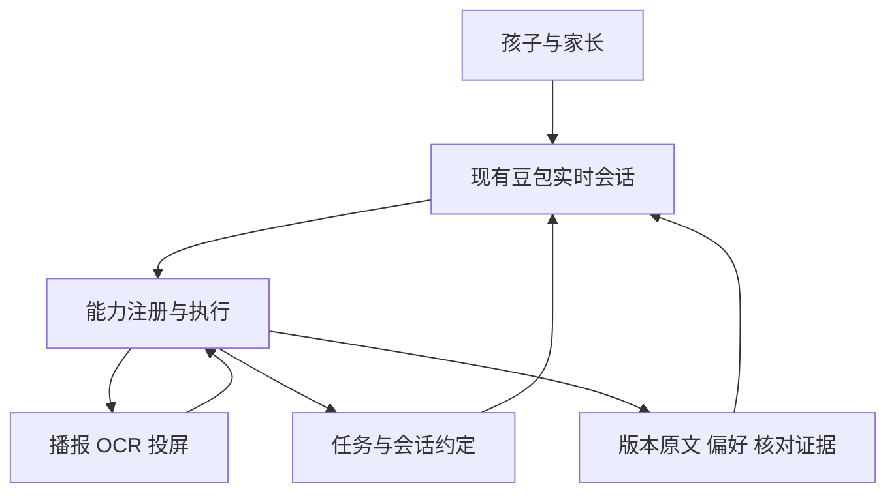
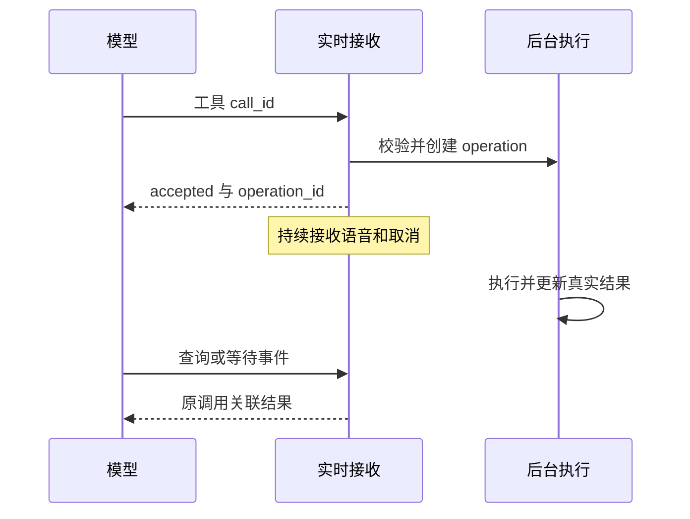
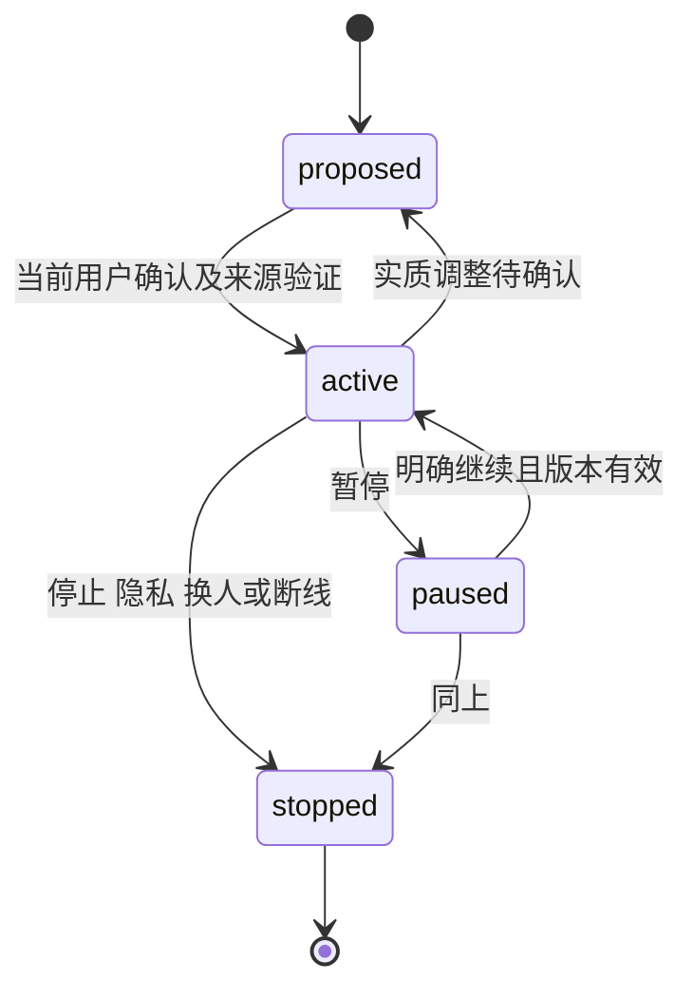
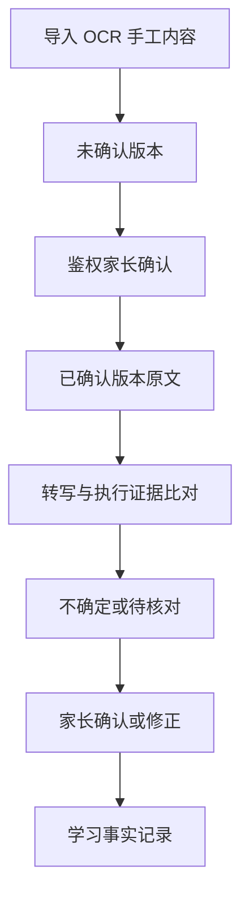
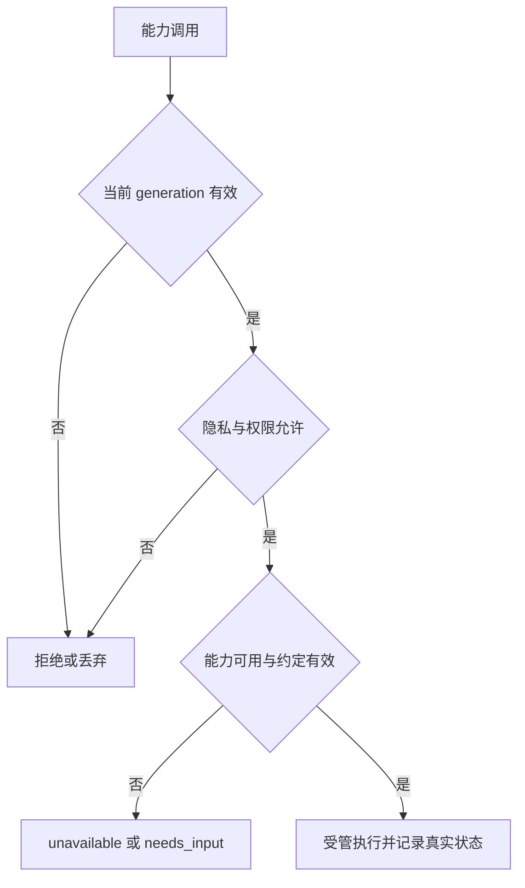

# LIRA 教学辅导：基础能力与 Agent 判断边界

## Goal Capsule

### N1. 目标与当前范围

- Objective：孩子可以通过自然对话使用可靠的辅导能力，协商本次安排并随时调整；家长能确认资料和实际结果。
- Means：沿用现有豆包实时语音，LIRA一次准备任务与后台配置快照，电视内置执行、回调共享状态及按课入账（KTD12–KTD21）。
- Authority：当前Product Contract及用户最新指令优先。当前实施范围U11–U18；经典链路不改，U1–U10仅作历史参考，其他学科和通用扩展不扩建。
- Execution profile：分单元实现并验证基础能力；涉及已有协议、资料兼容和隐私联锁时先补特征覆盖。
- Stop conditions：发现需改变产品范围、绕过现有授权或依赖未证实的新云事件时停止该单元并报告，不用虚假用户输入代替。
- Tail ownership：本次ce-plan完善技术决策、任务协议、实施单元、验证与回滚。未开发、运行产品测试或部署。ce-work需按本计划验收后才启用新电视任务，未通过采集等能力保持关闭。


---

## Product Contract

### N2. 产品定位与分层

- Summary：扩展现有豆包工具注册与分发，新增可观察的能力执行、会话状态及资料证据管理，保留经典链路现有行为。
- LIRA 作为辅导 Agent，基础能力负责感知与行动，大模型负责情境判断，对话形成当次约定，确定性机制负责守住执行与事实边界。
- 管理控制台负责维护资料、查看能力状态、确认内容与结果；孩子可通过自然对话发起辅导，不要求逐项操作固定练习页面。
- 同一安排可能同时涉及自主判断与协商：模型先判断需要澄清什么、提出建议，再由孩子确认影响其参与方式的安排。
- 阅读主线：N12 基础能力 → N13 模型自主判断 → N14 与孩子协商 → N15 硬性边界；N3 保留需求编号索引。

### N12. 基础能力：感知、行动、知识与记忆

本节保留早期源码核查快照；电视当前已有能力及本次待实施差异以 N28 为准，不能把历史缺口视为最新部署状态。

- C1. 语音感知与对话。已有：本地 ASR→路由/模型→TTS 与豆包实时语音两条链路。模型调用：实时对话本身可用，豆包可调用其注册工具；两条链路能力不能混同。待补齐：验证儿童停顿、求助、改口及动态协商表现。依据：device/lira/conversation_paths.py:18、:33；device/lira/audio/doubao_realtime.py:58、:379。关联 R9、R16。
- C2. 语音播报。已有：本地 TTS 与实时语音输出，具备中断及部分播放状态处理。模型调用：豆包可生成语音回复，但当前工具表没有独立的通用精确播报任务接口。待补齐：指定内容的播报、实际完成、取消与恢复状态对 Agent 的统一可用性。依据：device/lira/audio/doubao_realtime.py:134、:297、:379；device/lira/audio/tts.py；device/lira/main.py。关联 R10、R18。
- C3. 电视投屏。已有：文字和登记图片准备、同意确认、发送、状态查询与取消待执行请求；检查实际 rendered_id 与 foreground。模型调用：已注册 prepare_tv_display、confirm_tv_display、get_tv_display_status、cancel_tv_display 等，并接入运行时分发。待补齐：清屏或撤下已显示内容、持续展示任务管理；现有 cancel 不等于清屏。依据：device/lira/tv_voice.py:16、:49、:170、:179、:190；device/lira/tv_display.py:23；device/lira/conversation_paths.py:473。关联 R11、R18。
- C4. 视觉与 OCR。已有：相机、OCR 引擎、阅读采集管线及教材页面识别入口。模型调用：在已审阅的豆包实时工具注册表和运行时分发中未发现通用拍照或 OCR 工具；当前已有使用来自本地管线和控制台。待补齐：向 Agent 开放采集识别，并返回来源、疑点及执行状态；不等于承诺自动批改。依据：device/lira/main.py:330；device/lira/vision/reading.py:288；device/lira/textbook_recognizer.py:195；device/lira/ui/textbooks.py:129；device/lira/audio/doubao_realtime.py:58。关联 R7、R8。
- C5. 教材知识与检索。已有：导入、识别、核对、发布教材字表，按课文或单元筛选四会字和二会字。模型调用：已有 list_practice_textbooks 与 prepare_pinyin_practice，目录查询和字表投屏已接入；不等于通用教材内容读取。待补齐：完整课文和诗词的已确认原文管理、版本关联与模型检索读取入口。依据：device/lira/textbook_practice.py:21、:54、:59；device/lira/textbook_import.py:259；device/lira/tv_voice.py:23、:24、:190。关联 R4、R7、R8、R14。
- C6. 记忆。已有：个人对话记录、摘要、称呼与身份关联；摘要要求不把助手建议当用户事实。模型调用：get_personal_memory 与 identify_current_speaker 可读取身份允许的记忆，未识别时可返回设备历史；不是通用任意写入工具。待补齐：长期偏好、当次约定、学习事实的结构化区分，以及可控写入、修正和失效机制。依据：device/lira/personal_memory.py:163、:175、:200；device/lira/conversation_paths.py:502。关联 R12、R17、R19。
- C7. 任务状态与执行。已有：阅读任务上下文、语音会话状态、投屏请求及状态各自存在。模型调用：可获得部分专用上下文或查询工具，尚非统一教学任务状态读写。待补齐：通用目标、有效约定、进度、暂停续接及执行一致性状态。依据：device/lira/dialog/context.py:19；device/lira/llm/client.py:209；device/lira/conversation_paths.py:18；device/lira/tv_voice.py:190。关联 R9、R12、R18。
- C8. 计时与等待。已有：内部存在超时、等待与调度机制，不能据此认定已有用户任务计时能力。模型调用：已审阅的实时工具注册表及分发中未发现通用计时入口。待补齐：创建、查询、修改、取消计时和到期通知 Agent；是否使用仍由会话约定决定。依据：device/lira/main.py:301、:1160；device/lira/audio/doubao_realtime.py:58；device/lira/conversation_paths.py:473。关联 R12。
- C9. 内容比对与核对记录。已有：教材内容人工核对、对话历史及部分执行记录。模型调用：已审阅的实时工具表与分发未提供完整背诵比对、家长作答核对及学习结果存储工具链。待补齐：可靠原文比对、识别不确定性、家长确认结果和练习事实记录；对话历史不能替代核对结果。依据：device/lira/ui/textbooks.py:107、:143；device/lira/textbook_import.py:259；device/lira/conversation_paths.py:18、:473；device/lira/audio/doubao_realtime.py:58。关联 R13、R14、R16、R17。
- 核查口径：已有指工作区代码及调用链存在；模型调用栏主要指豆包实时语音链路。未进行设备、真实云模型或部署验证，不能将源码接入视为已可稳定使用。

### N13. 交给大模型自主判断

- J1. 在当前授权范围内理解孩子目标、检索相关资料并检查工具是否可用，依据 R9、R14、R18 处理信息不足。
- J2. 判断哪些信息已知、哪些会改变辅导安排，选择有必要的澄清问题，避免机械地每次询问全部选项。关联 R9、R19。
- J3. 结合对话与可靠记忆提出适合当前情境的建议，组织解释与鼓励；建议不自动成为会话约定。关联 R12、R15、R19。
- J4. 在已确认的约定内安排工具调用，并根据孩子反馈与实际执行结果判断是否需要重新协商。关联 R12、R18。
- J5. 根据可用证据生成反馈；事实性结论受 N15 约束，模型不能通过自信表达消除识别或核对的不确定性。关联 R13、R14、R16。
- 代码证据：投屏工具支持缺参数返回 needs_input，并提示模型追问和合并上下文；这是局部协商机制，不证明模型具备完整自主辅导判断。依据：device/lira/tv_voice.py:16、:51；device/lira/textbook_practice.py:59。模型实际主动协商表现仍待验证。

### N14. 需要与孩子协商的会话约定

- S1. 确定影响本次参与方式的目标与内容范围；已清楚表达或已有有效约定时，不重复盘问。关联 R9。
- S2. 后端保存可配置的推进方式，每次启动向电视传入本次参数；孩子可通过 LIRA 协商变更。语音采集入口尚待验证，不能据此宣称电视已支持语音推进。关联 R12、R42、R46。
- S3. 讨论提示和纠正方式，例如背完统一反馈或练习中适度提醒；过去选择可作为确认时的参考，不能变成永久限制。关联 R15、R19。
- S4. 孩子要求变慢、换方式、暂停或停止时，应响应并在必要时更新约定；模型建议不代替孩子的明确选择。关联 R12、R15。
- S5. 确认已经达成的约定，使其在当前会话持续生效；只有缺失、冲突或需要实质变更时再询问，不要求每一步都确认。关联 R19。
- 本节定义可协商事项与约定的作用，不提供必问清单、固定开场话术或具体听写流程。

### N15. 必须有硬性边界

- B1. 内容依据：正式背诵核对使用已确认的教材版本和原文；未经确认的 OCR 或模型回忆不能当作权威答案。Covers R8、R14。
- B2. 结论依据：未看到或未核对纸上答案就不能宣称写对；没听清不等于背错；播报或投屏结束不等于孩子完成或掌握。Covers R13、R16、R17。
- B3. 执行真实性：工具返回失败或结果未知时不能宣称执行成功，也不能据此推进完成记录；暂停或停止后不能继续原执行。Covers R12、R18。
- B4. 练习意图：二会字写拼音任务中不主动泄露拼音答案；孩子要求答案时应澄清是否转为提示或讲解，而不是暗中改变任务。Covers R11。
- B5. 记忆边界：偏好不自动升级为永久规则；只有有依据的练习事实才记为结果，当前明确约定优先于旧偏好。Covers R17、R19。
- B6. 落实方式：工具层与状态管理约束可检查的授权、执行及记录条件；模型职责需配合行为验证，不能只靠提示词保证所有边界。Covers R20。

### N3. 需求索引（保留原编号）

- R1. 开发者控制台保留「教学管理」App 作为教学资料与能力管理入口。
- R2. 教学管理卡片内先选择语文、数学或英语，再进入该科目的教材或功能；卡片内切换、返回，不跳转控制台页面。标题不额外显示“+”。
- R3. 内置语文、数学、英语科目导航可用；自定义科目的新增、改名、排序、删除等完整管理业务仍推迟，不与一级科目导航混同。
- R4. 原「课本导入与核对」归入教学管理的教材能力，保留已有入口功能。
- R5. 已有课本页面可返回教学管理，返回后该 App 可见。
- R6. 保留已有课本地址、登录校验与导入核对保存行为。
- R7. 具备教材组织、视觉与 OCR 内容获取和检索能力，覆盖字表、课文及诗词。
- R8. 原文支持导入、手动录入、修正与家长确认，未确认内容不作为正式背诵核对依据。
- R9. Agent 能在对话中理解辅导目标、获取所需上下文并按需澄清，无需用户逐项配置固定流程。
- R10. 具备准确、可中断和可观察执行状态的播报能力，支撑四会字报读与纸上写字场景。
- R11. 具备可观察状态的电视展示能力，支撑二会字看字写拼音；保持该任务时不主动泄露答案，意图转为讲解前先澄清。
- R12. 后端可配置默写推进方式，每次启动将本次方式及参数传给电视，电视按参数执行；支持通过 LIRA 协商和调整，不把某种推进方式固化为所有任务唯一规则。返回上一页须暂停自动推进，明确继续后恢复。
- R13. 纸上答案本阶段由家长核对，提供参考答案并记录实际确认结果，未核对维持待核对。
- R14. 背诵差异判断基于可追溯、已确认的原文，不能用模型回忆替代。
- R15. 提示与纠正时机为会话可协商安排，不将此前「背完再反馈、仅求助才提示」写成全局规则。
- R16. 保留识别不确定与提示使用信息，没听清不能直接判错，独立完成与提示后完成不能混记。
- R17. 记录有依据的练习事实、核对状态及相关内容，不把执行结束直接推断为完成或掌握。
- R18. 工具调用须返回可区分成功、失败与未知的实际结果，异常不能冒充成功或推进完成记录。
- R19. 区分长期偏好、本次约定与练习事实；当前明确选择覆盖旧偏好，约定有效时避免反复确认。
- R20. 可检查的授权、执行与记录条件须由确定性机制约束，模型的主动协商与判断能力另以场景验证。

### N4. 关键决定与已撤销的固化假设

- D1. 以支撑场景的基础能力和判断权责为本轮主体。Governs R7–R20。session-settled: user-directed；rejected alternative: 继续细化固定教学流程；reason: 用户明确要求重构原文档。
- D2. 保留教学管理的统一管理入口，但不以菜单页面定义孩子的辅导过程。Governs R1、R2、R9。
- D3. 完整科目管理仍不纳入本轮。Governs R3。
- D4. 纸上答案保留家长核对的阶段性范围。Governs R13；OCR 作为基础能力不等于本轮承诺自动批改。
- D5. 原「背完再反馈、仅主动求助提示」从全局规则降为可讨论的会话选项，不作为已保存的孩子偏好。Governs R15、R19。
- D6. 推进可采用手动或按参数自动执行，由后端配置并逐次传给电视；返回上一页暂停自动推进，孩子明确继续才恢复。Governs R12、R19、R42、R44；本次约定不自动变成长期偏好。
- D7. 继续支持课文与诗词及手动录入，作为知识内容覆盖要求。Governs R7、R8、R14。
- D8. 模型表现保持待验证，不把能力清单或提示词当成 Agent 自主性的证明。Governs R20。

- D9. 电视内置默写流程，LIRA只传汉字和参数，不下发有序步骤脚本。Governs R38–R45（session-settled: user-directed — chosen over LIRA 下发步骤、电视只执行：用户明确选择由电视拥有默写流程与历史）。此决定更新 D1 对电视执行流程的早期限制，其他 Agent 判断边界继续保留。
- D10. 返回上一页立即暂停自动推进，直到孩子说“继续”或按继续键后才恢复。Governs R44（session-settled: user-approved — chosen over 返回后继续计时自动翻页：避免刚回到上一页又自动离开）。
- D11. 固定操作指令直接调用控制能力；无法理解的表达才交大模型分析，再以电视 function calling 执行。语音采集方式保持待验证。Governs R43、R45、R46；不把厂商语音按钮可用等同于第三方可取得音频。

### N5. 场景与能力关系（不细化步骤）

- F1. 控制台管理支撑：教学管理承载资料维护、能力状态和结果查看。Covers R1–R6。
- F2. 教材准备支撑：视觉/OCR、手动录入、内容核对与检索共同提供可靠知识。Covers R7、R8、R14。
- F3. 内置科目导航与完整科目管理独立，不以科目 CRUD 作为教学前置条件。Covers R3、R21。
- F4. 四会字场景需要语音理解、播报、状态与计时、会话约定、家长核对和记录；不在这里指定推进方式。Covers R9、R10、R12、R13、R17、R19。
- F5. 二会字场景需要电视展示、任务意图、会话约定与纸上结果核对；不依赖固定间隔。Covers R11–R13、R17–R19。
- F6. 背诵场景需要语音感知、可靠原文、差异判断、提示播报与会话记忆；反馈时机由约定确定。Covers R14–R17、R19。

### N6. 验证场景：能力、协商与边界

- AE1. 从教学管理访问资料维护和能力状态，入口不强迫孩子逐项完成设置。Covers R1、R2、R9。
- AE2. 语文、数学、英语入口可切换；尚未提供的自定义科目管理及跨科目学习功能不显示假执行。Covers R3、R21、R27。
- AE3. 课本页面返回后能看到教学管理。Covers R4、R5。
- AE4. 旧课本地址和登录核对流程继续可用。Covers R6。
- AE5. OCR 有疑点或手工原文未确认时，Agent 不把内容作为正式判错依据。Covers R7、R8、R14。
- AE6. 同一学习目标以不同推进参数启动时，电视分别按本次参数执行；后台默认值不覆盖已明确的本次选择，期间可暂停或协商变更。Covers R12、R19、R42。
- AE7. 保持二会字写拼音任务时不提前播报答案；孩子请求讲解时先澄清意图变化。Covers R11。
- AE8. 没有纸上答案核对结果时只能记录待核对，不能汇报全对。Covers R13、R17。
- AE9. 不同会话可约定背完反馈或其他提示方式；约定成立后遵守，改变方式时重新协商。Covers R15、R19。
- AE10. 噪声导致语音不确定时表达不确定并获取确认，不直接算背错。Covers R16。
- AE11. 投屏失败、播报未完成或孩子暂停时，记录与后续动作反映实际情况，不假报成功。Covers R10、R12、R18。
- AE12. 查看记录能分清练习事实、核对结果与提示使用，不将它们混成掌握结论。Covers R16、R17。
- AE13. 缺少会影响安排的信息时，模型主动发起必要协商；信息已明确时不照表重问。Covers R9、R20。
- AE14. 旧记忆与孩子今天选择冲突时采用当前选择，不强行沿用旧偏好，也不把临时选择自动固化为长期偏好。Covers R19。
- AE15. 只验证单句样例不能证明自主性；应覆盖多轮、不同表达、反悔和工具失败，记录模型漏问或擅自决定的情况。Covers R20。

### N7. 范围边界

- 当前范围：保留基础能力与 Agent 判断边界；新增 LIRA小助手的通用电视能力、内置默写执行、汉字排版、参数推进、控制与步骤回退需求。
- 电视按本次字表和参数执行内置默写流程，需求详见 N24–N28；具体接口、计时实现、字号阈值和视觉尺寸留待规划，不扩展其他辅导流程。
- 保留三类辅导目标、手动录入与家长核对范围；撤销把单次选项升级为全局规则的表述。
- 暂不承诺自动复习排期、纸上答案自动批改或自定义科目管理。数学与英语学习场景由 r6 的 N20 纳入演进规划，尚不承诺能力已支持。

<!-- ce-section: work-relationships -->
### N8. 能力如何共同支撑 Agent

- 感知与知识提供当前事实；记忆提供可核实的上下文；模型提出判断与建议；对话形成会话约定；工具执行并返回真实结果。
- 任务状态与确定性约束管理执行，避免模型越过事实边界；实际结果又成为后续判断的输入。关联 R18、R20。
- N12–N15 是同一个 Agent 能力契约的不同视角，不是要求并行开发的独立功能项目；具体技术划分留待规划。
- 电视、播报、OCR 和记忆继续提供跨场景能力；r10 明确电视内置参数化默写流程，教学内容与本次推进参数仍由 LIRA 提供，不扩展为所有辅导目标的唯一流程。

### N16. 源码核查结论与待补齐项

- E1. 模型调用机制已具备：豆包注册工具并处理 function_call 参数，运行时分发本地能力并回传工具结果；并非所有 Python 功能都因此可调用。依据：device/lira/audio/doubao_realtime.py:58、:379；device/lira/conversation_paths.py:473。
- E2. 已有模型接入：电视投屏、教材目录和字表准备、个人记忆读取；可复用底座包括语音、OCR、阅读状态与内部调度。差异详见 N12，不将「部分已有」计为完整实现。
- E3. 缺口分三类：已有能力尚未开放给 Agent（如 OCR）；通用共享状态不足（约定、计时、任务和学习事实）；自主判断与协商缺少多轮行为验证。此分类不指定技术方案或教学流程。
- E4. 二会字目标现已明确为看汉字写拼音。此前真实测试的固定8个拼音展示只作历史证据，由 R40–R41 覆盖；待改为向电视传汉字、自适应排版，不能把拼音测试通过视为新目标已完成。
- E5. 投屏已有逐次内容确认机制，其授权范围不等于通用教学会话约定；本轮不决定是否改变投屏确认策略。依据：device/lira/tv_voice.py:51、:190。
- E6. 确认边界：代码支持 needs_input 追问，不代表模型实际会在节奏、提示方式等事项上主动协商；测试文件存在也不等于本轮已执行测试。

### N9. 未决问题与验证方向

- Resolve Before Planning：无。已确认主链路范围；具体技术决定见 Planning Contract。
- Deferred to Implementation：按现有 speech_text_buffer.commit 与工具结果回传协议做设备验证，不扩展未核实的云消息类型；协议不支持时保持能力不可用并报告。
- Deferred to Implementation：在实际硬件验证 OCR 效果、电视清屏确认、精确播报中断与恢复；具体函数名和索引细节可按现有代码调整。
- Deferred to Implementation：完成固定行为场景集的真实模型评测，模型不达标时不得将场景标为已支持；不以写死教学流程修补。

### N10. 依据与证据状态

- 当前主导依据：用户要求先梳理基础能力，区分模型自主判断、与孩子协商和硬性边界，按此重构原文件对。
- 场景依据：此前明确的四会字纸上写字、二会字投屏写拼音，以及课文和诗词背诵，保留为能力覆盖场景。
- 历史选择的解释修正：推进与反馈方式是可协商选项，不再视为永久规则，也没有据此建立真实孩子偏好记忆。
- 本轮依据：N12 逐项列出的源码路径及行号，以及注册表→运行时分发→执行→工具结果回传链路。模型工具结果回传见 device/lira/audio/doubao_realtime.py:379。
- 证据限制：早期核查仅为工作区源码快照；后续电视音频和旧拼音分页实测见 N28 引用的验证记录。本次仅更新文档，没有新运行设备测试；新汉字展示、内置流程和语音采集均未验收。

### N11. 修订历史与当前状态

- r15：ce-plan完成电视整任务实施计划；新增后台配置R60/AE32，内容与配置快照一次下发。当前执行U11–U18：协议/配置、课级账本、选词与素材、电视执行、配对回调、实时工具/输出闸门、语音背诵和真实验收。U1–U10归入历史；经典链路不动，未开发或部署。

- r14：计数规则确认——每课默写完成后计数，中断课不计数；单元任务中已完成课立即独立计数，不等整个单元结束，后续中断不撤销已完成课次数。更新R56、AE29及N33，计数时点不再是未决项；本轮仅更新文档。

- r13：每次只选部分扩词覆盖全部四会字，不默全部候选词；重复课文可轮换词语；每次记录默写次数，单元内按课单独追踪；两类默写可关注前后鼻音，四会字可附加指定字标拼音。新增N33、R56–R59、AE29–AE31。计次时点待明确，本轮仅更新需求。

- r12：开始前沟通确定内容；扩词默写覆盖四会字，不重复另设单字阶段；二会字由LIRA预先组词交电视展示；所选课次有背诵课文时置于最后，默写计时结束不能提前报告整次完成。新增N32、R53–R55、AE27–AE28；扩词计时与背诵结束条件待规划，本轮未实施。

- r11：整次默写JSON经function calling交给电视内置方法；默认自动模式先四会字（三遍、每字30秒）再二会字（展示汉字、按页字数计时），缺项跳过；电视结束后回调LIRA。回调扩展语音输入，由LIRA/豆包理解后控制电视；保留返回暂停和明确继续。新增N29–N31、R47–R52、AE23–AE26；尚待规划实施。

- r10：电视应用定位为LIRA小助手；电视内置默写流程，后端逐次传入字和推进参数；二会字改为看汉字写拼音、自适应两行；固定操作直达、陌生指令模型兜底；返回上一页暂停，明确继续才恢复；语音采集保留待验证。新增 N24–N28、R38–R46、D9–D11、AE16–AE22。

- r9：新增 N23、R35–R37；书页缩略图、关联课次直达核对、保存/修订后返回原书页，全程在教学卡片内保留上下文。

- r8：教学卡片最大 1080px，书架精简为书形卡片；新增 N22、R31–R34，课本工作区分四个页签，逐页选择封面及关联单元/课次，背诵内容沿用可选正文数据。

- r7：课本列表改为封面书架，新增 N21、R28–R30；按单元与课次核对录入，保存扩词和可选正文，已发布教材通过新草稿修订。

- r6：根据设备试用反馈去除多余“+”，以语文、数学、英语组织卡片内入口；更新 R2、U9，新增 N20、R21–R27 与跨科目能力边界。

- r5：沿用现有豆包实时语音链路，经典链路暂不扩展；新增 Planning Contract、U1–U10、Verification Contract 与 Definition of Done，并同步双格式。
- r4：将代码核查同步到 N12，每项列出已有实现、模型调用入口、待补齐项与代码依据；更新 N9、N10、N13，新增 N16 核查结论与范围冲突。
- r3：从固定练习流程重构为能力与判断权责；修改 N1–N11，新增 N12–N15、R19–R20、D8、AE13–AE15；原编号不重排。
- r3 重点修正：R12、R15、D5、D6、F4–F6、AE6、AE9 改为动态协商，不再强制孩子控制推进或背完反馈。
- r2 历史：确定三类辅导场景、原文管理、家长核对与记录；其可复用目标延续，固定流程解释已被本轮替换。
- r1 历史：确定教学管理 App 与原课本入口归属。
- 当前为 r9 scope-update-needs-planning；原 U1–U10 保留为历史实施合同，新增跨科目能力尚需技术规划与验收，不继承原计划的 implementation-ready 声明。部署和验证进度见独立记录。


---

## Planning Contract

### N17. Planning Contract

**Product Contract preservation：** 保留R1–R59及用户决定；新增R60记录本轮明确的后台配置随任务下发。N24–N33中的待规划细节由本节落实，不宣称已经开发或部署。本次执行U11–U18，U1–U10仅作历史参考，不重新执行。

**Problem Frame：** 当前默写依赖模型逐字调度。真实测试出现重复读取教材、下一条误识别，以及工具拒绝后模型仍从音箱念字。电视与后端没有可追溯的课级完成事实。

**Summary：** 开始前沟通内容，LIRA准备有来源的完整JSON、后台配置快照及音频素材；电视负责确定性执行，LIRA接收事件、处理语音意图并记录课级完成。

#### Key Technical Decisions

- KTD12. 在既有豆包实时分发中增加整次任务工具，同时撤下旧逐字工具和固定8个拼音的提示词。保留教材、身份与电视探测能力。旧接收器不支持新协议时返回unsupported，不退回逐字调度。依据：device/lira/dictation.py、audio/doubao_realtime.py、conversation_paths.py。Governs R39、R47、R51。
- KTD13. JSON包含有序课次、目标字、所选词语、覆盖映射、音频引用及可选背诵，不接受代码或步骤脚本。双方校验版本、核对来源与摘要，启动前冻结内容和配置快照；运行中编辑教材或后台配置不悄悄改变任务。Governs R40、R47、R53–R55、R60。
- KTD14. 播报由LIRA启动前独立合成并向电视推送，电视缓存后本地播放。复用TtsEngine.generate及现有24kHz单声道PCM约束，不调用RealtimeSession.speak_text，不提前从音箱或电视发声。电视收齐并校验素材才启动。避免依赖尚未验证的电视中文TTS，不改变经典TTS调用链。Governs R10、R39、R48、R59。 TtsEngine返回模型采样率float32，素材管线必须读取engine.sample_rate，显式重采样到24kHz并转换为PCM16，核对单声道、帧数与时长；不能仅贴24k标签或修改经典引擎配置。
- KTD15. 电视引擎独立于Activity，以单线程状态转换、单调时钟和可注入播放/计时接口执行。回调绑定执行代次；返回、暂停、取消使旧timer失效。熄屏、离开前台、音频焦点丢失时停播并暂停；恢复前台或重启不自动继续。依据：tv-receiver/src/Screen.java、AudioReceiver.java；[SystemClock](https://developer.android.com/reference/android/os/SystemClock)、[Handler](https://developer.android.com/reference/android/os/Handler)。Governs R42、R44、R45、R48。
- KTD16. 后台保存版本化配置，每次完整下发有效快照。时长、次数、推进方式、计时起点、返回继续后的计时策略及背诵结束方式均为校验后的参数，不由电视默默补值。缺失、非法或不支持的字段在启动前明确返回。计数、答案保护与返回暂停等已确认边界不能被配置改写。Governs R12、R42、R44、R56、R60。
- KTD17. 在现有FastAPI中独立挂载机器回调，不复用家长Cookie。双向配对鉴权，回调地址由配对登记，不接受模型提供的任意URL。电视先持久化待发事件，LIRA提交数据库后ACK；有界重试不阻塞UI、HTTP接收线程或任务计时。Governs R49–R52。
- KTD18. 完成次数由课级完成账本聚合，不给模型提供直接递增计数工具。某课所选默写阶段实际完成即形成事实，背诵状态单独记录；不等待单元结束或背诵反馈。唯一键为task_id＋稳定课次键，事件收据、完成事实与实际选词历史同事务提交。Governs R49、R52、R56、R57。
- KTD19. 学习对象在启动前经现有身份授权确定并冻结，回调不能任填孩子ID改归属。未确认时可用匿名设备任务，不读写个人历史，以后不自动归并。稳定书ID＋单元/课次作为课身份，revision/hash另存溯源；普通核对修改不清零同课次数。依据：TeachingMemory.owner与TextbookPractice。Governs R17、R19、R56、R57。 删除或遗忘个人记录前持久化撤销其活动任务/归属代次；成员仍存在也不能使旧回调重新创建已遗忘历史。撤销跨LIRA重启有效，与普通取消前已完成事件的正常补账区分。
- KTD20. 模型、遥控器和明确固定指令使用同一prepare/start/status/control任务服务。控制绑定task_id、command_id及期望状态版本；结果不明先查询，不重放start。陌生语音通过LIRA交给现有豆包理解，语音事件本身不授予控制权限或完成事实。Governs R43、R45、R50–R52。
- KTD21. 电视任务音频独立于普通会话播放器，普通回答仍走音箱。任务运行时普通模型PCM先有界缓存，取得对应最终文本后检测是否在读任务字词/原文；命中或无法校验则不释放该PCM，改用不含答案的实际状态提示。重播走电视控制。缓存超限、缺文本、换会话或取消均丢弃，不能用播放后的文本检查冒充阻断。仅修改实时链路，并以真实“工具拒绝后仍念字”验证闸门。Governs R18、R51、R59。 缓存必须在接收侧非阻塞收集，不以播放器等待最终文本再消费旧队列；达到上限立即丢弃该response音频，继续处理最终文本、工具与取消，避免队列填满阻断最终文本到达。

#### High-Level Technical Design

**组件与数据流**

~~~mermaid
flowchart LR
 U[孩子与家长] --> D[现有豆包实时链路]
 D --> P[任务准备与后台配置]
 P --> A[LIRA预制音频]
 P --> T[电视内置执行器]
 A --> T
 T --> C[LIRA配对回调]
 C --> L[课级完成账本]
 C --> D
 D --> K[共享任务控制]
 K --> T
~~~

**准备、提交与完成回调**

~~~mermaid
sequenceDiagram
 participant L as LIRA
 participant T as 电视
 participant B as 账本
 L->>L: 课次核对、覆盖、配置快照
 L->>T: 素材上传与摘要校验
 L->>T: 整次JSON
 T-->>L: accepted与状态版本
 T->>T: 播放、显示、计时
 T->>T: 持久化课级完成及待发事件
 T->>L: lesson_dictation_completed
 L->>B: 收据、事实、选词同事务
 L-->>T: durable_ack
 T->>L: task_completed或cancelled
~~~

**电视生命周期**

~~~mermaid
stateDiagram-v2
 [*] --> preparing
 preparing --> ready: 素材及参数有效
 ready --> running: 启动
 running --> paused: 返回、失焦、熄屏或暂停
 paused --> running: 明确继续且前台可用
 running --> awaiting_recitation: 默写结束且有背诵
 awaiting_recitation --> completed: 约定结束条件满足
 running --> completed: 无背诵且结束提示播完
 running --> cancelled: 明确结束
 paused --> cancelled: 明确结束
 running --> failed: 不可恢复错误
~~~

重启把非终态任务恢复为paused_recovery，校验检查点和素材后等待明确继续，不能用经过的墙钟时间推断完成。

**课级状态与阶段排布**

先按目录确定课次，再按本次包含阶段执行：所选扩词→所选二会字→可选背诵。每个词和每页保留课归属，页面不混课。某课只含扩词时该课扩词完成即可计数；两类都有时需该课两类完成。空课不创建可计数任务。手动跳过未做项目不产生完成事实；返回已完成课不撤销也不增加计数。

**接口与配置**

| 方向 | 计划入口 | 责任 |
|---|---|---|
| 模型→LIRA | prepare_dictation_task | 接受范围、词语建议与约定，服务端校验并产生prepared_task_id |
| 模型→LIRA | start_dictation_task | 启动有效准备结果，不接受模型手填reviewed=true |
| 模型/管理面→LIRA | get_dictation_task_status、control_dictation_task | 共享真实状态、任务控制与版本冲突 |
| LIRA→电视 | /dictation/assets、/dictation/start、/dictation/control、/dictation/status | 配对鉴权、素材校验、任务幂等与回执 |
| 电视→LIRA | /api/tv/events | 状态、课完成、任务完成、取消、失败，事务提交后ACK |
| 电视→LIRA | /api/tv/voice | 有界音频输入与来源仲裁，不把输入直接当命令 |

JSON协议方向如下，字段名可在U11细化；双端共用版本契约及样例。

~~~json
{
  "schema_version": 1,
  "task_id": "server-issued-example",
  "content_hash": "snapshot-digest",
  "config_revision": 4,
  "lessons": [{
    "lesson_id": "stable-book-unit-lesson-key",
    "source": {"book_id": "example", "unit": 4, "number": 7, "revision": 3},
    "four_targets": ["依"],
    "expanded_words": [{"text": "依靠", "covers": ["依"], "audio_asset_id": "asset-a", "pinyin_required_for": []}],
    "two_targets": ["登"],
    "recognition_words": [{"text": "登山", "covers": ["登"]}],
    "recitation": null
  }],
  "parameters": {
    "advance_mode": "automatic",
    "expanded_word_seconds": 30,
    "expanded_repeat_count": 3,
    "expanded_timer_anchor": "after_playback",
    "recognition_seconds_per_character": 30,
    "resume_timer_policy": "restart_current",
    "recitation_end_mode": "observed_user_signal"
  },
  "callback_registration_id": "paired-lira"
}
~~~

这些是配置值示例，不是唯一产品规则。实际值由后台配置和本次有效约定合成。枚举、时长和容量有界，缺值或超界在开始前返回字段错误；模型传字段不等于用户授权。运行中修改须显式控制并收到成功回执，不能篡改历史事实。

事件至少含配对身份、event_id、task_id、课级lesson_id、run_epoch、sequence、state_revision、kind及快照摘要。电视保存发生顺序；取消前已完成但延迟到达的课，在补齐序号并核验后仍入账。取消后伪完成、旧任务新内容或状态冲突进入拒绝/待核实。永久格式错误不无限重试，暂时网络失败采用有界退避和队列告警。

#### Persistence and Lifecycle

LIRA新增独立配置、任务快照、课次运行、事件收件箱、完成账本及选词记录仓储，复用现有SQLite连接和加法迁移。计数按已授权对象＋稳定教材课次聚合；内容hash用于溯源，不使每次核对编辑都变成新课。

电视持久化当前任务、检查点、已完成课及待发事件。收到durable_ack后删除对应项。磁盘满、持久化失败、素材缺失不宣称完成；不确定的末状态待核实，不自动重播或计数。

素材仅由配对LIRA推送，以ID和摘要寻址，不接受任意URL或文件路径；设置任务与缓存容量上限，完成/取消/过期后清理。常规日志不保存教材全文、原始录音或密钥。删除成员清理新账本、历史和回调归属；匿名任务不冒认个人。

#### Voice and Recitation Boundary

回调可收音频不等于电视麦克风可用。首轮可信入口为现有LIRA麦克风；USB/遥控器录音单独探测、授权并验回声。双源输入只允许一个有效代次，不把电视播报当孩子语音。电视采集未通过时保持关闭，遥控、LIRA对话及自动默写仍可用。

背诵最后提示任务，不自动展示参考原文。配置选择受支持的结束输入形式；用户结束或按键只能结束采集并触发基于已核对原文的反馈，不表示背对。豆包不可用时保持待反馈/暂停，不能固定超时判背诵完成。背诵结果不改已形成的默写完成事实。

#### Scope and Rollout

本轮执行R38–R60及必要依赖。R1–R37的已有教材与管理行为做回归，不扩建数学、英语、OCR或通用Agent框架。后台配置位于现有教学管理card内，复用管理鉴权，不另跳页面。

顺序为协议/配置与账本→内容/素材→电视执行→回调→实时工具和管理面→语音与真机验收。新电视任务开关默认关闭，保持LIRA_REALTIME_CAPABILITIES=false；电视先升级兼容协议，再经探测启用LIRA新模式。旧/show、/clear、/audio保留兼容，但不得抢占活动任务。

回滚先停用新任务并明确停止当前执行，再恢复旧版本；保留新账本，不删除已确认次数。不能静默回到模型逐字默写。经典路由、TTS、记忆算法和既有教材格式保持。

#### Sources and Confidence

代码依据：tv-receiver/src/ReceiverService.java、Screen.java、AudioReceiver.java；device/lira/dictation.py、realtime_audio_output.py、teaching_memory.py、textbook_practice.py、ui/teaching.py。device/pyproject.toml要求Python≥3.11，AndroidManifest.xml的minSdk为23；不依赖电视升级系统。

真实证据：docs/verification/2026-10-20-lesson7-auto-tv.md、2026-10-20-unit7-split-audio.md、2026-10-20-split-audio.md、2026-10-20-dse12-karaoke-stopped-retest.md。它们说明已有行为和失败，不证明新执行器或账本已经存在。未发现docs/solutions/、根目录STRATEGY.md、CONCEPTS.md，未据此虚构约束。

Android官方时钟资料约束KTD15；[TextToSpeech](https://developer.android.com/reference/android/speech/tts/TextToSpeech)要求检查引擎能力，而电视中文TTS未验证，因此采用KTD14预制音频。外部资料不用于推断新的豆包云事件。

---

规划审阅：六个本地角色已完成，未保留待处理项；针对音频采样率、非阻塞输出闸门、遗忘后的迟到回调补入3项技术约束及验收，并完成可实施性/安全复核。跨模型复核因启动环境缺少jq未生成审阅结果，不算独立模型通过。记录：docs/verification/2026-10-20-tv-dictation-plan-review.json。


## Implementation Units

### U11. 版本化任务协议与后台配置

**Goal：** 双端一致解析任务与配置，旧电视不误启动。

**Requirements：** R39、R42、R47、R52、R60；KTD12、KTD13、KTD16。

**Dependencies：** 无；沿用当前基础，不重跑历史U1–U10。

**Files：** 新增device/lira/dictation_task_contract.py、device/lira/dictation_settings.py、device/tests/test_dictation_task_contract.py；修改tv-receiver/src/ReceiverService.java；新增tv-receiver/src/DictationSpec.java、tv-receiver/tests/DictationSpecTest.java及双端契约样例。

**Approach：** 明确能力、字段限制及枚举。按KTD13、KTD16区分不可变内容和配置快照。配置仓储先于管理界面。

**Patterns：** tv_display.py配对探测、接收端有界请求解析。

**Test scenarios：**

- Covers AE17、AE19：同字表不同有效配置双端解释一致；旧接收端返回unsupported，不调用旧默写。
- 缺计时字段、负时长、未知版本、无素材引用和不完整覆盖拒绝启动。
- 同ID同摘要返回现状，同ID不同摘要返回冲突。

**Verification：** 双端样例互通，拒绝请求不会播放或计数。

### U12. 课级仓储、完成账本与选词历史

**Goal：** 单元后续中断不丢已完成课计数。

**Requirements：** R17、R49、R50、R52、R56、R57；KTD18、KTD19。

**Dependencies：** U11。

**Files：** 新增device/lira/dictation_repository.py、device/tests/test_dictation_repository.py；修改device/lira/teaching_memory.py、device/lira/conversation_paths.py成员删除/隐私接缝，回归device/tests/test_teaching_memory.py。

**Approach：** 独立增量表复用现有事务。冻结归属，聚合唯一完成事实。先证明失败事务与重发不损坏账本，再接执行器。

**Test scenarios：**

- Covers AE29：A完成立即＋1，B中断不增；不等单元结束即可查询A次数和词语。
- 同课相同event_id或换event_id重复完成均只记一次；返回不重计，新任务真实完成可再计。
- 事务中途失败时收据、计数、选词均不半提交；重启重试可恢复。
- 换说话人不改原归属；未知身份不读他人历史；成员删除使晚回调失效。

- 成员记录未删除而执行个人遗忘时，先持久化撤销活动任务和归属代次，再清理历史；重启后仍不可由旧回调恢复。

**Verification：** 次数可由完成账本重建，没有模型直接加数入口。

### U13. 内容准备、覆盖选词与音频素材

**Goal：** 启动前取得有据可查的词语、原文及可播放素材。

**Requirements：** R8、R14、R47、R53–R59；KTD13、KTD14、KTD19。

**Dependencies：** U11、U12。

**Files：** 新增device/lira/dictation_preparation.py、device/lira/dictation_assets.py、device/tests/test_dictation_preparation.py、device/tests/test_dictation_assets.py；修改device/lira/textbook_practice.py读取接缝；新增tv-receiver/src/TaskAssetStore.java及测试；只复用device/lira/audio/tts.py合成接口。

**Approach：** 服务端从真实目录解析课/单元并冻结核对版本，校验模型建议的覆盖、语境和轮换；按KTD14交付音频。某所选课未核对时先返回具体缺口，与用户重定范围后重新准备，不暗中跳课。

**Test scenarios：**

- Covers AE23、AE27、AE29：部分扩词覆盖全部目标，轮换不漏字，候选不足有记录地复用。
- Covers AE30、AE31：二会字组词、鼻音关注与指定字拼音要求保留，电视不接收应隐藏的答案展示内容。
- 第7单元不混入第21课，未核对课返回缺口；全书未发布不阻止已核对第7课。
- 合成取消、磁盘满、摘要错、上传中断无提前发声；多音字素材按词语语境并真机试听。

- 非24kHz的模型float32样本转换后帧数、时长和音高正确；真机试听无变速，经典TTS配置不变。

**Verification：** 字到词及来源映射完整，准备过程不会从电视或音箱出声。

### U14. 电视执行器、自适应词页与遥控器

**Goal：** 电视按JSON独立执行，返回暂停、重启可恢复。

**Requirements：** R38–R45、R48、R55、R59、R60；KTD14–KTD16、KTD18。

**Dependencies：** U11、U13。

**Files：** 新增tv-receiver/src/DictationEngine.java、tv-receiver/src/DictationStateStore.java、tv-receiver/src/WordPageView.java、tv-receiver/src/TaskAudioPlayer.java；修改tv-receiver/src/Screen.java、tv-receiver/src/ReceiverService.java、tv-receiver/src/AudioReceiver.java音频所有权接缝、tv-receiver/AndroidManifest.xml名称；新增tv-receiver/tests/DictationEngineTest.java、tv-receiver/tests/WordPageLayoutTest.java、tv-receiver/tests/TaskAudioPlayerTest.java。

**Approach：** 引擎注入时钟与播放回执，按实际显示和播放排空转换。页面按词分组，测量两行可读布局。名称改为LIRA小助手，保留包名、签名、配对；Activity重建不重新播题。

**Test scenarios：**

- Covers AE17–AE20、AE23–AE24：单类、混合、末尾背诵按配置执行，三遍只由电视播放。
- Covers AE18：短页、多字词、末页和不同分辨率不裁切、不无限缩字，页时间按实际汉字数计算。
- 返回临近超时先暂停，超过旧截止仍不推进；继续依快照策略；连续按键和旧timer不多走一步。
- Home、熄屏、失焦、进程重启停播且恢复后仍暂停；音频/存储失败不生成课级完成。
- 已完成课重看不重计，跳过未做内容不成为完成。

**Verification：** 豆包断连后正常默写仍可执行；Java引擎证明与API23真机音频、排版、返回证据齐全。

### U15. 配对回调、持久事件与对账

**Goal：** 课级完成反向可靠入账，断网不丢事实。

**Requirements：** R45、R49、R50、R52、R56；KTD17–KTD20。

**Dependencies：** U12、U14。

**Files：** 新增tv-receiver/src/EventOutbox.java、对应测试；新增device/lira/ui/tv_events.py、device/lira/tv_task_events.py、device/tests/test_tv_task_events.py、device/tests/test_tv_events_api.py；修改device/lira/ui/app.py装配及配对配置接缝。

**Approach：** 按KTD17–KTD18实现双向机器鉴权、持久化、ACK和去重。共享状态来自实际事件/查询；缺序号先补齐，不依接收时间猜先后，不依赖豆包会话存活。

**Test scenarios：**

- Covers AE21、AE25、AE29：A完成即计，B取消不影响；ACK丢失重发仍只一次。
- 取消前发生的完成延迟到达，补齐证据后仍计；取消后伪完成与旧任务事件拒绝。
- 网络及两端重启可补发，不重播已完成内容；磁盘故障不ACK未提交事件。
- 错误配对、浏览器Origin、任务归属不符、超大载荷和任意回调地址不能进入计数事务。

- 已撤销任务的晚回调返回终止确认，电视可清理待发项，但LIRA不重建身份、历史或计数；与普通取消前已完成的合法补账区分。

**Verification：** 真机→HTTP→SQLite→ACK有端到端证据，拒绝路径无计数变化。

### U16. 实时任务工具、配置界面与输出闸门

**Goal：** 豆包一次启动任务，普通音箱不绕过电视朗读答案。

**Requirements：** R1、R2、R18、R43、R47、R51、R60；KTD12、KTD16、KTD20、KTD21。

**Dependencies：** U13、U15。

**Files：** 修改device/lira/dictation.py、device/lira/conversation_paths.py、device/lira/audio/doubao_realtime.py、device/lira/realtime_audio_output.py；新增device/lira/dictation_task_service.py、device/lira/dictation_output_guard.py、device/tests/test_dictation_task_tools.py、device/tests/test_dictation_output_guard.py；修改device/lira/ui/teaching.py和实际教学模板/脚本，新增device/tests/test_teaching_dictation_settings.py；回归device/tests/test_conversation_paths.py。

**Approach：** 新工具与电视共用服务，call_id重试不创建重复任务。配置在教学管理card内维护，新设置不改当前快照。按KTD21在出音前检查实时PCM，不只改提示词。

**Test scenarios：**

- 真实“默写第7课”自动检测、沟通内容、准备JSON后一次启动，不问开机，不暴露旧逐字工具。
- Covers AE19、AE21：遥控后模型看到同一状态，旧版本控制拒绝；超时先查询不重复start。
- 工具拒绝后模型仍念三遍任务词语，音箱未出该PCM且电视未推进；普通非答案回答仍走音箱。
- 配置越权、跨站和保存失败拒绝；后台改间隔不改当前任务；普通对话中断不连带停电视，隐私/明确取消按统一联锁处理。
- classic不注册任务工具、不实例化闸门，既有播报与记忆保持。

- PCM先到且超过原队列容量、最终文本后到时，接收循环仍消费工具/取消和最终文本，超限音频被丢弃且未从音箱播出。

**Verification：** 保存真实参数/回传、配置摘要、电视回执及音箱正常/阻断的分层证据。

### U17. 语音回调、输入仲裁与最后背诵

**Goal：** 有来源的语音可经LIRA/豆包控制电视，背诵单独反馈。

**Requirements：** R14–R16、R43、R46、R50、R51、R55；KTD17、KTD20。

**Dependencies：** U15、U16。

**Files：** 新增device/lira/tv_voice_input.py、device/lira/dictation_recitation.py、device/tests/test_tv_voice_input.py、device/tests/test_dictation_recitation.py；修改device/lira/ui/tv_events.py和device/lira/conversation_paths.py输入仲裁；新增tv-receiver/tests/VoiceInputContractTest.java；实际采集适配器和权限在能力验证后添加。

**Approach：** 先实现有界音频输入交接，保留来源与序号；不是把回调文字伪造成真人语音。结束信号按配置解析，固定指令及陌生表达复用KTD20服务。电视采集能力独立验证，未通过保持关闭。

**Test scenarios：**

- Covers AE26：真实豆包对陌生表达调用控制，歧义先澄清；未识别短语不擅自推进。
- 两端并发、电视自身声音、过期语音和隐私开关不重复控制、不串人。
- Covers AE28：有背诵时默写结束不提前结束整个任务；用户结束不等于背对；无可靠原文不生成课文。
- 电视MIC不可用明确disabled，遥控与LIRA麦克风仍可用；真实USB儿童语音通过后才标采集可用。

**Verification：** 分别提供协议、云端模拟输入与实际录音证据，前两者不替代采集验收。

### U18. 真机验收、分阶段启用与回滚

**Goal：** 新任务可审计验收，经典链路原状保留。

**Requirements：** R20、R38–R60；AE16–AE31；KTD12–KTD21。

**Dependencies：** U11–U17；采集未通过只关闭相应入口，不宣称其验收通过。

**Files：** 新增device/tests/e2e/test_tv_dictation_task.py、device/tests/browser/test_teaching_dictation_settings.py；修改tv-receiver/README.md及现有部署文档；docs/verification/新增真实任务、配置、回调和账本报告。

**Approach：** 先备份APK、配对、配置和SQLite，再部署兼容版本。按N18分层验收，任务执行与采集分别记录能力及开关；回滚不丢账、不回退逐字调度。

**Test scenarios：**

- 真机第7课混合任务电视播报/汉字显示，音箱不泄露答案；再次选词仍覆盖全部目标。
- 多课任务A完成即计、B中断不计，断网/重试/重复/重启均无多计或少计。
- 遥控返回超过旧截止保持暂停，继续按配置恢复；设置变更只影响目标快照。
- 旧电视、缺素材、SQLite故障、删除成员、隐私与回滚不误播或误计，classic回归通过。

- 电视离线期间遗忘孩子记录→LIRA重启→电视重连重发完成事件，个人记录和计数不会重新出现。

**Verification：** N18、N19满足并交付真实调用、快照、排空、事件ACK和账本证据，模拟handler不算真机通过。

---

## Verification Contract

### N18. Verification Contract

产品验证发生在ce-work。本次ce-plan不运行产品测试、不探测设备行为；旧报告仅作设计依据。

| 层 | 执行范围 | 必须证明 |
|---|---|---|
| Python≥3.11 | 新任务、配置、仓储、回调、闸门、语音测试及test_dictation、test_tv_audio、test_tv_display、test_textbook_practice、test_teaching_memory、test_conversation_paths、test_realtime_audio_output回归 | 参数拒绝、事务去重、身份隐私和经典路径无回归，不以Windows3.10旧超时差异作正式环境 |
| Java纯逻辑 | 契约、引擎、假时钟、素材、队列与分页测试入口 | 可重放暂停边界、旧timer、乱序和进程恢复 |
| API23真机 | 现有tv-receiver/build.py构建签名、安装与配对探测 | 兼容包名/签名/配对；任务能力可探测；实际电视扬声器播放与排空证据 |
| 管理浏览器 | Playwright独立进程检查card配置、错误反馈及1080px上限，回归课本工作区 | 不跳页面、配置有效、越权拒绝；不与pytest-asyncio同进程混跑 |
| 真实云端＋真机 | 模拟指令经实际ASR、真实部署handler、实际电视播放/显示 | 整次提交、无逐字调度；普通音箱与电视任务分流；工具结果真实回传 |
| 家庭现场 | 孩子现场语音与遥控；电视采集单独验证 | 合成输入不冒充儿童识别、USB录音或背诵成功 |

核心用例：单类、混合、末尾背诵；部分选词覆盖、轮换、鼻音及指定字拼音；不同配置、不同屏幕和末页；返回暂停、失焦/熄屏、旧timer；单课及单元部分完成；回调重试、乱序、ACK丢失和两端重启；工具拒绝后模型念字被出音前阻断；经典链路与总扩展开关保持。

回调证据包含发送、持久收件、账本提交、ACK，不只断言HTTP200。计数和背诵结果分别核对。常规执行记录保留task_id、课次键、config_revision、snapshot_hash、序号和音频帧，不保存完整教材、原始录音或密钥。

部署前备份并记录受保护经典文件、课本数据和开关哈希，部署后比较。失败尝试保留，后续成功不覆盖失败。未通过采集能力保持关闭，不能写成所有入口全部通过。

---

## Definition of Done

### N19. Definition of Done

- U11–U18及N18满足；U1–U10不是本次新增待办。
- 实际任务携带已确认内容及后台配置快照，电视本地完成播报、显示、计时和返回暂停；不依赖豆包逐词驱动。
- 课级完成立即且仅一次入账，中断不计；断网/重启可对账，单元后续中断不丢此前已完成课。
- 工具、遥控和语音共用状态，普通音箱不绕过工具读答案；背诵反馈不冒充准确评分，未验证采集明确关闭。
- 旧电视不误启动，素材与存储失败不误记完成；回滚有证据且不破坏教材与账本。
- 经典链路不改，未验收扩展关闭。双格式文档、协议、配置与验收报告一致。
- 清除废弃试验代码与临时录音，保留必要兼容接口和失败证据；未经另行指令不提交、推送或发布仓库变更。

---

## N20. 科目优先的教学工作区与演进范围

### 确认范围

本轮重构教学管理的信息层级和管理入口，并将数学、英语、打印等需求加入演进范围；不在本轮实现完整跨科目教学，不改经典链路，不以固定教学脚本绕过模型验收。

### R21

教学管理以语文、数学、英语为一级导航。进入科目后并列查看教材与可用功能，允许直接选择活动，不强制先建课本、再选章节、再开始练习。教学卡片是统一容器，所有入口在卡片内切换，提供返回与未保存提醒。

### R22

语文：课本列表与导入核对、课文与诗词原文、默写与听写、背诵。四会字由 LIRA 报读、孩子纸上写；二会字可电视展示、孩子写拼音。背诵默认背完反馈、孩子求助再提示，这些是可协商的当前偏好。资料管理可用，新增模型工具仍关闭。

### R23

数学：教材章节可关联知识点，知识点关联视频讲解、课外题及参考解答。支持围绕知识点选择资源和练习，保留来源与核对状态；实际视频检索、播放及题库尚未建设。当前语文课本字表导入不能假称通用数学教材解析。

### R24

数学纸面练习：题目可形成可预览的练习文档，再连接家中打印机。发起实际打印前确认设备、页数与份数；打印任务与真实设备结果可查询、失败可见，不把提交任务等同于打印完成。打印机协议、连接、适配与任务服务待建设，当前不发送打印。

### R25

英语：在线英文对话、每日一个单词、复习最近学过的词并完成简单对话。使用孩子能理解的简单解释与生活例子；难度、话题和练习方式可协商。“每日”不自动授权提醒或固定时间推送。现有语音链路可复用，英文教学效果尚未验证。

### R26

学习记录按成员、科目与有来源的教材、知识点或词汇关联，区分资料、活动证据、待核对反馈与已确认结果。学过、跟读过、答对过不能直接等同于掌握。跨科目教材元数据、知识点关系和词汇记录模型待补齐；保留现有资料与成员删除、隐私、遗忘边界。

### R27

入口显示可用、待验收或待建设。允许查看未开放功能的用途和缺口，但不提供假执行。家长核对和实际能力状态是公共管理入口，学习时无需孩子先完成控制台配置流程。新增科目导航本身不启用任何模型工具。

### 基础能力与模型调用

已具备：现有豆包实时语音链路、语文课本草稿核对、版本化原文与家长记录；新增执行、约定、OCR、播报、背诵证据等代码已开发，但受关闭开关保护，模型当前不可调用。待补齐：多科目教材归属、知识点与资源关联、视频资源和播放证据、习题与答案管理、练习排版、打印机发现/任务/取消、词汇学习与复习证据。入口不是能力验收证据。

### 自主判断

大模型判断如何用简单语言解释、提出话题或复习建议、选择合适的工具、澄清缺少的信息，以及如何表达识别不确定性。输出必须基于实际资料、工具返回和可见状态。

### 需要协商

当前学习科目与内容、教材或知识点范围、活动节奏、反馈时机、提示程度、视频是否播放、练习数量、词汇复习范围和每日提醒意愿，都根据当次对话决定。不能由卡片导航隐含成已经确认的活动约定。

### 硬性边界

未验收能力维持关闭；隐私、身份、原文确认和证据规则沿用 N15。数学视频、习题、英语学习结果必须有来源或注明生成/未核对；打印是实际外部动作，须明确预览和确认，真实完成才能报告完成。不得自动连接、打印、订阅内容或开启每日推送。

### 实施顺序

第一步：修正多余符号及卡片内导航，复用现有语文资料与公共记录视图。第二步：明确跨科目资料归属与资源/词汇/题目结构。第三步：分开验证知识点讲解、视频、练习打印、英语对话与词汇能力，再逐项开放。各阶段保持未验收工具关闭，不等所有科目完成才获得资料管理反馈。

### 待明确

孩子年级与教材版本、数学视频与课外题来源、家庭打印机型号和连接方式、英语当前理解水平及是否需要每日提醒。暂不假设这些答案，不影响本轮导航修正。

### 代码与验证依据

卡片模板 device/lira/ui/templates/dev.html、teaching_hub.html；导航 teaching-hub.js 与样式 teaching-hub.css；嵌入复用 teaching.html、textbooks.html、teaching-embed.js；原后端鉴权和写入 API 不变。浏览器场景覆盖科目切换、卡片内课本/原文、返回、未保存保护、关闭能力和窄屏；真实设备状态以单独部署回执为准。


## N21. 封面书架与逐课核对

### R28

课本导入与核对首先展示书形课本卡片，每本课本可点击。新导入及没有历史封面选择的记录默认用第一张导入页，用户可换成任意页或明确取消封面；无封面或加载失败时在书形区域显示课本名称。已发布教材和草稿按标识去重。此规则由 r8 用户反馈覆盖 r7 的不默认首图约定。

### R29

进入语文课本后按单元列出课次与课文标题，逐课展示单元、课次、标题、四会字、二会字、扩词、可选课文内容，并可查看原页。扩词为家长可编辑文本，正文允许留空，不能由字表拼凑或自动确认成背诵标准。

### R30

允许逐课选择、录入、核对与保存，显示全书核对进度；切换课次保留当前未保存编辑，离开课本前提醒。修改本课内容撤销该课核对标记，其他课标记保留。只有全部课程核对后才能发布。已发布教材可读，需修改时新建修订草稿另存，原教材不覆盖。

### 代码与兼容

TextbookImportStore 保存 cover_page、每课 expansions 和可选 text；发布仅附加非空扩词/正文，旧文件的读写契约和发布幂等性保留。管理 API 新增已发布教材详情与建立修订草稿，仍使用现有会话、隐私和来源检查。TextbookPractice 的经典字表读取算法不变。

### 验证与边界

验证封面正常/缺失/加载失败、旧教材打开、按单元与课次选择、扩词和可选正文保存重开、逐课核对、版本冲突及已发布文件不被修订覆盖。设备发布保持 LIRA_REALTIME_CAPABILITIES=false，不借资料编辑启用模型扩展。部署进度与实测回执独立保存。


## N22. 卡片内课本工作区

### R31

整个教学管理卡片最大宽度 1080px，在较窄工作区自适应。书架作为课本入口，只保留书形圆角长方形、封面或内置书名及简短状态，不重复显示大量说明。导入按钮按需展开文件选择。

### R32

点击课本后，卡片进入同一课本工作区，采用核对结果、课本信息、课本书页、课文四个页签；每次显示一个内容书页，切换页签不丢失编辑，支持键盘方向键和清晰的返回书架入口。

### R33

课本书页包含全部已导入页面，可前后翻页或按页号选择；当前页可直接设为封面。每页可关联单元，并通过课次多选关联多个课文。关联以页面 unit 和课文 source_pages 保存，新增或移除课文关联撤销相关课文的核对标记，其他课保持。

### R34

课文按单元、课次选择，编辑标题、四会字、二会字、扩词与选填背诵内容；背诵内容继续使用 text 字段，不复制一套原文。核对结果页汇总状态并跳到对应课文，全部核对后才能发布。

### 发布边界

已发布课本允许独立补设或取消封面，仅更新导入源中的展示元数据及 revision，教材 JSON 的内容字节不变；字表、正文及页面课程关联仍需建立修订草稿后编辑。旧教材没有原始导入页时不伪造封面或书页。

### 代码和验证

复用现有教材管理 API，新增带乐观版本检查的已发布封面更新接口；page_units 和 source_pages 有范围和类型检查，保留隐私/会话/来源边界。浏览器验证四页签、书页翻阅、封面保存重开、页课关联、草稿编辑保留、1080px 上限和窄屏；设备部署另留回执，经典链路不变，扩展继续关闭。


## N23. 缩略图与书页课文往返

### R35

课本书页增加按页号排列的缩略图列表，点击查看对应原页，明确标记当前页；桌面纵向、窄屏横向滚动，键盘可选择。缩略图使用鉴权的小图接口与延迟加载，不为列表同时下载所有完整原页，不改变上传图片。

### R36

选中书页显示已关联单元和课次；关联课次为可点击入口，直接进入对应课文核对。显示页面单元与课程单元，允许跨页或一页关联多课，不把未关联页面伪装成已有课程。

### R37

从书页进入课文后提供返回原书页按钮，记住课本、原页码与缩略图滚动位置。切换课程、保留未保存编辑、保存草稿，以及由已发布课本建立修订草稿后仍能返回原页；通过课本书页页签返回也恢复原页。打开另一课本清除旧返回点，所有操作保持教学卡片内，不跳转顶层页面。

### 实现与验证

复用 source_pages 与页面 unit，无新增教材迁移。缩略图接口沿用会话及隐私校验，仅返回最大 160×220 的 JPEG，不缓存到教材目录。浏览器验证缩略图选页、关联显示、跨页课程返回、未保存/保存后返回、发布课本修订后的原页与当前课文、窄屏与键盘。原始图片和已发布教材字节保持，经典链路不改，未验收扩展继续关闭。

## N24. LIRA小助手：电视内置流程与通用能力

- R38. 电视应用显示名称改为“LIRA小助手”，提供可供 LIRA 调用的语音播放、二会字展示、任务控制及状态查询能力；名称变更不等于替换已有配对关系或经典链路。

- R39. 电视接收开始默写所需的汉字和本次参数后，执行电视内置流程并记录步骤；LIRA负责取得可靠字表、配置或协商参数。电视拥有播报准备、展示字页和翻页的执行顺序，LIRA不逐步下发脚本。

- 当前已确认执行方向：LIRA一次提交整次默写内容及参数，电视内置方法依次处理准备、四会字播报、二会字展示、计时结束与完成回调。默认自动模式每字30秒，仍可逐次配置；详见N29–N31。

## N25. 二会字：看汉字写拼音与自适应排版

- R40. 二会字默写向电视传入要显示的汉字，孩子在纸上写拼音；保持默写任务时不显示或主动播报拼音答案。本轮撤销此前“传拼音并展示”的测试目标，正常教学内容仍由已核对的课次提供。

- R41. 电视根据可用屏幕尺寸自适应排版，优先两行；每个汉字独立留出间距，预留两侧、行间与四周安全空白，在这些约束内尽量放大字号。单页字数由排版结果决定，不固定8个；过多内容分页，不以无限缩字塞满一屏。

- 视觉验收方向：大屏、较小屏及不同字数下均能清晰辨认，不裁切、不相互挤压；单字、短页和最后一页保留合理空白。具体字号下限和安全区尺寸属于后续视觉验证，未在本次指定数值。

排版方向示例：第一行“登　唐　依”，第二行“尽　欲　穷”。仅为6字示例，不代表每页固定6个。

## N26. 推进参数与固定指令加模型兜底

- R42. 后端可配置默写推进方式及相关参数，每次启动将该次配置传给电视；电视依据参数选择执行方式。手动推进和定时推进不共用一个写死的全局节奏，不能因未验证语音采集就假定口头控制已可用。

- R43. 提供下一页、上一页、暂停、继续、重播、结束等固定操作，明确指令可直接执行。无法理解的表达交大模型结合当前任务、页码、步骤和暂停状态判断，再通过电视可调用的 function calling 推进；仍有歧义时再澄清，不凭空报告动作成功。

- 语音处理与采集分开：无论未来音频从遥控器、USB还是LIRA取得，都应复用同一组电视控制能力。需要模型理解的语音通过LIRA交给现有豆包实时语音链路，再调用电视控制工具；采集设备及其可用性仍待验证，不绑定厂商接口。

## N27. 步骤历史、返回暂停与状态同步

- R44. 电视记录当前默写步骤及已展示页，遥控器返回可回到上一步；在返回上一页时立即暂停自动推进，取消该次未发生的自动翻页，保留原推进配置。只有孩子明确说“继续”或按继续键才恢复，不因页面恢复、模型回复或旧计时到期自动恢复。

- R45. 遥控器、固定操作指令与模型 function calling 共用电视任务状态；翻页、返回、暂停、继续、重播、结束后，LIRA可以取得当前步骤、页码、推进方式及暂停/完成/失败状态。模型依据电视实际状态继续处理，不能电视停在上一页而后端仍按下一页推进。

- 验证重点：自动推进临近触发时按返回，上一页保持暂停；暂停期间无自动翻页；按继续或明确“继续”指令后才按原配置恢复。步骤历史不把已经播出的声音当成可以撤销的现实动作。

## N28. 证据基线、待验证项与本轮验收

- R46. 语音采集方式保留为待验证项：分别调查小米遥控器麦克风是否向第三方应用开放、USB麦克风能否被电视应用稳定录音，以及录音许可、回声和中止行为。需要模型理解的输入由LIRA接入既有豆包实时语音链路。支持USB接口或遥控器语音搜索，不等于本应用已获得可用音频。未验证前不标记为可用。

- 已有基线：电视PCM接收与播放、内置扬声器路由及实际完成回执已有真实测试，见 docs/verification/2026-10-20-tv-audio-and-lesson7-two.md；代码为 tv-receiver/src/AudioReceiver.java、ReceiverService.java、device/lira/tv_audio.py。

- 待实施差异：当前 tv-receiver/src/Screen.java 返回会退出，ReceiverService.java 仅保留当前展示，没有步骤历史；device/lira/dictation.py 的二会字仍生成拼音、每页8个。更名、汉字自适应、电视内置流程、参数推进和返回暂停尚未实现；不能把本次文档更新称作部署或验收通过。

- 最新代码与实测：普通豆包回复走LIRA音箱，现有指定文本默写播报走电视；check_dictation_tv已自动检测亮屏和前台状态，ready不再询问开机。见 device/lira/realtime_audio_output.py、device/lira/dictation.py 与 docs/verification/2026-10-20-lesson7-auto-tv.md。第7课首字三遍电视播报完成，但曾发生重复查资料、下一条ASR错误及模型绕过工具在普通回复中念字，完整流程未验收。这些是采用电视整任务执行器的现有问题依据，不表示新执行器已实现。

- AE16. 以名称“LIRA小助手”找到电视应用，LIRA能调用其实际支持的能力；经典链路与已有配对保持。Covers R38。

- AE17. LIRA只发送汉字及本次参数，电视执行内置默写流程、记录实际步骤，不要求LIRA下发逐步脚本。Covers R39。

- AE18. 二会字屏幕展示汉字而非拼音；不同屏幕及不同字数优先两行、大字和独立字间距，必要时自适应分页而非固定8个。Covers R40、R41。

- AE19. 同一字表以不同推进参数启动，电视按各自配置执行；清楚的固定指令直接操作，陌生表达经模型调用相同控制能力，意图不清时询问。Covers R42、R43。

- AE20. 自动推进中返回上一页立即暂停，观察超过原翻页时机仍保持；只有明确继续后恢复，旧定时不能抢先翻走。Covers R44。

- AE21. 遥控器返回或暂停之后，LIRA读到与电视一致的步骤、页码和状态；模型不重复推进已撤回的步骤，失败如实回报。Covers R45。

- AE22. 未验证的遥控器/USB录音入口明确显示待验证，不能用现有LIRA麦克风或模拟语音测试替代电视采集验收。Covers R46。

## N29. 整次JSON任务与电视内置执行

- R47. LIRA在开始前先与用户沟通确定本次内容与范围，再取得已核对的课次，准备整次默写内容及参数，通过一次开始默写function calling提交JSON。任务内容为扩词默写、二会字写拼音，以及所选课次存在时放在最后的课文背诵。后端把任务交给配对电视应用，电视将JSON传入内置执行方法。大模型不再逐字查询、逐字播报或逐页触发定时推进。只要求本次使用的课次已核对，不要求全书完成；内容不足或未核对不得编造启动。

- R48. 电视自动模式按本次已沟通的内容依序执行：先扩词默写（覆盖四会字，词语默认播报三遍），再二会字看词写拼音；有课文背诵时放在最后。无对应内容就跳过该阶段。二会字可由LIRA预先组词后传入，电视展示汉字词语而非拼音，按自适应分页展示；二会字每页时长默认以本页实际汉字数乘以每字30秒计算，不固定8字。30秒仍可配置；扩词计时单位、时长与计时起点采用本次后台配置快照，不把旧单字规则当作不可改默认。默写计时结束提示“默写时间到”；如有背诵阶段应继续进入背诵，不能把整次任务提前记为完成。

- 延续约定：扩词默写不把词语、汉字或拼音答案展示到屏幕；二会字展示汉字词语，不显示拼音答案。返回上一页立即暂停自动推进，只有明确继续后恢复；暂停期间不消耗默写计时。遥控器和固定控制工具操作同一电视任务，正常默写执行不依赖大模型逐项调度。背诵由可靠原文支撑，不能因计时到期就判断背诵完成或正确。

- 参数方向：任务标识、教材与课次来源、已选扩词及目标四会字覆盖关系、二会字及组词、可选背诵原文、推进与时长、播报遍数、前后鼻音关注项、四会字附加拼音要求。保存各课实际选词供轮换参考，单元任务保留各课身份以单独计数。JSON表达内容和参数，不下发代码或逐步脚本；示意不代表已实现接口。

JSON参数示意（字段名与协议尚待规划）：

```json
{
  "task_id": "example-only",
  "source": {
    "lesson": 7
  },
  "expanded_words": [
    {
      "text": "依靠",
      "target_characters": [
        "依"
      ],
      "require_pinyin_for": [
        "依"
      ]
    }
  ],
  "recognition_words": [
    {
      "text": "登山",
      "target_characters": [
        "登"
      ]
    }
  ],
  "recitation": {
    "title": "已核对的背诵标题",
    "text": "此处填已核对原文，此例不提供真实课文"
  },
  "parameters": {
    "advance_mode": "automatic",
    "seconds_per_character": 30,
    "word_repeat_count": 3,
    "focus": "可选：前后鼻音"
  }
}
```

## N30. LIRA事件回调与语音意图控制

- R49. 电视完成本次实际包含的全部阶段后，通过LIRA回调服务报告任务完成。只包含默写时，结束提示实际播放后可上报；包含课文背诵时，默写计时结束只能报告阶段完成，背诵结束条件另行确定后才能报告整次完成。LIRA更新共享状态并可普通语音回应，不以任务已接收、模型声称完成或预计到期代替实际结果。任务完成不等于孩子写对或背对。

- R50. 回调服务按事件类型支持多个后续能力，至少容纳任务完成和语音输入，不把入口写成只接受“完成”。事件需要能关联任务与顺序，区分重复、延迟、失败及中断；重试不能重复播报、重复启动或把已结束任务恢复执行。回调只接收配对设备的授权事件，不能任意调用未授权能力。

- R51. 默写过程中如取得用户语音，电视通过回调把语音输入交给LIRA，LIRA接入现有豆包实时语音进行意图理解，再按需function calling控制电视当前任务。明确固定指令可沿用直接执行路径，陌生或需协商的表达由模型分析，歧义时澄清。电视不另建一套大模型对话系统；普通模型回答走LIRA音箱，默写任务内容与固定提示由电视播放。模型不得在普通回复中自行朗读默写字表绕过电视执行器。

- 采集方式继续待验证：回调能力定义不等于电视麦克风已可用。电视语音与LIRA现场麦克风如何去重、避免回声、自身播报触发及并发输入，以及语音输入采用何种传输方式，由后续实施规划验证。

## N31. 新执行模型验收与未决实现项

- R52. 电视执行器与LIRA共享同一任务标识和实际状态；开始、阶段切换、暂停、返回、继续、取消、失败和完成可观察。多次提交同一任务不能重复启动；旧任务回调或过期控制命令不能推进新任务。取消和失败不得记为完成，后端短暂断连不能让电视重播已完成步骤。

- AE23. 对仅扩词、仅二会字、两类都有及追加课文背诵的已确认内容分别提交一次JSON；词语覆盖全部目标字，电视按所含阶段执行，正常默写路径无需模型逐字调用。Covers R47、R48、R53–R55。

- AE24. 扩词默认三遍播报；二会字展示预先准备的汉字词语，自适应分页并按实际页字数计时。暂停/返回不推进，明确继续后恢复。包含背诵时，默写到时进入背诵，不提前上报整次完成；背诵效果由LIRA依据原文和实际输入判断。Covers R48、R49、R55。

- AE25. 真机完成事件反向到达LIRA；重复、乱序、延迟回调不产生重复动作或错记完成；取消、失败与正常完成可区分。Covers R49、R50、R52。

- AE26. 在已验证的采集入口上取得真实语音，回调至LIRA并由真实豆包识别意图、调用电视控制工具，电视状态实际改变后再反馈。模拟语音只能证明后半链路，不能冒充电视采集验收；未知表达不能直接映射为擅自推进。Covers R51、R52。

- 执行配置归属已确认：扩词/二会字时长、计时起点、返回继续后的计时策略和背诵结束方式由LIRA后台维护，每次随任务发送；具体可选值及校验由KTD16、U11落实。播报采用KTD14的启动前预制素材，不依赖模型逐字云端播报。

## N32. 开始前约定内容：扩词、二会字组词与最后背诵

- R53. 开始前通过自然对话确定课次及内容。四会字默写就是扩词默写，每次从合适候选词中选择一部分，覆盖所选范围全部目标四会字即可，不要求默完全部扩词，也不另设重复的单字阶段。词语可覆盖多个目标字，应检查覆盖关系而非按全部候选词逐项输出。优先使用已核对扩词；缺失时准备合适词语并保留依据。相同课文再次默写可轮换所选词语，覆盖要求不变。

- R54. 二会字可由LIRA结合教材读音和语境自行组成合适词语，在提交任务前准备好；每个目标二会字须可追溯到所用词语，不能组词后漏字或混淆多音字。电视只负责显示传入的汉字词语，孩子在纸上写拼音，不由电视临时生成词语。

- R55. 本次所选课次含已核对的背诵课文时，把背诵内容放在扩词默写和二会字之后。保留背完再反馈、孩子主动求助才提示的既有安排；LIRA负责听取与可靠原文比对，电视不自行判对错。缺少可靠原文时如实说明并补齐，不让模型回忆代替课文。背诵范围由开始前约定确定，结束方式由后台配置随任务下发；不能靠固定超时判背对。

- AE27. 启动前已形成内容约定；JSON中选择的部分扩词覆盖全部目标四会字，不强制使用全部候选词；二会字组词覆盖全部目标字，电视显示汉字词语而非拼音，扩词不在屏幕泄露。Covers R53、R54。

- AE28. 所选课次有背诵内容时，任务在默写后进入背诵；不把默写到时当作整次完成，不把计时或电视结束提示当作背诵正确依据；没有背诵内容时不生成虚构课文。Covers R55。

## N33. 选词覆盖、按课计数、鼻音关注与附加拼音

- R56. 每课的本次默写完成后才计数，中断或尚未完成的课不计数。按教材版本和课文分别追踪；单元默写中，每篇课文一旦完成就立即单独计数，不等待整个单元完成。后续课文或整个单元中断，不撤销此前已完成课文的计数。保留课次、实际选词、任务标识及执行状态；同一任务中同一课的重复完成事件、提交或回调不得重复计数。中断记录可供排查，但不能混入完成次数；计次不等于孩子写对或掌握。

- R57. 再次默写同一课文时，LIRA可根据该课历史选词轮换候选词，使练习有变化，同时始终覆盖全部目标四会字。轮换是内容准备时的选择，不由电视临时换词；候选词不足时允许复用并如实记录，不编造词语或为了不重复漏掉目标字。次数与词语记录属于真实练习历史，不能只从模型对话中的“已经默过”推断。

- R58. 四会字扩词默写和二会字写拼音均支持重点关注前后鼻音的字。LIRA在准备任务时结合教材读音、词语语境及本次约定选择和标记关注项，可结合已有可靠练习记录调整；关注不能造成原定覆盖范围漏字，也不能仅凭前后鼻音标签断言孩子薄弱或答错。具体强化方式可在开始前沟通，不默认改变全部任务时长或播报次数。

- R59. 四会字扩词默写可单独增加“给指定字标注拼音”的要求，开始前确定本次是否需要以及哪些字需要，并随任务参数交给电视。它仍是四会字扩词任务的附加作答要求，不等于切换成二会字或把全部扩词另默一次；电视可提示标注要求，但不能显示或播报拼音答案。未观察纸上作答前不声称已完成标注或标注正确。

- AE29. 选择部分候选词仍完整覆盖目标四会字，再次练同一课可轮换且不漏字。单课完成计数一次，开始、进行中和中断均不增加完成次数；单元中先完成的课立即独立计数，后续课中断时已完成课次数保持、被中断课不计数。重复提交、重复或延迟完成回调不重复计数，完成课保留实际选词历史。Covers R53、R56、R57。

- AE30. 两类默写均可携带前后鼻音关注项，词语读音与语境一致、原定覆盖不减少；只有有依据的作答证据才记录错误或薄弱点。Covers R58。

- AE31. 同一四会字任务分别以不要求拼音、要求指定字拼音启动，电视提示与参数一致、不泄露拼音答案，实际结果维持待核对直到有作答核对证据。Covers R59。

- 计数规则已确认：按课完成后累计，中断课不累计；单元任务按各课实际完成事件分别提交计数，不等待单元结束。课级完成事件的协议、去重与重启恢复机制属于后续实施规划。选词轮换结合当前孩子的身份记录，身份未确认时不得串用他人的练习历史。本轮仅更新需求，尚未实现这些计数能力。

## N34. 后台配置与每次任务快照

R60. 电视App提供可配置的默写执行能力，LIRA后台保存默写配置，每次发起命令都把该次有效配置与内容一并发送；电视按该快照执行，不把时间、推进或恢复策略写死。后台修改不暗改当前任务；完成计数、答案保护和返回暂停边界不能被配置取消。

AE32. 后台保存两套有效配置，分别启动相同内容，电视各按收到的配置执行；运行中修改后台设置不改变当前快照，非法或缺失配置在开始前给出字段错误。Covers R60。

## Appendix

### N35. 历史基础能力设计（KTD1–KTD11，不作为新任务方案）

以下保留原设计供追溯，不作为当前U11–U18的执行指令。旧规则与新任务冲突时以当前N17及Product Contract为准。


- Product Contract preservation：Product Contract unchanged；R1–R20、F1–F6、AE1–AE15 的含义与正文不变。只更新目标胶囊、计划状态与已解决的技术问题。
- Problem Frame：工具能力已局部存在，但实现、模型可调用范围与实际结果状态不一致。缺少会话约定、统一异步执行和学习证据，使模型难以可靠调整或恢复任务。
- KTD1. 复用现有豆包链路；工具服务可复用，但不向 classic 注册新工具、不改经典路由和记忆算法。共享资料格式扩展保持旧读者兼容。(session-settled: user-approved — chosen over 同步扩展两条链路：用户明确确认经典链路暂时不动。) Governs R9、R18、R20。
- KTD2. 在现有分发旁建立小型能力注册与执行层，不引入新 Agent 框架。每个能力声明参数、可用状态、敏感数据边界、任务标识与结果；未知能力和非法参数在执行前拒绝。复用现有身份/红外/投屏工具，不重写。Governs R7、R10、R11、R18、R20。
- KTD3. 长操作采用 operation_id 与后台受管任务，模型可查询或取消。实时 _receive 持续消费消息，不能在其中等待 OCR、TTS 或计时完成。新工具按 call_id 幂等且绑定 session generation；重复调用不重复执行。原工具结果回传格式保持不变。Governs R12、R18。
- KTD4. 任务与约定在当前会话内存保存，均有 revision、owner/session generation 和来源语音轮次。提议与生效约定分离；模型提交的 confirmed=true 不能单独成为确认依据。更新须引用本会话观测到的明确用户表达，冲突时返回 needs_input，不用狭窄词表代替语义理解。关闭、切链路或换人后约定不自动转移。Governs R9、R12、R15、R19。
- KTD5. 资料与结果用现有设备 SQLite 连接上的增量表，使用独立仓储，启动仅做可重复的加法迁移。保留旧教材字表格式，完整课文/诗词用独立版本记录；确认绑定内容版本，修改即重新待确认，已有旧书不自动拥有完整原文。Governs R6–R8、R14、R17。
- KTD6. 长期教学偏好存独立结构化记录，避免改变 PersonalMemory.completed/summarize 的经典行为。模型仅能提出带来源的偏好或事实；明确用户长期表达才可持久化偏好，纸上对错只接受已鉴权家长核对。无已确认身份仅保留设备级临时任务，不将学习数据写入候选个人。Governs R13、R16、R17、R19。
- KTD7. 播报复用 RealtimeSession.speak_text 的精确文本插入；由输出仲裁器与正常回答、身份插话共享占用状态，后台调用而非阻塞 _tool。以真实播放器排空确认 completed；被打断记 interrupted，恢复需新决定。OCR 复用相机、引擎与 dev_mutex，在线程执行并设有界容量；取消后晚结果不得发布。Governs R7、R10、R16、R18。
- KTD8. 电视新增带预期 content_id 的清除请求及清除确认状态，设备和 Android 接收器同步版本；旧接收器不支持时返回 unavailable，不能用空白文本假装清除。沿用逐次投屏同意机制，不将会话约定当成电视授权；clear 只清本任务且不得唤醒电视或抢回前台。Governs R11、R18。
- KTD9. 计时使用单调时钟并绑定约定版本，只产生到期事件，不自动切题或认定完成。事件等待复用模型已发起的 wait_for_task_event 工具调用：后台等事件后回传原 call_id；无待等待调用时排队到下一次工具查询，不伪造用户话轮或假定新云推送协议。每次等待有界，断线即取消等待与定时任务。Governs R12、R18、R19。
- KTD10. 管理 UI 复用开发者鉴权、隐私联锁及来源校验，教材/能力/状态/家长核对为管理面；模型工具与 UI 共用服务但不共享家长确认权限。OCR 文本与教材是资料，不能更改工具权限；新增 OCR、教材和证据工具仅向云端返回必要文字或摘要，不额外上传原图或录音；现有豆包实时音频传输沿用原授权与隐私机制，不新增原始音视频持久化。不把全文写入系统日志。新增敏感能力在本地诊断和云协议诊断的持久化之前统一过滤参数与结果（含 JSON 编码及模型复述的相关回合），只保留工具名、operation_id、状态、长度及不含内容的来源标识。Governs R1–R8、R13、R20。
- KTD11. 背诵差异为基于确认版本原文与观测转写的带证据建议，不宣称全自动准确判定。字级/句段对齐保留漏字、重读与转写疑点；模型解释不覆盖证据，人工核对可修正。提示使用来源于实际播报事件。Governs R14、R16、R17。
- 风险与发布：先以设备配置开关启用新能力；classic 关闭注册且保持行为。SQLite 新表可保留以供回滚，旧数据不破坏；先备份再升级。Android 清屏需接收器能力探测，不匹配只禁用新操作。
- 数据生命周期：会话/OCR 中间结果随会话结束或隐私开启丢弃，不保存原始音视频；持久资料和家长结果可在鉴权管理面删除或修正。删除成员时清理其教学偏好与结果；保留旧模型上下文的情况下不宣称已完成遗忘，须重新创建会话。
- 研究依据：以 N12、N16 的工作区证据为主。检索到的火山官方 RTC/旧二进制协议资料与本仓 duplex JSON 端点并不等同，不据此引入 response.create 等事件；只沿用仓库已使用的消息类型，延迟工具回传及并发输入的真实协议在 U1 先验证，U10 再做整体复验。不能把邻近协议文档当作支持证据。
- 执行顺序：U1 → U2；U3、U4、U5、U6 在相关依赖满足后可独立实现；U7、U8 → U9 → U10。切分为十个能力单元用于隔离协议、持久化与管理面的变更，不是十套教学流程。

#### High-Level Technical Design

**组件关系**



**异步工具协议**



**生命周期与约定**



**资料与证据流**



**调用边界判断**




---


#### 历史单元：本轮不执行

### U1. 能力注册与非阻塞执行

- Goal：能力注册与非阻塞执行。
- Requirements：R18、R20；AE11。
- Dependencies：无。
- Files：device/lira/realtime_capabilities.py（新）；device/lira/audio/doubao_realtime.py；device/lira/conversation_paths.py；device/lira/voice_trace.py；device/lira/voice_history.py；device/tests/test_voice_trace.py（新）；device/tests/test_voice_history.py；device/tests/test_realtime_capabilities.py（新）；device/tests/test_doubao_realtime.py；device/tests/test_conversation_paths.py。
- Approach：按 KTD1–KTD3，将新工具校验、operation 状态与生命周期集中在适配层。保留已有工具名与回传兼容。枚举可用性区分 configured/unavailable/busy，而非仅暴露注册成功。 新增敏感能力须在两个诊断写入入口前做内容最小化，嵌套 JSON 与转写复述不能绕过。先以合成输入验证延迟工具结果在语音打断、新话轮和并发消息下可被正确消费；此门槛通过前不启动依赖它的 U5/U8，无支持则停止相关单元并报告。
- Patterns：沿用现有 ConversationPaths._tool_impl、RealtimeSession._tool、TvVoiceTools 与设备管理面校验模式，按本单元所引 KTD 取适用部分。
- Test scenario 1：正常工具注册→模型调用→本地结果回传，可查询 operation 的真实状态。
- Test scenario 2：同 call_id 重试只执行一次；取消或切换 generation 后的迟到结果被丢弃。
- Test scenario 3：OCR/播报阻塞时仍接收 user_text、音频与取消消息；非法参数不触达设备。
- Test scenario 4：classic 不注册新工具；既有红外、身份与投屏分发保持原有契约。
- Test scenario 5：合成 OCR/偏好/学习结果经过本地与云协议诊断后，数据库只含白名单元数据；JSON 编码和相关 assistant 复述不泄露内容。
- Verification：本单元场景有自动化证据，异步取消/权限/真实状态分支明确；设备依赖项另附实测，不把仅注册工具视为实现完成。

### U2. 任务状态与会话约定

- Goal：任务状态与会话约定。
- Requirements：R9、R12、R15、R19；AE6、AE9、AE13、AE14。
- Dependencies：U1。
- Files：device/lira/agent_task_state.py（新）；device/lira/conversation_paths.py；device/lira/audio/doubao_realtime.py；device/tests/test_agent_task_state.py（新）；device/tests/test_conversation_paths.py。
- Approach：按 KTD4 管理任务、proposal、active agreement 与 revision。提供 read/propose/activate/revise/pause/stop 类能力；使用当前 user_text 事件编号作为证据，确认逻辑验证语音来源、有效期、会话身份和冲突。对语义不能确定的情况返回待澄清，不接受模型自报用户同意。
- Patterns：沿用现有 ConversationPaths._tool_impl、RealtimeSession._tool、TvVoiceTools 与设备管理面校验模式，按本单元所引 KTD 取适用部分。
- Test scenario 1：明确约定有可追溯用户轮次后生效；模型提出但用户未答复时保持 proposal。
- Test scenario 2：旧轮次、另一会话、模型 assistant_text 或单独 confirmed=true 无法生效；并发旧 revision 更新冲突。
- Test scenario 3：孩子改变安排产生新 revision；原约定有效时无需每步再次确认。
- Test scenario 4：暂停/停止、隐私开启、换人、断线使相应任务权限和待执行动作失效；不自动恢复执行。
- Verification：本单元场景有自动化证据，异步取消/权限/真实状态分支明确；设备依赖项另附实测，不把仅注册工具视为实现完成。

### U3. 教材字表与确认原文服务

- Goal：教材字表与确认原文服务。
- Requirements：R4、R6–R8、R14；F2；AE4、AE5。
- Dependencies：U1。
- Files：device/lira/teaching_content.py（新）；device/lira/textbook_import.py；device/lira/textbook_recognizer.py；device/lira/textbook_practice.py；device/tests/test_teaching_content.py（新）；device/tests/test_textbook_import.py；device/tests/test_textbook_practice.py。
- Approach：按 KTD5 新增独立原文版本记录，支持手工课文/诗词和导入识别草稿。模型获取目录、字表与已确认原文，返回 source/version/review_state；写入与确认通过管理服务。旧导入字表继续可读，完整原文未确认时只作草稿资料。
- Patterns：沿用现有 ConversationPaths._tool_impl、RealtimeSession._tool、TvVoiceTools 与设备管理面校验模式，按本单元所引 KTD 取适用部分。
- Test scenario 1：旧 JSON 教材目录与四会/二会筛选结果保持一致，重复迁移不改变原数据。
- Test scenario 2：课外诗手工录入→家长确认→模型读取正确版本；修改内容后旧确认不覆盖新版本。
- Test scenario 3：空内容、版本冲突、重复教材编号及缺失原文返回明确状态，不编造。
- Test scenario 4：OCR 草稿含指令文字时仍作为资料；模型不能自行发布已确认原文。
- Verification：本单元场景有自动化证据，异步取消/权限/真实状态分支明确；设备依赖项另附实测，不把仅注册工具视为实现完成。

### U4. 视觉与 OCR 模型入口

- Goal：视觉与 OCR 模型入口。
- Requirements：R7、R8、R18、R20；AE5、AE11。
- Dependencies：U1、U2。
- Files：device/lira/realtime_vision.py（新）；device/lira/conversation_paths.py；device/lira/main.py；device/tests/test_realtime_vision.py（新）；device/tests/test_conversation_paths.py。
- Approach：按 KTD7、KTD10 为已有相机/OCR 增加受管工具入口，与控制台共用 dev_mutex，不修改经典阅读管线。捕获→本地 OCR→带来源结果，交付 engine 可提供的疑点信息，不伪造置信度。隐私或无硬件时返回 unavailable。 按 KTD10 过滤持久诊断及相关派生历史，临时 OCR 不进入 VoiceHistory 的工具或协议正文档案。
- Patterns：沿用现有 ConversationPaths._tool_impl、RealtimeSession._tool、TvVoiceTools 与设备管理面校验模式，按本单元所引 KTD 取适用部分。
- Test scenario 1：模型请求识别得到本次 capture_id、文本与待核对状态，结果不自动变为教材真值。
- Test scenario 2：相机忙、模型缺失、空白页、线程异常均形成可查询失败状态。
- Test scenario 3：识别期间隐私开启或会话切换后不再向云发布结果，即使底层线程迟返回。
- Test scenario 4：与控制台同时采集时互斥，不抢占既有经典阅读任务；原图不进入日志或云工具结果。
- Test scenario 5：会话结束、隐私开启或资料删除后，数据库诊断、派生历史及缓存不含本次临时 OCR 原文。
- Verification：本单元场景有自动化证据，异步取消/权限/真实状态分支明确；设备依赖项另附实测，不把仅注册工具视为实现完成。

### U5. 精确播报与输出仲裁

- Goal：精确播报与输出仲裁。
- Requirements：R10、R16、R18；AE11。
- Dependencies：U1、U2；须先通过 U1 的真实延迟工具回传验证门槛。
- Files：device/lira/realtime_speech.py（新）；device/lira/audio/doubao_realtime.py；device/lira/conversation_paths.py；device/tests/test_realtime_speech.py（新）；device/tests/test_doubao_realtime.py。
- Approach：按 KTD7 包装现有 speak_text，后台运行，借用已有输出占用与停止机制，协调正常回复及身份插话。播报目标与实际事件绑定，可查询、取消、重复；不把模型语音回复结束等同任务播报完成。
- Patterns：沿用现有 ConversationPaths._tool_impl、RealtimeSession._tool、TvVoiceTools 与设备管理面校验模式，按本单元所引 KTD 取适用部分。
- Test scenario 1：指定文本执行后只有播放器排空才 completed，回传内容标识与实际结果。
- Test scenario 2：正常回复占用时返回 busy 或排队状态，不同时混播；身份插话不窃取任务状态。
- Test scenario 3：孩子打断、取消、网络超时或断线形成 interrupted/failed，而非已读完。
- Test scenario 4：精确播报等待期间接收循环仍处理音频与取消；重复调用不重复发声，恢复不自动跳过未完成内容。
- Verification：本单元场景有自动化证据，异步取消/权限/真实状态分支明确；设备依赖项另附实测，不把仅注册工具视为实现完成。

### U6. 电视持续展示与清除

- Goal：电视持续展示与清除。
- Requirements：R11、R18；F5；AE7、AE11。
- Dependencies：U1、U2。
- Files：device/lira/tv_voice.py；device/lira/tv_display.py；tv-receiver/src/ReceiverService.java；tv-receiver/src/Screen.java；tv-receiver/client.py；tv-receiver/test_client.py；tv-receiver/VERIFICATION.md；device/tests/test_tv_voice.py；device/tests/test_tv_display.py。
- Approach：按 KTD8 扩展接收器能力探测、清除与幂等结果；每次展示保留现有内容级同意，不预先扩大授权。clear 持当前展示标识，接收器在 UI 线程清除并返回 cleared_id；不清除已被其他请求替换的内容。
- Patterns：沿用现有 ConversationPaths._tool_impl、RealtimeSession._tool、TvVoiceTools 与设备管理面校验模式，按本单元所引 KTD 取适用部分。
- Test scenario 1：新版接收器清除匹配内容后确认 cleared_id，屏幕返回等待态。
- Test scenario 2：旧接收器、屏幕关闭、用户已退出时不假报清屏成功，也不唤醒或抢回前台。
- Test scenario 3：并发新内容覆盖旧内容后，旧任务 clear 不影响新内容；重复 clear 不重启展示。
- Test scenario 4：无现有有效同意不发送 show；cancel 仅取消待执行，clear 是独立操作，语义不混淆。
- Verification：本单元场景有自动化证据，异步取消/权限/真实状态分支明确；设备依赖项另附实测，不把仅注册工具视为实现完成。

### U7. 教学记忆、证据与核对结果

- Goal：教学记忆、证据与核对结果。
- Requirements：R13、R14、R16、R17、R19；AE8、AE10、AE12、AE14。
- Dependencies：U1、U2、U3、U5。
- Files：device/lira/teaching_memory.py（新）；device/lira/teaching_evidence.py（新）；device/lira/conversation_paths.py；device/lira/main.py；device/tests/test_teaching_memory.py（新）；device/tests/test_teaching_evidence.py（新）；device/tests/test_personal_memory.py。
- Approach：按 KTD5、KTD6、KTD11 保存偏好及学习证据；提供模型读取与有来源的建议入口，家长结果仅鉴权 UI 可写。背诵比对返回原文/转写片段与不确定标记，由模型解释或请求确认；转写不完整保持待核对。成员删除及遗忘操作同步清理教学记录并重建会话，经典记忆摘要算法不变。 删除/遗忘同时处理教学资料的派生历史和缓存，不仅删除主表；新增敏感工具仅记录 KTD10 所定元数据。
- Patterns：沿用现有 ConversationPaths._tool_impl、RealtimeSession._tool、TvVoiceTools 与设备管理面校验模式，按本单元所引 KTD 取适用部分。
- Test scenario 1：一次会话间隔不变为长期偏好；明确长期表达才写偏好，当前约定覆盖旧偏好。
- Test scenario 2：无已确认身份不能读写其他孩子的偏好或记录；候选姓名不能用作授权。
- Test scenario 3：家长确认的纸上结果可保存与修正；模型伪造批改确认被拒绝，重复操作幂等。
- Test scenario 4：转写差异保留证据，没听清不判错；提示仅在实际播报后计入，删除/遗忘后旧记录与旧会话均不能继续提供相关记忆。
- Verification：本单元场景有自动化证据，异步取消/权限/真实状态分支明确；设备依赖项另附实测，不把仅注册工具视为实现完成。

### U8. 计时、事件等待与取消

- Goal：计时、事件等待与取消。
- Requirements：R12、R18、R19；AE6、AE11。
- Dependencies：U1、U2；须先通过 U1 的真实延迟工具回传验证门槛。
- Files：device/lira/agent_timers.py（新）；device/lira/realtime_capabilities.py；device/lira/conversation_paths.py；device/tests/test_agent_timers.py（新）；device/tests/test_doubao_realtime.py。
- Approach：按 KTD9 实现会话级计时和有界事件等待，复用原 call_id 结果回传，不制造用户消息。timer 到期只更新事件队列；模型的 wait_for_task_event 结果把事件交回当前上下文。无等待时查询也可获取事件，事件不会自行触发切题。
- Patterns：沿用现有 ConversationPaths._tool_impl、RealtimeSession._tool、TvVoiceTools 与设备管理面校验模式，按本单元所引 KTD 取适用部分。
- Test scenario 1：创建/修改/取消定时均校验约定 revision；时间调整后旧回调不触发。
- Test scenario 2：有等待调用时到期回传对应 timer_id，无等待时排队且可查询；一次事件不重复消费。
- Test scenario 3：等待超时返回 pending，等待期间麦克风、打断及其他工具仍可处理。
- Test scenario 4：暂停、停止、隐私或断线取消原定时与等待；重连后旧事件不能影响新 generation。
- Verification：本单元场景有自动化证据，异步取消/权限/真实状态分支明确；设备依赖项另附实测，不把仅注册工具视为实现完成。

### U9. 教学管理与家长确认入口

- Goal：教学管理与家长确认入口。
- Requirements：R1–R8、R13、R17；F1–F3；AE1–AE5、AE8。
- Dependencies：U1、U2、U3、U7。
- Files：device/lira/ui/teaching.py（新）；device/lira/ui/templates/teaching.html（新）；device/lira/ui/static/teaching.js（新）；device/lira/ui/static/teaching.css（新）；device/lira/ui/dev.py；device/lira/ui/templates/dev.html；device/lira/ui/templates/textbooks.html；device/lira/ui/static/dev-console.js；device/tests/test_teaching_routes.py（新）；device/tests/browser/test_teaching_ui.py（新）；device/tests/browser/test_textbooks_ui.py。
- Approach：按 KTD10 把教学管理加入现有 App 中心，科目为语文、数学、英语；在卡片内展示科目、功能、教材核对和原文编辑，不跳走页面。已有编辑器以同源嵌入视图复用鉴权、版本检查和服务层；保留旧课本 URL 兼容。家长记录和能力状态为公共管理入口。数学、英语新增能力仅呈现规划及状态，开放前另作实施与验收，不把页面入口视为工具已支持。
- Patterns：沿用现有 ConversationPaths._tool_impl、RealtimeSession._tool、TvVoiceTools 与设备管理面校验模式，按本单元所引 KTD 取适用部分。
- Test scenario 1：打开教学管理后选择科目，在卡片内进入课本或原文，再返回科目；顶层 URL 不变，窄屏无横向溢出。切换前保护未保存编辑及进行中的保存操作。
- Test scenario 2：未登录、跨来源写入或隐私禁止时请求被拒；前端不能伪造确认绕过后端版本检查。
- Test scenario 3：家长编辑→确认→模型读到同版本；批改结果保存后刷新保持，冲突提示而非覆盖。
- Test scenario 4：能力不可用、忙和失败按真实状态显示；键盘与窄屏能完成资料确认和核对，不提供假成功控件。
- Verification：本单元场景有自动化证据，异步取消/权限/真实状态分支明确；设备依赖项另附实测，不把仅注册工具视为实现完成。

### U10. 模型职责、链路验证与发布门槛

- Goal：模型职责、链路验证与发布门槛。
- Requirements：R9、R12、R15、R18–R20；AE6、AE9、AE13–AE15。
- Dependencies：U1–U9。
- Files：device/lira/audio/doubao_realtime.py；device/lira/tv_voice.py；device/tests/test_agent_contract.py（新）；device/tests/agent_scenarios/teaching_capabilities.json（新）；device/scripts/evaluate_teaching_agent.py（新）；docs/agent-capabilities.md（新）；device/tests/test_conversation_paths.py。
- Approach：移除把默写固定解释为看字写拼音的指引，组织能力说明、职责、当前约定和资料边界，不编排教学脚本。增加可重放的工具契约测试与独立真实模型评测记录，设备发布前验证。已有 classic 测试证明新能力关闭时不改变原行为。
- Patterns：沿用现有 ConversationPaths._tool_impl、RealtimeSession._tool、TvVoiceTools 与设备管理面校验模式，按本单元所引 KTD 取适用部分。
- Test scenario 1：不同表达的缺信息、已约定、反悔、换人、旧偏好冲突分别回放，检查模型是否问该问的问题及是否越权。
- Test scenario 2：伪造 OCR 指令、工具失败、未知状态、原文缺失、未核对结果均不得产生成功或掌握断言。
- Test scenario 3：设备实测验证精确播报、OCR、电视 clear 及事件等待回传；配置不足记 unavailable，不以 mock 通过替代。
- Test scenario 4：固定场景集每个场景独立新会话至少三次：硬边界违规为零，关键协商行为逐项记录；任何必测场景不通过不标为支持。
- Verification：本单元场景有自动化证据，异步取消/权限/真实状态分支明确；设备依赖项另附实测，不把仅注册工具视为实现完成。


---


交互视图：2026-10-18-2115-feat-teaching-management-entry-plan.html。两份文件同步维护完整正文、修订、readiness 与全部稳定编号。
