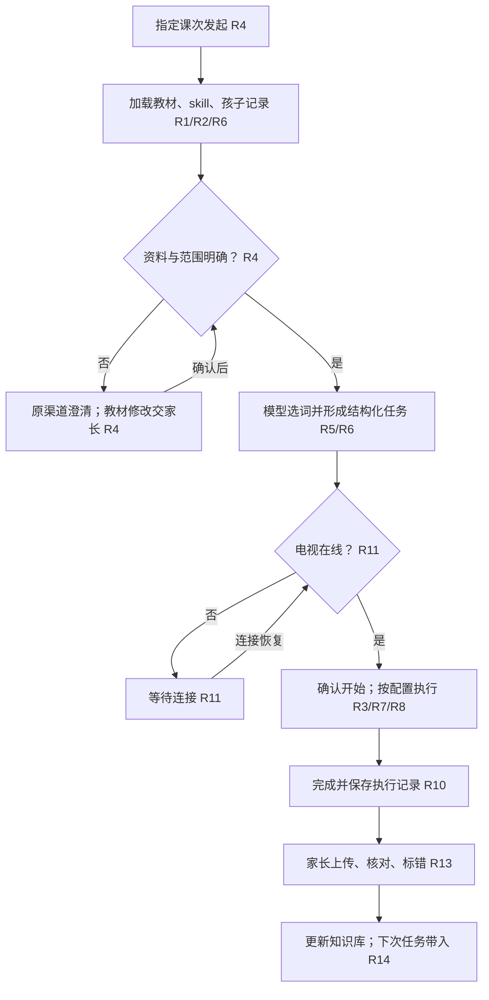
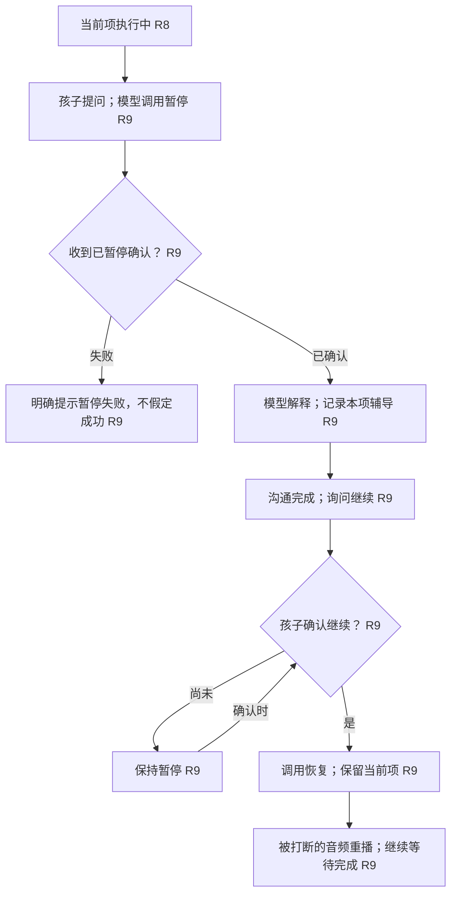
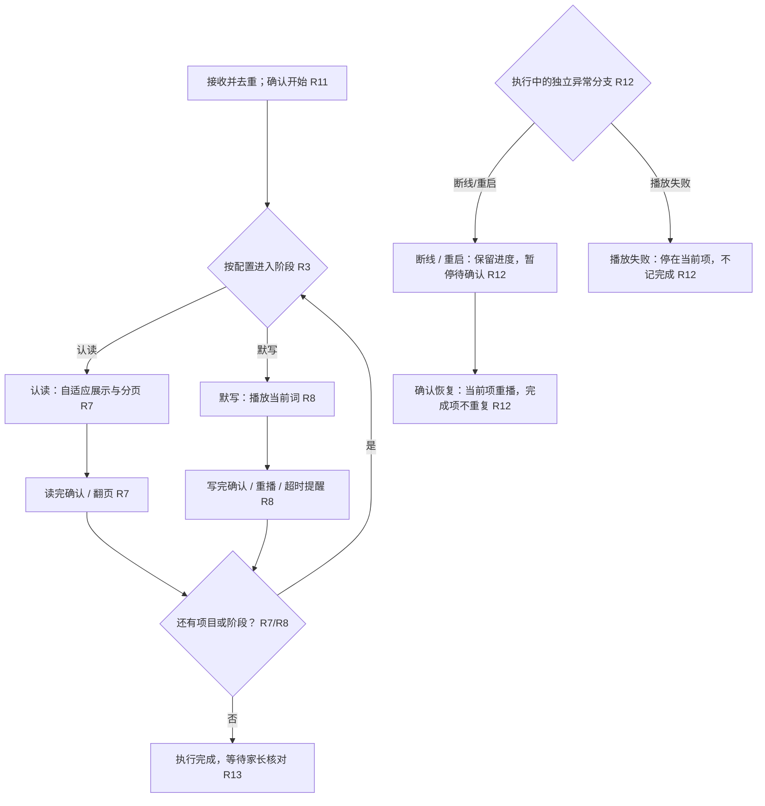
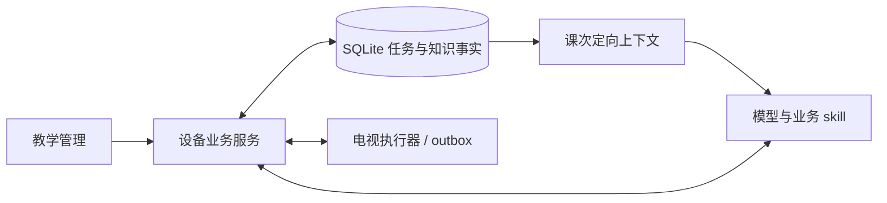
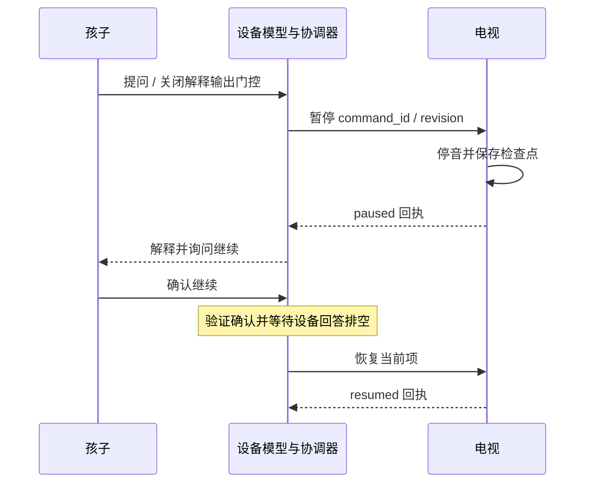
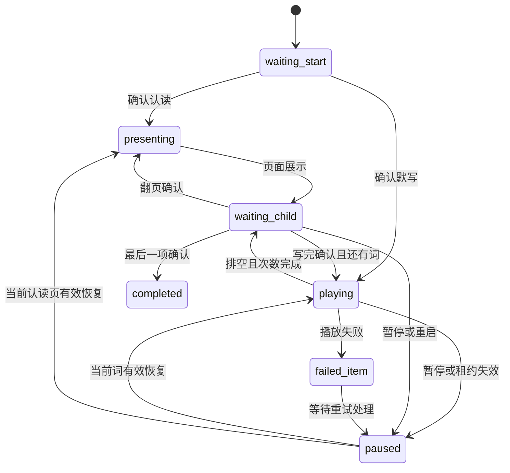
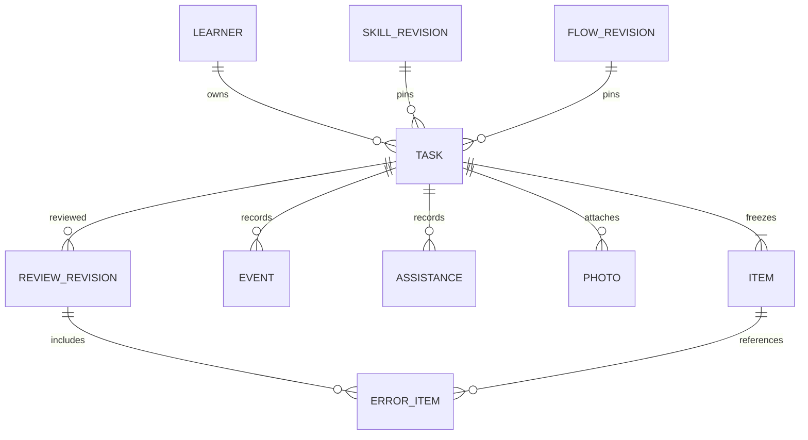
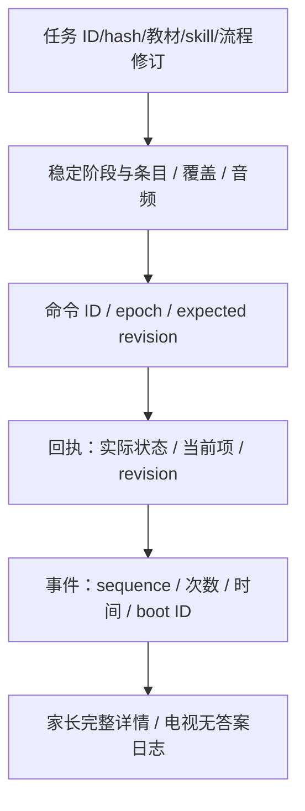
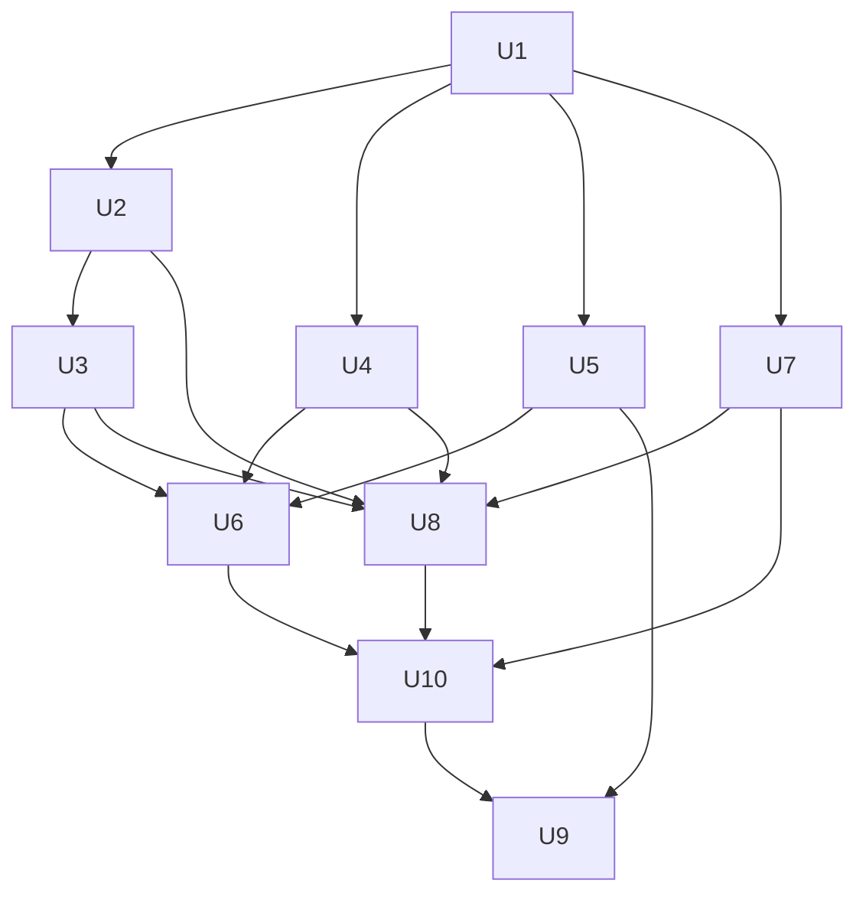

# 语文默写 · 教学管理初版实施规划 - Plan

修订 r6 · 2026-10-21T13:17:01+08:00 · implementation-ready · 新增长流程回归要求，尚未实施

## Goal Capsule

让家长和孩子能够按指定课次完成语文认读与默写，电视可靠执行，家长反馈进入孩子知识库，并在下一次任务中被大模型使用。

产品权威：本聊天中用户 Q1–Q30 的最终回答及明确确认；后续回答覆盖早期建议。已确认需求不被仓库旧计划或旧实现覆盖。
Means：复用设备端业务服务、结构化知识事实与电视执行（KTD3–KTD12）。

权限与收尾：本轮仅规划；后续实施默认本地开发与验证，发布由用户届时指令决定。

停止条件：新证据使既定范围、成员归属或设备能力无法成立时报告阻塞，不猜测修改需求。

## Product Contract

### Summary

覆盖已确认的语文认读与默写初版闭环，复用设备服务、教学管理和电视组件；模型准备、电视执行、家长核对、知识回流。测试覆盖正常体验及暂停、重启、重复事件和核对修订。

### Problem Frame

现有运行路径与结构化电视组件尚未完整接通；旧单字/拼音/计时规则与本轮需求不同。细粒度执行记录及家长错词反馈尚未形成完整闭环。

### Key Decisions

- KD1. **教学判断交给模型与业务 skill。** (session-settled: user-directed — chosen over fixed mastery thresholds and deterministic difficulty tags: 用户要求模型结合记录自行判断。) Governs R2, R5, R6, R14。
- KD2. **纸笔作答、家长照片与错词核对。** (session-settled: user-directed — chosen over first-release OCR or full manual grading: 初版保留结果事实并支持错词。) Governs R13, R14, R15, R16。
- KD3. **电视固定执行、确认后辅导与恢复。** (session-settled: user-approved — chosen over model per-item improvisation and timed advancement: 需要可靠执行及交流。) Governs R3, R7, R8, R9, R10, R11, R12。

### Actors

- A1. 发起者：家长或孩子，指定范围并回答澄清。
- A2. 练习孩子：执行练习并确认翻页、写完或继续。
- A3. 家长：确认资料、管理 skill/流程、上传及核对。
- A4. 设备端模型与服务：读取上下文、准备任务、协调辅导和控制。
- A5. 电视 APP：执行、接受操作、保存进度并报告事实。

### Requirements

以下既有 N1–N6 分组保留 R1–R16 的完整产品行为；技术机制另见 Planning Contract。

以下节点均为当前有效内容；R 节点为已确认需求，N 节点为组织概览，KTD 为事实或待细化项。UI 数字、姓名、课文字词均为示例，不代表真实教材或设备状态。

## N1 · 教学管理与资料基础

所有教学能力都必须在教学管理页面有管理入口。初版聚焦语文认读与默写；学科和辅导类型是后续扩展的组织维度。

UI 小示例：管理首页（示意，非实际运行）

```text
语文｜教材资料　默写任务　学习记录
配置｜默写 skill　流程配置　执行日志
```

### R1 · 教材与学习进度

按孩子保存使用的教材版本、年级、学期和学习进度；教材按课维护课文原文、二会字、四会字、扩词和背诵要求。上传或录入教材，缺失内容向发起者索取或确认，教材补充和修改由家长确认后保存复用。

UI 小示例：教材维护（示意，非实际运行）

```text
孩子：小禾（示例）　语文·上册
第二课｜原文｜二会字｜四会字｜扩词｜背诵要求
资料状态：待家长确认 → 已确认
```

### R2 · 业务 skill 管理

每次与大模型交流并生成默写任务时，携带默写业务 skill。skill 指导模型结合个人学习记录和掌握情况，优先考虑未掌握词、前后鼻音易混字及难写字。skill 可持续编辑、更新并保留版本；任务记录所用版本。此处是产品中的业务 skill，并非本次文档使用的 Codex 工具技能。

UI 小示例：Skill 编辑（示意，非实际运行）

```text
语文默写 skill · v1（示例）
优先参考孩子历史错词；关注前后鼻音与难写字。
[编辑内容]　[保存新版本]
```

### R3 · 流程配置

后台允许启用、排序二会字认读与四会字词语默写阶段，并配置播报次数、间隔和语速。任务保存所用配置版本。等待确认、暂停恢复和异常处理采用系统固定机制；字号、排版、每屏容量及分页由电视 APP 自适应实现，不作为后台配置。

UI 小示例：阶段与播报设置（示意，非实际运行）

```text
① 二会字认读　启用　[下移]
② 四会字词语默写　启用　[上移]
次数 2｜间隔 3 秒｜语速 标准（均为示例值）
```

## N2 · 任务发起与模型准备

输入任务范围即为边界。大模型承担内容组织与教学判断，结构化任务承载执行所需的明确内容。

UI 小示例：发起任务（示意，非实际运行）

```text
孩子：小禾　范围：第二课（示例）
“帮我默写第二课。”
状态：正在准备任务
```

### R4 · 发起者与澄清

家长和孩子都可以发起；例如“默写第二课”就围绕第二课准备，不追问布置原因，也不另行区分老师作业或自主复习。有疑问先通过原发起渠道交流；涉及教材内容补充或修改则交由家长在教学管理中确认，确认前保持待准备。

UI 小示例：原渠道澄清（示意，非实际运行）

```text
发起者：默写第二课。
助手：你使用的是哪一本语文教材？（示例）
教材资料需补充时：等待家长确认
```

### R5 · 默认内容与选词

默写默认包含二会字认读和四会字扩词默写；扩词覆盖任务范围内全部四会字，默认以词语覆盖而不重复默写单字，明确要求单字时增加单字环节。优先使用教材或已维护词库，缺词由模型提出候选并与发起者确认。后台可以查看目标字与词语覆盖关系。

UI 小示例：目标字覆盖（示意，非实际运行）

```text
目标字　覆盖词语（示例）
清　　　清水
晴　　　晴天
四会字覆盖：2 / 2
```

### R6 · 掌握判断与任务快照

生成任务时直接带入孩子相关知识库记录，由大模型按 skill 判断掌握情况及选词，不引入固定掌握阈值或单独的自动评估流程。记录选词理由。下发结构化任务包含孩子、教材课次、认读字、目标字及覆盖词语、阶段顺序、播报配置、音频信息和版本引用；开始执行后保持任务内容稳定。字段形状留待实施规划。

UI 小示例：准备结果（示意，非实际运行）

```text
第二课 · 认读 + 词语默写（示例）
选词依据：本课覆盖／历史错词／易混音关注
skill v1 · 流程 v1　[查看任务详情]
```

## N3 · 电视执行与辅导交流

设备端负责收音和大模型语音回答；电视端负责展示、默写音频播放及固定执行控制。

UI 小示例：电视概览（示意，非实际运行）

```text
第二课 · 默写准备就绪（示例）
认读 6 字 → 默写 8 词
[开始]
```

### R7 · 二会字认读

电视尽量大字展示覆盖二会字的组词（至少二字），保持词内紧凑、词间分隔，适配屏幕及文字数量；一屏容纳不下时分页，使用遥控器左键返回上一屏、右键进入下一屏，确认键不参与认读操作。只记录展示、翻页和完成，不自动评判发音、不把翻页视为已掌握。家长可标记不会认的字。

UI 小示例：电视认读（示意，非实际运行）

```text
清水　晴天　眼睛
请读完这一屏（示例）
第 1 / 2 屏　[读完了 · 下一屏]
```

### R8 · 四会字词语默写

四会字扩词默写使用豆包语音合成2.0，Vivi 2.0（zh_female_vv_uranus_bigtts），音调0、语速-20、音量30，语音指令“朗读 播音 拉长音 着重强调 标准普通话”。KIMI继续负责准备和调度。后台可配置语音参数并保存版本；新准备会话固定参数和音频，旧任务不变。手动播报默认每词只播一次后停住：左键上一词并播放，右键下一词并播放，确认键重播当前词；首词左键重播首词，末词右键结束，不循环。认读确认翻页，暂停确认恢复，提问仍须暂停回执和解释排空后恢复。实际遥控、音频帧数与任务事件保留调试日志；助手演示标记未核对，不写入孩子掌握结论。

UI 小示例：电视默写（示意，非实际运行）

```text
词语默写（答案隐藏）
当前第 1 / 8 项 · 已播报 2 次（示例）
等待写完　[再读一遍]　[写好了]　[暂停]
```

### R9 · 提问、暂停与恢复

孩子可就歧义词等内容与大模型交流，不把读音歧义作为开始前必须消除的门槛。模型通过 function calling 请求暂停，收到电视已暂停的确认后才回答；暂停失败则明确提示，不能假定成功。允许解释词义、组词、例句及具体字词，记录对应项目和辅导内容。沟通结束询问是否继续，孩子确认后调用恢复；保留当前项，被打断的播报重新播放。

UI 小示例：辅导暂停（示意，非实际运行）

```text
电视：已暂停 · 保留第 1 项（示例）
孩子：是哪个 qīng？
助手：是“清水”的“清”。要继续吗？
孩子：继续 → 请求恢复电视
```

### R10 · 电视状态与调试日志

默认展示简洁状态区：任务接收状态、当前阶段、当前项及总数、播报状态与次数、正在等待的操作；详细事件日志可展开。四会字默写时，状态和日志均隐藏当前答案；家长在教学管理查看完整内容。调试信息必须体现实际回执，不以发送命令冒充执行完成。

UI 小示例：调试信息（示意，非实际运行）

```text
任务已接收 · 第 1 / 8 项（示例）
▶ 详细日志
12:00:01 进入词语默写
12:00:05 第 1 项播报完成 · 第 2 次
12:00:06 等待孩子确认
```

## N4 · 异常恢复与运行管理

每种已定义异常有可见状态和恢复路径，执行成功与失败有事实记录。

UI 小示例：任务运行管理（示意，非实际运行）

```text
任务 D-001（示例）
设备：电视客厅｜状态：等待连接
当前项：1 / 8　[查看事件]
```

### R11 · 离线与重复投递

电视离线时可准备任务，状态显示等待电视连接；上线后提示确认开始，不突然播报。同一任务重复投递不能重复启动。

UI 小示例：电视连接（示意，非实际运行）

```text
电视未连接（示例）
任务已准备 · 等待连接
连接恢复 → [确认开始]
```

### R12 · 断线、重启与播放失败

保存任务及执行进度。断线或 APP 重启后恢复为暂停，孩子确认后继续；中断发生在播报或等待书写时，从当前项重新播报，已完成项不重复，重播留记录。执行时播放失败停在当前项，不能跳过或记为完成。音频生成失败的准备重试细节属于后续技术细化，未约定必须因读音歧义阻塞任务。

UI 小示例：恢复提示（示意，非实际运行）

```text
进度已保留（示例）
第 3 / 8 项 · 等待确认
[继续本项]　[结束本次]
播放失败：停留本项，显示原因
```

## N5 · 结果核对与知识库反馈

纸笔作答，家长事后上传和核对；事实进入孩子知识库，在下次任务准备时提供给模型。

UI 小示例：结果管理（示意，非实际运行）

```text
第二课 · 执行已完成（示例）
结果：待上传　核对：未核对
[上传照片]　[核对词表]
```

### R13 · 照片与错词核对

支持一张或多张结果照片关联孩子及本次任务，可补传、替换、备注。家长从本次词表勾选错误词，可选标记具体错字并备注；认读字可标记不会认。区分未核对、已核对有错、已核对全对，空错词清单不能自动视为全对。OCR 和完整人工逐项判分后续考虑，错词勾选在初版内。

UI 小示例：家长核对（示意，非实际运行）

```text
照片：第 1 页、第 2 页（示例）
☑ 清水　错字：清　备注：写成“晴”
☐ 晴天
核对状态：[有错] / [全对]　[提交]
```

### R14 · 学习事实与下次上下文

结构化保存学习进度、教材、任务历史、错误词及可选错字、核对状态、认读困难、辅导和执行记录。家长提交后更新知识库，下次生成任务直接带入相关记录；不在提交后另起自动掌握评估流程。未核对不能作为答对证据，练习完成不能等同掌握。

UI 小示例：孩子学习记录（示意，非实际运行）

```text
小禾 · 第二课（示例）
历史错词：清水　认读困难：睛
最近核对：有错　辅导：解释“清”
下次任务准备：提供相关记录
```

### R15 · 正确率与速度的事实边界

长期需要持续反馈正确率、速度和掌握情况。初版保存执行时间、播报及重播次数、暂停辅导和核对事实，为后续提供依据；未完成可靠核对时不展示推算正确率。单项等待耗时不等于纯书写速度，涉及播报或辅导的时间需要可区分。具体统计口径后续定义，不宣称初版具备自动精确测量。

UI 小示例：记录指标（示意，非实际运行）

```text
已练习：1 次　重播：2 次（示例）
核对：未核对 → 正确率：未评估
单项耗时：执行记录，不等同纯书写速度
```

## N6 · 范围、验收与实施依据

本轮产物是已确认需求基线和 UI 示意，不是已实施功能或完成验收的证明。

### R16 · 初版与后续范围

初版包含二会字认读、四会字词语默写、执行中辅导、配套管理与结果闭环。教材保存背诵要求，但背诵执行另行规划；执行途中增词、换词后续实现；OCR、完整人工录入判分及自动精确评分不在初版。

### KTD1 · 已有实现仅供复用核对

仓库已有教学管理入口、教材内容管理、结构化默写准备及电视本地执行组件，也存在旧模型逐项调度路径。实施时逐项核对与本基线的差异，不同时继承冲突旧规则；本轮只读调查不能证明当前设备部署或验收通过。关键参考：device/lira/dictation_preparation.py、dictation_task_contract.py、dictation_repository.py、tv-receiver/src/DictationEngine.java、Screen.java、device/lira/ui/static/teaching-hub.js。

### KTD2 · 后续技术细化

技术细化已落实到本轮 Planning Contract 的 KTD3–KTD12、U1–U9 与验证合同。最终方法名、SQL 和真机参数按对应单元处理，不改变已确认产品行为。

## 流程图

### F1 · 完整任务闭环



### F2 · 暂停交流与恢复



### F3 · 电视执行与异常



## 用户可验收场景

- **AE1**（覆盖 R1、R2、R3、R4、R6）：发起“默写第二课”，能按该孩子教材和知识库准备任务，并记录 skill 与配置版本；资料有疑问时回原渠道澄清。
- **AE2**（覆盖 R5）：默认词语覆盖本课全部四会字；可在管理页面核对覆盖关系，不自行扩展到其他课次。
- **AE3**（覆盖 R7）：二会字在电视上尽量大字展示，可分页、确认翻页，不出现后台字号或每屏数量配置要求。
- **AE4**（覆盖 R8）：播报结束仍等待孩子确认；超时不跳项，重播次数可见，播报完成不等于作答完成。
- **AE5**（覆盖 R9）：孩子询问歧义时，先有电视暂停确认，再有模型解释；孩子确认继续后恢复当前项，保留辅导记录。
- **AE6**（覆盖 R10）：电视能查看事件与当前动作，但四会字默写状态和日志不泄露答案；管理端可查看完整内容。
- **AE7**（覆盖 R11、R12）：同一任务重复投递不重复运行；电视离线后上线不突发播放；重启后能确认恢复当前项；播放失败不跳项。
- **AE8**（覆盖 R13、R14）：家长上传多张照片、勾选错词及错字并提交；相关记录更新到该孩子知识库，下次任务可用；未核对与全对不混淆。
- **AE9**（覆盖 R15、R16）：初版不把完成、上传或耗时当作掌握或精确速度；背诵执行、OCR 和中途换词保持后续范围。

---

## N7 · 技术设计与协议

本轮新增：KTD3–KTD12，协议、数据、工具回执、恢复与迁移。

## N8 · 开发单元与依赖

U1–U10：开发依赖、文件、测试场景和完成证据；r3 新增单次真实模型/H5 回归。

## N9 · 验证与完成条件

本轮新增：验证、风险、发布边界及完成条件。

## Planning Contract

Product Contract preservation：R1–R16、F1–F3、AE1–AE9 unchanged。技术设计细化既定需求，不扩大产品范围。KTD1 保留现有事实；KTD2 的待细化项由下列设计和开发单元落实。

### Assumptions

继续使用现有设备端 SQLite、家长会话和已配对的局域网电视。知识库初版采用结构化事实查询，不引入向量数据库、通用工作流平台或新的模型供应商。精确方法名、最终 SQL、附件容量及网络参数的真机调优留给实施；产品行为不留给实施者临场决定。

### KTD3. 唯一业务服务与新旧路径隔离

设备端新增默写业务服务，管理 API 与模型工具操作同一持久任务。模型按 R2、R5、R6 判断掌握情况和选词，代码只验证权限、来源、范围、字段及覆盖，不能继续用 `choose_words` 按频次重排模型最终词表。

`device/lira/conversation_paths.py` 和 `device/lira/audio/doubao_realtime.py` 都接入新服务。新任务会话不同时加载旧 `DICTATION_INSTRUCTIONS` 和逐项调度工具，电视音频/画面只由当前任务占有。按 R16，新准备路径不默认加入背诵，不沿用“默写时间到”提示。普通阅读、家电、聊天不做旁支重构。

依据：现有 Python 准备器、配置和账本正常运行入口尚未接通；Java 有执行器不等于完整链路已实现。

### KTD4. v2 任务、阶段和兼容协议

新增 `dictation_task_v2` 能力和独立严格解析，保留 v1 fixture 及旧记录读取。新字段不能塞入 v1；电视不支持 v2 时明确要求升级，不能降级成旧拼音或计时流程。

执行快照包含 task_id、schema、内容哈希、教材课次/修订、skill 与流程修订、按配置排序的阶段、稳定 phase_id/item_id、认读目标字、四会目标字与扩词覆盖、音频资源、次数/间隔/语速。发起渠道、成员授权、选词理由及知识依据在设备端保存，电视只接收执行必需信息。认读直接使用二会汉字集合，单字要求可用同一默写条目类型承载。

同 task_id 同哈希幂等，异哈希拒绝。资源生成、校验和传输就绪后才可启动，失败保持可见待重试；这不要求预审读音歧义。阶段可启用/排序但不能全禁用、重复或加入初版外类型；无内容阶段显式略过。依据 R3、R5–R7、R11、R16。

### KTD5. skill、配置与课次定向知识上下文

沿用 SQLite 连接与增量迁移，新增不可变 skill 修订、流程修订、孩子教材绑定/学习进度及准备上下文引用。教材仍复用现有服务。新准备会话加载当前版本，同一准备会话和执行中辅导沿用所绑定 skill；更新不改变已开始任务。

查询限定练习孩子、教材、课次/目标字词，带最新有效核对、错词错字、认读困难、练习和辅导事实及修订引用。按目标字词组织事实摘要，不能让“全局最近 100 条”丢掉相关错词；完整依据可定向分页读取。摘要只统计事实，不形成固定掌握等级，原图不默认发给模型。依据 R1、R2、R6、R14。

### KTD6. 状态、命令与持久事件

设备准备状态为 preparing、needs_input、waiting_parent、ready、waiting_tv；电视接收后为 waiting_start，确认后进入 presenting/playing/waiting_child。运行还包含 paused、failed_item 和 completed/cancelled。结果上传、核对是独立状态维度。

控制命令关联 command_id、task_id/hash、run_epoch、expected_state_revision、phase_id/item_id。重复命令返回同一结果，旧 revision 或同 ID 异内容拒绝。遥控器和语音确认进入同一串行转换；当前项确认只消费一次。音频 generation 屏障丢弃暂停、重播、结束后的迟到回调。

v2 事件包含 event_id、sequence、state_revision、命令关联、task/phase/item、动作、实际次数、boot/session 标识及时间。区分任务接收、页面展示、单次播报开始/排空完成、等待、确认、暂停/恢复、失败和结束。电视 durable outbox 补传，设备 inbox 事务提交后才 ACK，连续 sequence 投影，缺口重拉；同序异内容拒绝。owner/run epoch 与删除墓碑阻止旧事件复活。依据 R8–R12。

### KTD7. function calling 与辅导语音门控

复用 CapabilityRegistry 的参数校验与 deferred 执行，提供定向上下文读取、准备/提交、下发、状态和控制能力。暂停工具等待电视播放器停止、检查点落盘且任务/revision 匹配后才返回 paused；超时为 unknown/failed，保留 command_id 查询，不能把 accepted 当暂停。

设备收到默写中问题后，先阻止该轮解释音频播放，等待模型调用暂停及真实回执。模型未调用、普通 `pause_agent_task` 成功、旧回执或暂停失败均不能解锁。确认后才播放解释，按当前 item_id 写辅导事实。

恢复需暂停后真实孩子轮次或遥控器确认，由协调器绑定 task/item/pause revision 并一次消费，不能信任模型自填布尔值。设备回答实际排空后才恢复电视。身份、任务、revision 或重连变化使旧确认失效。依据 R9；不新增教学判断规则。

### KTD8. 电视执行、断线与音频证据

复用 DictationEngine、DictationStateStore、TaskAssetStore、TaskAudioPlayer 与 WordPageLayout/View。接收任务先落盘且等待开始；重启暂停，认读保留字游标，默写保留当前项。按 R12 恢复。

设备与电视以 run 绑定心跳租约判断失联，租约到期停音、保存暂停状态；不能以某次 HTTP 关闭代表断线。初始工程默认心跳 2 秒、租约 6 秒、控制超时 5 秒，作为可注入传输参数测试，真机调优不改变教学行为；上线不自动续播。

每次播报独立通过 PCM 播放帧排空与有效 generation 认定，再增加次数，按间隔调度下一次。不能用一次多次播放的总完成回调冒充逐次进度。暂停清理在途队列，失焦/后台/静音失败停本项；物理声学顺序需真机验证。[AudioTrack 文档](https://developer.android.com/reference/android/media/AudioTrack) 是暂停清队列的 API 依据。

自适应分页按实际可用区计算，扣除状态/日志区域；屏幕重建按稳定字游标重排，不能把旧页码当新页面完成。字号和每屏量不进入后台配置。依据 R7、R8、R10–R12。

### KTD9. 家长核对、照片与知识一致性

新增任务级结果修订：unreviewed、reviewed_with_errors、reviewed_all_correct。错词引用冻结 item_id，具体错字属于该词，认读困难引用二会字。空清单不自动全对，有错状态至少一个错误条目；照片与核对可分别提交。

结果与知识事实投影在同一 SQLite 事务提交，用请求幂等键和 expected_revision。修改核对保留修订历史，只读最新有效事实，不能重复累计或沿用撤销结果。附件在设备受管理目录，记录随机附件 ID、成员/任务归属、类型、大小和哈希，不用客户端文件名作路径。

附件采用临时文件→持久文件→元数据提交，失败可重试，定期回收无引用文件；替换先写新附件再切换引用。沿用家长会话、成员权限、同源与隐私约束。遗忘孩子同时撤销任务并清理结果、附件、辅导和上下文缓存。依据 R13、R14。

### KTD10. 管理、身份与无答案日志

扩展现有家长守卫和 mutation lock，提供教材/孩子进度、skill/流程修订、任务/事件、照片/核对和学习记录 API。读写使用共同服务，保存冲突显式反馈。发起家长与练习孩子分别绑定；语音从可信身份或已确认目标取得 learner_id，模型不能任填成员 ID，目标不明时澄清。

模型能读相关教材、事实并提出候选，但不能冒充家长最终确认教材或提交核对。网页和工具共享持久任务，不另建模型私有结果库。

电视日志只允许状态、阶段、项号、次数、动作和错误码，排除答案、完整模型上下文及可能夹带答案的异常文本；家长授权详情保留完整内容。电视日志容量有界，完整事件以设备账本为准。前端采用 createElement/textContent 展示 skill、教材、理由、备注和日志。依据 R1、R4、R10、R13。

### KTD11. 迁移与切换

采用新增表和显式 schema 迁移，旧列按兼容需要补充，不依赖目标 SQLite 未确认的新特性。由连接所有者管理事务，嵌套使用保存点，避免构造器提前提交外层事务。网络/音频/文件传输不得占用长写事务。依据 [SQLite 事务](https://www.sqlite.org/lang_transaction.html) 和 [ALTER TABLE 文档](https://www.sqlite.org/lang_altertable.html)。

扩展 verify_teaching_migrations 的只读源库→备份副本验证，检查重复迁移、失败回滚、旧表不变与完整性。历史完成不回填全对/掌握。v1 快照保留只读，不按 v2 原地解释；未完旧任务切换时暂停，明确结束或重建，不悄悄续跑。

发布顺序：兼容读协议的设备端→v2 电视→启用新任务入口。回退先停新任务、关闭新增入口，保留新记录及备份；旧程序不得误读新活动快照。本轮不部署。

### KTD12. 统计与范围边界

按 R15 保存播报、等待孩子、暂停辅导、重播和确认事实；同一 boot/session 用单调时间分段计时，跨重启不拼成负值。初版不算纯书写速度，不以错词数/总词数冒充可靠正确率。

按 R16，OCR、完整逐项判分、背诵执行和途中改题后续规划；不增加固定掌握阈值、独立评估任务或课外追加复习策略。

### KTD13. 单次真实模型与 H5 电视回归架构

新增仅开发/测试使用的本地 H5 电视模拟器及协议桥，复用 v2 任务、命令、事件、配对身份和序号合同。浏览器展示认读、默写状态/日志和遥控器控件，执行 wait/start、播放、确认、暂停、恢复和持久检查点；桥接服务只模拟电视边界，不模拟模型、生产工具处理器、知识查询或核对结果。H5 不随电视 APK 或生产页面部署。

回归运行器调用已配置的真实大模型，通过正式默写工具入口发起指定测试课次，不直接调用 prepare/start 绕过模型。使用隔离 SQLite、合成孩子和合成教材；技能、流程、业务服务、资源准备、任务投递及结果核对走实际接口。现有 evaluate_teaching_agent 的工具结果 fixture 可复用采集方式，不能作为本案例的控制结果来源。

“最长流程”定义为 TC1 中覆盖所有初版阶段及可恢复交互的单次有限长路径，不穷举全部排列，不无限加轮次。浏览器自动操作模拟孩子/家长，按实际状态及关联回执推进，不用盲等后发送下一句话。脚本可以选择预定的测试问题，不能伪造模型工具调用或 paused/completed 事件。

启动会创建唯一 regression_run_id，只允许一个业务 task_id。准备澄清与同命令网络重试仍属于本次运行；不允许失败后自动重开模型会话、重发初始默写指令、创建替代任务或重跑整个案例。运行成功/失败/超时都写报告、停止输入并关闭会话及浏览器；同运行 ID 再启动应拒绝。初始工程上限为 15 分钟、60 个用户轮次、单个可恢复故障最多注入一次；到上限判失败，不以重新开始掩盖失败。

必须有真实模型调用标识和实际工具轨迹。缺凭据、接口不可用、模型不按合同调工具或断线恢复失败均明确失败/不可执行，不切换到模型 stub，也不因达到时间上限宣称完成。凭据仅从既有配置读取，不写入报告。

H5 的音频就绪/结束由浏览器实际播放状态驱动，阻止自动播放时明确等待测试解锁或失败，不能用 setTimeout 伪造播报完成。H5 回执标注 simulated_tv；可验证协议、交互顺序和软件状态，不能证明 Android AudioTrack、物理扬声器、麦克风识别、音频焦点或实体遥控器通过。实体层验收仍按 U9 保留。

### High-Level Technical Design

#### T1. 组件与数据流

KTD3、KTD5、KTD6、KTD9：管理与模型工具经同一设备服务读写；任务发往电视，事件返回账本，家长核对进入下次上下文。



#### T2. 暂停与恢复时序

KTD7：辅导门控先关闭输出；真实暂停确认后回答；孩子确认且回答排空后恢复。



#### T3. 运行状态与生命周期

KTD6、KTD8：waiting_start 需确认，播放完成进入等待；暂停/失败保留当前项，结果核对独立于运行状态。



#### T4. 结果与知识数据关系

KTD5、KTD9：任务冻结条目和版本，事件、辅导、照片独立关联；核对有修订，最新有效事实用于下次准备。



#### T5. 任务、命令与事件合同

KTD4、KTD6、KTD10：任务不可变，命令校验当前 revision，回执报告实际状态，事件分别投影到管理详情和无答案电视日志。



#### T6. 开发依赖

U1 定合同；配置、传输、电视、结果按接口展开；U6/U8 汇合至 U10 单次真实模型/H5 回归，再由 U9 验证整链。



---
## Implementation Units

U 编号固定，依赖以每单元字段为准。所有下列路径均相对于仓库；标注“新增”的文件尚未创建。各 U 单元必须落实所引用 KTD，不能重定义其产品规则。

### U1. v2 合同、事件模型与兼容边界

**Goal:** 固定跨 Python/Java 的任务、事件与命令合同。

**Requirements:** R3、R5、R6、R10–R12、R16；F1、F3；KTD4、KTD6、KTD11。

**Dependencies:** 无。

**Files:** `device/lira/dictation_task_contract.py`、`device/lira/dictation_repository.py`；`tv-receiver/src/DictationSpec.java`；测试 `device/tests/test_dictation_task_contract.py`、`device/tests/test_dictation_repository.py`、`tv-receiver/tests/DictationSpecTest.java`；新增共用 `tv-receiver/tests/fixtures/dictation-v2.json`。

**Approach:**

1. 先固定 v2 共用 fixture 与拒绝样例，再扩展双方严格校验，保留 v1 原义。
2. 增加稳定阶段/条目、资源/版本引用、waiting_start、细粒度事件及实际状态回执。
3. 设备账本按 KTD6 接收事件，明确旧快照/新快照的版本分支。

**Patterns to follow:** canonical_json/content_hash、严格字段解析和现有 inbox。

**Test scenarios:**

- Covers AE2. 缺任一四会字覆盖被拒绝；满足覆盖的模型词表及顺序不变。
- 同 ID 同哈希幂等，异哈希拒绝；v1 拒绝 v2 字段，未知能力不启动。
- 乱序先存等缺口，重复不多记完成；错设备/epoch、同序异内容及终态迟到事件不推进。
- 空/重复/全禁用/初版外阶段及资源缺失得到可定位错误。

**Verification:** Python 与 Java 使用同 fixture 判断一致，旧合同可读，新任务无法接受 R16 外阶段。

### U2. 教材绑定、业务 skill 与流程版本服务

**Goal:** 持久管理孩子教材进度、skill 和流程配置。

**Requirements:** R1–R3；AE1；KTD5、KTD10、KTD11。

**Dependencies:** U1。

**Files:** `device/lira/dictation_settings.py`、`device/lira/teaching_content.py`、`device/lira/ui/teaching.py`、`device/pyproject.toml`；新增 `device/lira/teaching_skills.py`、`device/lira/teaching_profile.py`、`device/lira/llm/chinese_dictation_skill.md` 种子；新增测试 `device/tests/test_teaching_skills.py`、`device/tests/test_dictation_settings.py`、`device/tests/test_teaching_profile.py`。

**Approach:**

1. 保存不可变修订与当前引用，已编辑 skill 不被安装种子覆盖。
2. 复用教材确认服务，补孩子教材绑定/进度和家长管理写入。
3. 新配置仅阶段启用/排序、次数/间隔/语速；旧计时参数仅历史可读。

**Patterns to follow:** DictationSettings expected_revision 和教材确认接口。

**Test scenarios:**

- Covers AE1. 新 skill 生效于新准备会话，既有快照仍用旧版。
- 并发以同 revision 保存，一方冲突；重复初始化不覆盖家长编辑。
- 模型候选不能直接确认教材，孩子 A 的资料不影响 B。
- 顺序可交换；后台字号、每屏量、自动跳项和背诵配置被拒绝。

**Verification:** 家长可真实保存、重读并追溯资料/配置版本，任务可引用持久版本。

### U3. 模型准备与课次定向知识上下文

**Goal:** 从实际运行入口生成符合 skill 与知识事实的任务。

**Requirements:** R2、R4–R6、R14、R16；F1；AE1、AE2；KTD3–KTD5、KTD10。

**Dependencies:** U1、U2。

**Files:** `device/lira/dictation_preparation.py`、`device/lira/teaching_memory.py`、`device/lira/conversation_paths.py`、`device/lira/audio/doubao_realtime.py`、`device/lira/dictation.py`；新增 `device/lira/dictation_context.py`、`device/lira/dictation_service.py`；测试 `device/tests/test_dictation_preparation.py`、新增 `device/tests/test_dictation_context.py`。

**Approach:**

1. 区分发起者与练习孩子，读取相关知识事实及版本，支持按课次/词语补读。
2. 接受模型最终选词与理由，准备器只做 KTD4 校验，覆盖不足回待补状态，不按旧算法重选。
3. 两条语音入口统一装配 skill/工具并隔离旧提示；认读取二会汉字，排除默认背诵。
4. 澄清留在原渠道，教材修改入家长待确认，准备重连复用持久会话。

**Patterns to follow:** CapabilityRegistry、现有 scope/source 冻结和 TeachingMemory 身份边界。

**Test scenarios:**

- Covers AE1. 家长为 A 发起第二课，只装配 A 的对应教材事实，不加载家长或 B 的历史。
- Covers AE2. 模型将错词排前且覆盖完整时，最终任务保留该顺序。
- 较早错词不因最近 100 条限制丢失；核对更新下次可见，未核对不当答对。
- 范围不明、资料未确认或覆盖不足时可澄清，不生成假 ready。
- 两条运行入口均不注入固定三遍/二会拼音/默认背诵，不产生独立评估任务。

**Verification:** 任务生成从真实工具注册入口可达，并留下快照与选词依据。

### U4. 投递、资源、事件回传与运行租约

**Goal:** 接通设备与电视之间可恢复的任务/事件链路。

**Requirements:** R10–R12；F1、F3；AE6、AE7；KTD4、KTD6、KTD8。

**Dependencies:** U1。

**Files:** `device/lira/dictation_service.py`（U3 新建，共享接口）、`device/lira/dictation_assets.py`、`device/lira/dictation_repository.py`、`tv-receiver/src/ReceiverService.java`；新增 `device/lira/dictation_transport.py`；测试 `device/tests/test_dictation_assets.py`、新增 `device/tests/test_dictation_transport.py` 和 `tv-receiver/tests/DictationTransportTest.java`。

**Approach:**

1. 复用配对和 PCM 缓存传输，补 waiting_tv、可恢复投递及实际接收状态。
2. 补电视事件获取/提交后 ACK、设备消费者与缺口重拉；控制返回任务/revision/当前项。
3. 增加运行租约失效暂停，重试保持同一命令/任务身份。

**Patterns to follow:** 配对资源上传、ReceiverService 路由和 repository inbox。

**Test scenarios:**

- Covers AE7. 离线可准备，上线仅等待开始；重投不多开运行。
- ACK 丢失、设备写库后崩溃、电视重启可补传，账本只记一次。
- 资源失败不标可启动，重试不换哈希或遗漏资源。
- 错配对、旧 revision 和租约超时不推进，恢复连接不自动播放。

**Verification:** 真实服务接口可收发并恢复持久任务，而非仅 fixture 内部通过。

### U5. 电视确认推进、认读分页与调试信息

**Goal:** 电视独立执行冻结任务并可观察每一步。

**Requirements:** R3、R7、R8、R10–R12；F3；AE3、AE4、AE6、AE7；KTD6、KTD8、KTD10。

**Dependencies:** U1。

**Files:** `tv-receiver/src/DictationEngine.java`、`tv-receiver/src/DictationStateStore.java`、`tv-receiver/src/TaskAudioPlayer.java`、`tv-receiver/src/Screen.java`、`tv-receiver/src/WordPageLayout.java`、`tv-receiver/src/WordPageView.java`；测试 `tv-receiver/tests/DictationEngineTest.java`、`tv-receiver/tests/DictationPoliciesTest.java`、`tv-receiver/tests/DictationCompletionTest.java`、`tv-receiver/tests/TaskAudioPlayerTest.java`、`tv-receiver/tests/WordPageLayoutTest.java`。

**Approach:**

1. 按阶段配置运行，加入等待开始；改认读语义，v2 关闭计时跳项和 skip。
2. 单次播放排空后记次数，再进入等待孩子；遥控器与远程确认共用 revision 转换。
3. 扩展状态、有界无答案日志、遥控器焦点和自适应页面。
4. 保留游标/代际/检查点，处理后台、失焦、租约和播放失败。

**Patterns to follow:** 已有 state machine、generation fencing、PcmDrainProof 和页面测量。

**Test scenarios:**

- Covers AE3. 多字/不同屏幕/展开日志/重建后大字分页不漏字，遥控器能走完流程。
- Covers AE4. 播完仍停当前项，超时只提醒；重复写完或双击不能跳两项。
- Covers AE6. 正常及错误日志不含答案，异常原文也不能泄露。
- Covers AE7. 播报或等待时杀进程，恢复暂停；确认只重播当前项，完成项不重复。
- 暂停 ACK 后旧音频回调不推进；播放失败或无有效排空证据不记成功。

**Verification:** 推进都有孩子确认，播报次数有实际回调证据，布局无后台像素参数依赖。

### U6. 暂停回执后的辅导与有效确认恢复

**Goal:** 模型交流与电视执行有可证明的先后顺序。

**Requirements:** R9；F2；AE5；KTD3、KTD6–KTD8、KTD10。

**Dependencies:** U3、U4、U5。

**Files:** `device/lira/dictation_service.py`、`device/lira/conversation_paths.py`、`device/lira/audio/doubao_realtime.py`、`device/lira/realtime_audio_output.py`、`device/lira/realtime_speech.py`、`device/lira/realtime_capabilities.py`；新增 `device/lira/dictation_tools.py`；测试 `device/tests/test_realtime_capabilities.py`、新增 `device/tests/test_dictation_dialogue.py`、`device/tests/agent_scenarios/dictation_v2.json`。

**Approach:**

1. 按 KTD7 注册 deferred 任务控制，协调当前项和真实回执。
2. 两条语音输出路径实现门控与回答排空后恢复，记录本项辅导和轮次。
3. 绑定并消费真实确认，退出时取消在途操作并忽略迟到结果，避免 self-gather。

**Patterns to follow:** response barrier、CapabilityExecutor deferred 和 ownership 清理。

**Test scenarios:**

- Covers F2 / AE5. 暂停回执延迟时不先解释，确认后才回答并记当前项。
- 模型未暂停、只 pause_agent_task、旧 ACK 或超时，均不解锁辅导。
- 模型伪造确认、旧确认、身份切换、任务结束后的恢复被拒绝。
- 孩子确认继续且设备回答排空后才恢复，被打断音频重播，两端不叠音。
- 关闭后 TV send 或音频回调晚到不推进；重复恢复不多播、不跳项。

**Verification:** 以工具/播放/事件顺序证明结果，模型口头称成功不作证据。

### U7. 照片、错词核对与下次知识事实

**Goal:** 家长结果成为下次任务可查询的结构化事实。

**Requirements:** R13–R15；F1；AE8、AE9；KTD5、KTD9–KTD12。

**Dependencies:** U1。

**Files:** `device/lira/teaching_memory.py`、`device/lira/ui/teaching.py`、`device/lira/dictation_context.py`（U3 新建，共享接口）；新增 `device/lira/dictation_results.py`；测试 `device/tests/test_teaching_memory.py`、`device/tests/test_dictation_context.py`、新增 `device/tests/test_dictation_results.py`。

**Approach:**

1. 实现结果修订、错误条目、认读困难和附件服务，共用任务/成员归属。
2. 核对与知识事实同事务，只采用最新有效修订，不启动评分或掌握评估。
3. 实现附件读取/替换/失败清理与成员遗忘联动，保留分段时间事实。

**Patterns to follow:** parent_review 幂等、expected_revision 和 revoke_owner。

**Test scenarios:**

- Covers AE8. 多照片补传/替换、备注和错词错字保存后可重读，下次上下文含新修订。
- 空清单不自动全对，有错但无错误条目或错字不属该词时拒绝。
- 请求重试不重复计错，并发冲突可见；改成全对后不再把旧修订当最新错误。
- 写盘/DB 提交失败可重试；A 不能读 B 照片，成员删除后晚写入不能复活。
- Covers AE9. 完成或上传不变掌握/全对，不生成正确率和纯书写速度。

**Verification:** 结果按任务追溯，并在下次模型上下文读取；附件与核对状态独立。

### U8. 教学管理全部入口与操作页面

**Goal:** 初版能力均有可访问、可读写的管理页面。

**Requirements:** R1–R6、R10、R13–R15；AE1、AE2、AE6、AE8；KTD5、KTD10。

**Dependencies:** U2、U3、U4、U7。

**Files:** `device/lira/ui/templates/teaching_hub.html`、`device/lira/ui/static/teaching-hub.js`、`device/lira/ui/static/teaching-hub.css`、`device/lira/ui/teaching.py`、`device/lira/ui/app.py`；新增 `device/lira/ui/templates/dictation.html`、`device/lira/ui/static/dictation.js`、`device/lira/ui/static/dictation.css`；测试 `device/tests/test_teaching_routes.py`、新增 `device/tests/browser/test_dictation_management_ui.py`。

**Approach:**

1. 语文入口连通教材/进度、skill、流程、任务准备/列表/详情/日志、结果核对与学习记录，教材复用旧页面。
2. 真实保存并反馈修订冲突，区分运行、上传、核对状态，展示目标字覆盖与选词理由。
3. 小样仅指导交互意图；支持手机和键盘，按 KTD10 使用文本渲染。

**Patterns to follow:** teaching hub、textbooks 页面和独立 browser 测试层。

**Test scenarios:**

- Covers AE1 / AE2. 选孩子/课次准备任务，可查覆盖和所用版本/理由。
- Covers AE6. 家长授权详情有全文，电视 DTO 仍隐藏答案，不能混用。
- Covers AE8. 手机上传和核对，刷新后知识记录一致，冲突时保留输入。
- 无家长会话、跨来源写被拒绝；skill/备注里的 HTML 字符按文本显示。
- 键盘可配置/核对/查日志，没有“有卡片、无管理页面”的初版功能。

**Verification:** 每个入口可实际读写，显示状态可与服务账本核对。

### U10. 真实模型驱动的单次 H5 长流程回归

**Goal:** 在本地可自动完成并审计 TC1，明确执行一次后停止。

**Requirements:** R2–R14；F1–F3；AE1–AE8；KTD4、KTD6–KTD10、KTD13、TC1。

**Dependencies:** U2、U3、U4、U5、U6、U7、U8；不依赖 U9，U9 汇合本单元结果。

**Files:** 新增 `device/scripts/run_dictation_h5_regression.py`、`device/tests/h5_tv/server.py`、`device/tests/h5_tv/index.html`、`device/tests/h5_tv/tv-simulator.js`、`device/tests/fixtures/dictation-long-flow.json`、`device/tests/test_dictation_regression_runner.py`、`device/tests/browser/test_dictation_h5_long_flow.py`；复用 `device/scripts/evaluate_teaching_agent.py` 的采集模式，文档更新 `tv-receiver/VERIFICATION.md`。真实模型长流程是显式集成门禁，不加入普通离线单测默认执行。

**Approach:**

1. 先按共享 v2 fixture 检查 H5 任务/命令/事件合同与 Android 一致；H5 只实现被替代的终端边界，不新增生产实现或模型 fixture。
2. 运行器调用正式真实模型路径，组织状态驱动的固定孩子/家长输入以及有界故障注入，完整执行 TC1。
3. 记录唯一运行/任务身份、阶段检查点和证据，在任一终态关闭资源；关闭整场重试、自动循环和失败后新任务兜底。
4. 给本地模拟页面保留明显标识和每阶段状态，测试启动仅绑定回环地址；不访问家庭电视、不写真实孩子资料。

**Patterns to follow:** v2 共用 fixture、既有 browser 独立进程、真实模型 trace 采集、KTD6 事件幂等和 KTD7 语音门控；不能复用 fixture 工具成功结果替代正式服务。

**Test scenarios:**

- Covers F1–F3 / AE1–AE8. 真实模型 + 本地 H5 走完 TC1，所有阶段有真实服务/模拟终端证据，skill/孩子事实和核对回流可追溯。
- 同 run 重启、重复点击运行、模型再次 prepare/start 或重复 completed 均被识别，不能生成第二场任务来让报告通过。
- 模型先答后暂停、暂停 ACK 超时、旧确认恢复、重复确认、晚回调或断线重载丢进度导致明确失败并停止。
- 缺凭据、模型服务错误、浏览器播放被阻止、超时/轮次上限均报告实际原因，不转 stub、不从头重跑。
- 所有可恢复故障最多注入一次，解除后同任务续接；故障不可恢复时不继续操作以掩盖失败。
- 成功终态后核对结果并只读知识上下文，观察窗口内无新增默写请求、任务、后台准备或遗留输入；失败终态同样清理。

**Verification:** 单次运行报告证明只创建一个任务并完成 TC1；本地回归与 Android/实体声学证据明确区分。新增 runner 单测验证 one-shot、超时、计数和清理，真实模型集成测试单独运行一次，不用默认重试插件反复跑到成功。

### U9. 迁移、跨端闭环与兼容发布验证

**Goal:** 建立可区分本地、真云与实体设备的验收证据。

**Requirements:** R1–R16；F1–F3；AE1–AE9；KTD3–KTD12。

**Dependencies:** U1–U8、U10。

**Files:** `device/scripts/verify_teaching_migrations.py`、`device/scripts/evaluate_teaching_agent.py`、`device/tests/agent_scenarios/dictation_v2.json`、`tv-receiver/README.md`、`VERIFICATION.md`；新增 `device/tests/test_dictation_integration.py` 及 `docs/verification/2026-10-21-dictation-v2-acceptance.md`（实施时）。

**Approach:**

1. 先以特征测试保护旧数据和非默写路径，再按 KTD11 演练副本迁移和发布/回退。
2. 用共享 task/command/event IDs 串起完整体验，不复制旧报告的通过状态。
3. 纳入 U10 的单次真实模型/H5 证据，再单列家庭电视验收；H5 通过不代替 Android 或物理声学证明。

**Patterns to follow:** 只读源库副本迁移、agent scenarios 和现有真机报告分层。

**Test scenarios:**

- Covers F1–F3 / AE1–AE9. 第二课准备→认读/默写→提问暂停/恢复→上传标错→下次上下文整链可追溯。
- 旧副本迁移两次兼容，失败可回滚，历史完成不变全对。
- 新旧 receiver 混用、旧活动快照和关闭新入口后记录保留均不误播。
- 真云不调工具或先解释由应用门控阻止，不能靠口头称成功通过。
- 实体遥控器/语音/失焦/断网/重启/扬声器播报顺序与记录一致。

**Verification:** TC1 单次完成且停止，AE 均有对应证据，数据与声学顺序缺口明确；本地实现不冒充部署验收。

---

## Verification Contract

### TC1. 一次完整最长路径回归

**目标：** 自动调用真实大模型，从一句默写请求走到同一任务完成、家长核对入库；全程只发起一次默写，不循环。

**固定输入：** 隔离测试孩子，预置两本含第二课的合成教材且孩子尚未绑定教材，以便一次澄清确定教材；选定课次含 18 个二会字、12 个四会字及完整覆盖的扩词候选；流程启用认读→默写，示例配置每词播报 3 次。H5 测试视口足够窄，使认读实际布局产生至少两页，不能通过后台配置每屏量。12 个四会字均应覆盖，实际词数由真实模型最终选择决定，不能强制覆盖算法重排。

输入通过现有真实会话支持的文本或预录合成音频通道注入；设备端输出使用隔离测试音频适配器，保留实际缓冲播放/排空回调和门控，不伪造设备回答完成。此替代同样不证明家庭音频硬件通过。

**单次脚本：**

1. 创建隔离数据和唯一运行 ID，H5 先模拟离线。自动向真实模型发送一次“帮测试孩子默写第二课”；本次只预留一个必要教材范围澄清，由自动发起者按模型实际问题回答。
2. 验证加载的 skill/流程版本、练习孩子及相关错词上下文；模型生成结构化任务并完整覆盖，形成唯一 task_id，离线显示等待连接。若模型直接假称开始或没有工具轨迹，判失败。
3. H5 上线，验证同任务投递重试不重复启动；浏览器确认开始，依次展示全部二会字页面，模拟孩子读完/翻页，检查稳定游标、字形和大字自适应。
4. 进入默写，浏览器等待每次实际播报事件及 waiting_child。第一个词额外请求一次“再读一遍”，不跳项；选定一个等待阶段触发一次超时提醒，验证仍在本项，再模拟“写好了”。
5. 在预定的下一项提出歧义问题，并跟进一轮解释问题。模型通过 function calling 暂停，H5 停音/落盘回执后才允许设备解释；记录辅导。模型询问继续后，模拟孩子明确确认；回答排空后恢复当前项，被打断播报重播。
6. 在后续指定项分别执行一次普通暂停/继续、一次运行租约断线/重连、一次 H5 页面重载。每次保留同 task_id 和当前项，恢复先暂停再确认，已完成项不重计。重载从同浏览器持久检查点恢复，不能由运行器重新创建任务。
7. 另一个后续条目注入一次可恢复播放失败，验证停在本项、不记完成；故障解除后明确重试并继续。故障按稳定 item_id 指定，若词表短于预定位置则在后续有效项分配，不靠无限加题延长路径。
8. 对剩余全部条目逐项模拟写完，等待同一任务唯一 completed 事实；同时检查电视日志隐藏答案、次数有实际依据、暂停解释与恢复顺序正确，无旧回调或重复确认跳项。
9. 模拟家长经管理接口上传测试照片，勾选本次错误词、可选错字并提交核对。只读取定向知识上下文以核对事实已更新，不再请求模型生成下一次任务；照片/核对不得作为任务执行完成条件。
10. 汇总证据并停止。断言 regression_runs_started=1、初始默写请求=1、业务 task_id 数=1、task_completed 次数=1、任务 ready 后新业务 prepare=0、新任务启动=0（同 ID 重传不算新启动）、无待执行定时器/继续输入任务。任何步失败立即结束本次运行并保留现场，不从头再来。

**证据：** 模型调用/响应标识、每轮输入输出及实际 function calling 参数/结果、任务/skill/配置哈希、H5 命令事件与浏览器播放/页面状态、SQLite 核对与知识事实引用、关键阶段截图和可选录屏。报告按步骤记录通过/失败及失败位置，不以模型自评分替代断言。

**UI 小示例（测试工具，不是教学产品功能）：**

```text
单次默写回归 · RUN-001（示例）
真实模型：已连接 | 电视：本地 H5 模拟
步骤 5 / 10 · 等待电视暂停回执
任务 D-001 | 当前项 2 | 已播报 1 次
[仅运行一次]  [停止本次]
终态：完成后锁定启动；失败保留报告，不自动重试整场
```

### V1. 分层验证与失败门禁

本轮规划不运行产品测试、构建或家庭设备操作。以下为实施时门禁。新增测试文件由对应 U 单元创建。

| 层次 | 实施时入口 | 通过证据 |
| --- | --- | --- |
| Python | device 工作目录、项目 Python 3.11+ 环境，`python -m pytest` 加 U1–U7 的具体测试路径 | 合同、身份、版本、回执、结果的正反例与跨层场景通过 |
| 相关回归 | `device/tests/test_teaching_routes.py`、`device/tests/test_teaching_memory.py`、`device/tests/test_realtime_capabilities.py`、`device/tests/test_dictation.py`、`device/tests/test_tv_voice.py`、`device/tests/test_tv_audio.py` | 旧数据读取及非默写能力不回归，旧产品语义测试按 KTD3 分类更新 |
| Web UI | 独立进程：`python -m pytest tests/browser/test_dictation_management_ui.py tests/browser/test_teaching_hub_ui.py tests/browser/test_textbooks_ui.py` | 手机/桌面管理、核对持久化和文本转义有证据 |
| Android | 扩展现有 `tv-receiver/tests/` Java 测试入口和共用 v2 fixture；构建 `python tv-receiver/build.py` | 合同/状态/分页/播放测试通过，可安装 APK；JDK/SDK 沿用 README |
| 数据副本 | 扩展 `device/scripts/verify_teaching_migrations.py` 的只读源→副本模式 | 重复迁移、失败回滚、旧表保持和完整性回执 |
| 单次真实模型/H5 | 显式运行 `device/scripts/run_dictation_h5_regression.py` 一次；`device/tests/browser/test_dictation_h5_long_flow.py` 为对应集成入口 | TC1 完整通过、仅一个任务、结束后无再次发起；失败立即收尾，不自动重跑 |
| 真云/真机 | 扩展 `device/scripts/evaluate_teaching_agent.py` 与 U9 场景 | 工具调用、实际暂停、设备回答排空、恢复及结果反馈关联证据 |

浏览器测试与 pytest-asyncio 测试不得同进程。Android 精确宿主 runner 沿用实施时环境，不虚构现成统一脚本。仓库没有既定 `release:validate` 门禁，本计划不加入假命令。

越权、答案泄露、未确认推进、未暂停先解释、重复完成或迁移破坏任一存在，均不能通过初版验收。需要真机但不可用时可交本地结果和明确缺口，不能宣称家庭验收完成。

---

## Definition of Done

### DOD1. 完成条件

U1–U10 的目标与验证结果齐备；TC1 单次真实模型/H5 回归完成且终态停止，R1–R16、F1–F3、AE1–AE9 有追溯；每项初版能力均在教学管理可访问。规范性行为仍以上方产品合同为准。

每单元完成需对应文件/必要测试落地、具体场景有结果、接口接通、失败可观察；跨端行为有服务/回执证据，家庭验收另需真机与真云，页面小样不能代替。

旧数据可读，迁移演练通过，新任务不会误入旧自动推进/拼音路径；成员清理、附件恢复和迟到屏障有效。统计遵循 R15，不能把完成或上传当掌握。

清除本次废弃方案代码及无引用临时产物，保留版本与验收证据；不覆盖工作区其他未提交修改，不顺带清理摄像头、语音或开发控制台旁支。执行进度在 git/验证记录追踪，不把 readiness 当完成状态。

执行与收尾：本轮只规划。后续实现默认本地开发/验证，提交、推送、PR、家庭部署按用户届时指令及仓库约定；不因文档 implementation-ready 自动发布。

---

### V2. 风险与依赖

旧提示冲突用 KTD3 隔离；v1 严格解析用 KTD4 版本化；成员混淆用 KTD10 绑定；暂停/迟到竞态用 KTD6–KTD8；结果一致性用 KTD9；迁移回退用 KTD11。模型不稳定性转为可见失败，不承诺模型永远正确。

U1 后 U2/U4/U5/U7 可按共同接口并行；U3 依赖 U2；U6 汇合 U3/U4/U5；U8 汇合 U2/U3/U4/U7；U10 汇合真实模型/H5 单次长流程，U9 在 U10 后整体验收。共享 `device/lira/dictation_service.py` 和 `device/lira/dictation_context.py` 的单元应协调文件归属或顺序开发，不能并行覆盖同一文件。

### V3. Sources & Research

- `device/lira/dictation_task_contract.py`、`device/lira/dictation_repository.py`：KTD4、KTD6 的严格协议、哈希、inbox 基础。
- `device/lira/dictation_preparation.py`、`device/lira/dictation_settings.py`：KTD3–KTD5 的选词及配置差异。
- `device/lira/conversation_paths.py`、`device/lira/audio/doubao_realtime.py`、`device/lira/realtime_capabilities.py`：KTD3、KTD7 的双入口及工具边界。
- `tv-receiver/src/DictationEngine.java`、`tv-receiver/src/TaskAudioPlayer.java`、`tv-receiver/src/DictationStateStore.java`、`tv-receiver/src/ReceiverService.java`、`tv-receiver/src/WordPageLayout.java`：KTD6、KTD8 的状态/播放器/分页基础，尚缺网络租约和事件回传接口。
- `device/lira/ui/teaching.py`、`device/lira/teaching_memory.py`：KTD9、KTD10 的家长守卫、核对修订和成员清理。
- `device/scripts/verify_teaching_migrations.py`、`docs/verification/2026-10-19-teaching-data-compatibility.json`：副本验证模式，不证明生产已迁移。
- `docs/verification/2026-10-19-teaching-capabilities-u10-matrix-review.md`、`docs/verification/2026-10-20-dictation-review.md`：口头成功与执行事实的历史差异；旧报告不覆盖新产品语义。
- [SQLite 事务](https://www.sqlite.org/lang_transaction.html)、[ALTER TABLE](https://www.sqlite.org/lang_altertable.html)：KTD11 的事务与兼容约束。
- [Android AudioTrack](https://developer.android.com/reference/android/media/AudioTrack)：KTD8 的暂停清队列 API 依据。

`docs/solutions/`、根 STRATEGY/CONCEPTS 文档不存在，本轮未假定它们提供额外约束。源码调查为静态证据，不代表当前生产状态。


## 修订历史

- r1：确认需求基线、脑图、流程图及 UI 小样。
- r2（2026-10-21T12:35:49+08:00）：产品 R/F/AE 编号与原意保持；新增 KTD3–KTD12、U1–U9、T1–T6、验证及完成条件。KTD2 改为技术设计引用，本轮不实施产品代码。

- r3（2026-10-21T13:17:01+08:00）：按用户要求增加 KTD13、TC1、U10：自动真实模型 + 本地 H5，完成一次有限最长流程即停止；U9 依赖 U10，更新验证门禁和完成条件。R1–R16、F1–F3、AE1–AE9 保持原意。


## r4 · 2026-10-21 电视实测修订

R7 改为二会字组词展示：模型提交 recognition_words，覆盖全部二会字；教材词库外候选经发起者确认。电视整词分页，不在词内插入额外空格。旧任务快照不改写。R8 增加低电平短词 PCM 的有上限增益、静音资源拒绝及真实播放器帧数/路由/音量日志。实际部署与回归证据见 `../verification/2026-10-21-dictation-words-audio-fix.md`。readiness 仍为 implementation-ready，未据此改写既有计划进度。


## r5 · 2026-10-21 豆包语音与遥控手动播报

四会字扩词默写使用豆包语音合成2.0，Vivi 2.0（zh_female_vv_uranus_bigtts），音调0、语速-20、音量30，语音指令“朗读 播音 拉长音 着重强调 标准普通话”。KIMI继续负责准备和调度。后台可配置语音参数并保存版本；新准备会话固定参数和音频，旧任务不变。手动播报默认每词只播一次后停住：左键上一词并播放，右键下一词并播放，确认键重播当前词；首词左键重播首词，末词右键结束，不循环。认读确认翻页，暂停确认恢复，提问仍须暂停回执和解释排空后恢复。实际遥控、音频帧数与任务事件保留调试日志；助手演示标记未核对，不写入孩子掌握结论。

R4/R8、KTD8 和对应验收以本次修订为准；次数与间隔仅保留历史模式兼容，手动模式固定一次。readiness 保持 implementation-ready。UI 小例：后台“豆包语速 -20／音量 30／手动播报 ✓”；电视“播报结束，左上一词／右下一词／确认重播”。


## r6 · 2026-10-22 儿童电视界面与遥控交互

二会字仅用左键上一屏、右键下一屏；右键开始或从暂停继续，确认键不操作，首屏左键不回绕。四会词语保留左键上一词、右键下一词、确认键重播，逐词播放后停住。儿童界面采用暖白、青绿与柔和橙色，大字整词展示，固定遥控指引，无滑动、无滚动依赖；上、下及功能键不承担本页操作。四会阶段只显示“第一个词，慢慢写”“一共七个词”等本阶段进度，不显示全任务的2/23或默写答案。后台新增电视调试显示开关，默认关闭，可对当前任务同步；只有打开时电视显示安全事件日志，关闭后保留儿童进度和指引，服务端日志继续保存。2026-10-22按用户要求先用H5验证，实体电视安装与验收待用户通知开机后进行，H5不合成声音、不创建真实任务、不更新知识库。

R7/R8、UI小样及调试验收以本次修订为准。readiness 保持 implementation-ready。H5预览：`http://127.0.0.1:47622/`，只看电视画面：`http://127.0.0.1:47622/?tv=1`。

## 阶段收尾与当前文档（2026-10-22）

2026-10-22 阶段归档：用户确认本阶段任务完成。本文保留 r6 规划及历史 readiness，不代表当前未实施；当前产品规则、可复用基础服务、操作与复盘分别见产品文档。最新 UI 的实机补充验证边界见验收记录，未改判历史测试。

[产品 PRD](../product/teaching-prd.md) · [操作手册](../product/teaching-user-guide.md) · [开发复盘](../product/teaching-retrospective-20261022.md) · [最新验证](../verification/2026-10-22-child-tv-ui.md)
