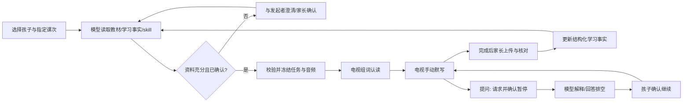

# 教学管理产品 PRD：语文认读与默写

版本：1.0 · 更新：2026-10-22 · 状态：本阶段完成，用户确认收尾。

本文是教学管理当前产品基线，整理已确认需求与已交付行为。历史实施计划用于追溯，不把其中早期的确认翻页、自动播报或历史 TTS 描述作为当前操作规则。阶段完成不代表所有异常场景均完成最新实体电视复验，也不代表孩子学习效果已经得到验证。

配套：[操作手册](teaching-user-guide.md) · [开发复盘](teaching-retrospective-20261022.md) · [原实施规划](../plans/2026-10-21-1206-feat-chinese-dictation-baseline-plan.md)。本文仅覆盖本阶段教学能力，不替代阅读、家电控制、声纹等全产品需求。

## 1. 产品目标与职责

家长说出“默写第8课”，系统结合孩子、教材和历史学习事实准备任务；电视按固定任务执行，孩子纸笔作答；家长核对后，结果成为下一次准备任务的依据。所有教学产品功能均须在教学管理有管理入口。

| 参与者 | 职责 |
| --- | --- |
| 发起者 | 指定孩子和范围，回答模型的必要澄清；无需解释为什么要默写该课 |
| 大模型 | 读取教材、学习事实与业务 skill，选词、说明依据、澄清疑问、通过工具协调暂停与恢复 |
| 后端业务服务 | 校验内容、权限及状态，冻结任务与资源，记录真实事件和家长核对 |
| 电视 APP | 自适应组词分页、遥控交互、播放完整音频、执行确定性状态机、报告实际状态 |
| 孩子与家长 | 孩子自备本子完成练习；家长上传照片、记录错词和认读困难、确认核对结果 |

当前部署组合为 KIMI 调度、豆包 TTS 合成、电视原生播放。模型提供商改变时业务职责不改变；豆包合成接口不承担教学判断。知识库在本阶段指结构化教材与个人学习事实，不意味着已交付向量检索平台。

## 2. 基础服务与产品功能边界

分类依据是“是否包含语文默写的教学规则”，而不是是否存在 API。基础机制可以复用；带二会字、四会字、词语核对含义的规则属于产品。

### 2.1 可供其他功能复用的基础能力

“既有共享”表示已有独立能力可接入；“默写内验证”表示机制已用在默写，但尚不是独立、跨学科的公共执行框架。

| 编号 | 能力与当前落点 | 状态 | 可复用方向及边界 |
| --- | --- | --- | --- |
| B1 | 模型客户端、工具调用与会话路径：`device/lira/llm/client.py`、`conversation_paths.py` | 既有共享 | 其他辅导复用同一调度方式；每种活动仍须提供自己的 skill、工具合同和权限校验 |
| B2 | 教材导入、识别、结构化资料、来源确认：`textbook_import.py`、`textbook_recognizer.py`、`textbook_practice.py` | 已有教材服务，本阶段主要验证语文 | 背诵、复习可复用教材来源；数学/英语字段与题型尚需设计，不能宣称任意学科直接可用 |
| B3 | 按成员隔离的教材进度与学习事实：`teaching_profile.py`、`dictation_context.py`、`dictation_results.py` | 档案可复用；词语事实仍属默写 | 后续按孩子、教材、范围读取事实；新活动须定义事实类型，不把一次完成提升为掌握 |
| B4 | 业务 skill 的版本保存与读取：`teaching_skills.py` | 已有版本机制，当前接入默写 skill | 新活动可沿用版本机制；实际注册、上下文装配及内容独立，不能共用一份语文规则 |
| B5 | 配置版本、冲突保护、任务冻结与资源哈希：`dictation_settings.py`、`dictation_preparation.py`、`dictation_task_contract.py` | 默写内验证 | 适合其他确定流程；需要先明确新任务 schema，再提取公共机制，不能直接给其他活动发送默写任务 |
| B6 | 电视配对、能力发现、投递及实际回执：`dictation_transport.py`、`tv-receiver/src/ReceiverService.java` | 电视传输已有共享能力；任务通道带默写协议 | 展示、听力与辅导可复用设备连接；按能力协商，发送 accepted 不等于显示或执行成功 |
| B7 | 音频资源合成、校验、缓存与原生播放器：`dictation_cloud_tts.py`、`dictation_assets.py`、`TaskAudioPlayer.java` | 播放器可复用；合成装配当前在默写内 | 新功能可复用完整资源播放与排空回执；音色、语速、降级策略由业务明确，不能沿用教学音色做所有回答 |
| B8 | 暂停/恢复、回答排空、租约、幂等、检查点、事件 ACK 与终态清理：`dictation_tools.py`、`dictation_repository.py`、`DictationEngineV2.java` | 默写内验证 | 其他长流程应沿用这些保证；当前未交付任意节点可配置的通用工作流引擎 |
| B9 | 管理认证、调试显示配置、执行日志与单次回归方法：`ui/dictation.py`、`dictation_settings.py`、`device/tests/browser/` | 公共管理基础 + 默写接入 | 功能应提供管理、回执与排障入口；电视展示日志独立于后台日志保留，显示开关不是采集开关 |

以上 Python 路径未写前缀时均位于 `device/lira/`；Java 路径位于 `tv-receiver/src/`。这些是追溯落点，并非对外稳定 SDK 承诺。

### 2.2 本阶段产品功能

| 编号 | 产品功能 | 管理入口/操作 | 依赖 |
| --- | --- | --- | --- |
| P1 | 孩子教材与已学进度 | 孩子与教材进度；教材管理与原文核对 | B2、B3 |
| P2 | 指定范围、模型澄清与任务准备 | 准备默写；候选词确认 | B1–B5 |
| P3 | 二会字组词认读 | 电视整词大字展示，左右翻屏 | B2、B5、B6、B8 |
| P4 | 四会字扩词默写 | 电视手动播放、上一词、下一词、重播、暂停 | B5–B8 |
| P5 | 执行中提问与辅导 | 模型暂停电视，解释后等待确认恢复 | B1、B6–B8 |
| P6 | 纸面结果、错词与知识回流 | 照片、家长核对、认读困难、学习事实查询 | B2、B3、B8 |
| P7 | 默写流程与教学策略管理 | 阶段排序、TTS 参数、业务 skill 版本 | B4、B5、B7 |
| P8 | 执行跟踪与电视调试显示 | 任务实际回执、事件日志、电视调试开关 | B6、B8、B9 |

## 3. 当前产品规则

### 内容与准备

- 默认任务包含二会字组词认读和四会字扩词默写；认读组词覆盖全部二会字，默写词语覆盖指定范围全部四会字。明确要求单字时才增设单字内容。
- 优先使用教材和已维护词库。缺资料或有疑问时与发起者交流；补充教材及候选词按管理确认流程处理，不把模型生成内容直接当教材事实。
- 每次准备携带业务 skill、相关课次事实与错词历史。模型优先考虑未掌握词、前后鼻音易混字和难写字；不使用固定掌握阈值代替判断。
- 准备会话绑定 skill 与流程版本；生成后冻结任务内容、来源、词序和音频。修改配置或 skill 只影响新准备会话，不在执行中换词或增词。

### 电视执行与交互

- 二会字展示组词；左键上一屏，右键开始/下一屏，确认键不操作。字号、每屏容量和分页由 APP 自适应，无滑动操作。
- 四会词语每次播报一次，结束后停住；左键上一词并播放，右键下一词并播放，确认键重播。首词左键重播首词，末词右键结束，不回绕、不计时自动推进。
- 返回键暂停；认读暂停后右键恢复，四会暂停后确认键恢复；长按返回结束。上、下、功能键无本功能额外操作。
- 四会界面不显示答案，以“第三个词，慢慢写”“一共七个词”和圆点表达进度，固定显示遥控指引，不显示混入认读步骤的 `2/23`。
- 孩子提问时，function calling 请求暂停；必须收到电视实际已暂停后才回答。解释排空后询问是否继续，确认后恢复当前项。断线或重启先暂停，失败可显式重试，不突然播放。
- 电视调试显示默认关闭，可从后台实时切换；不靠遥控功能键开启。后台执行日志独立保留。

### 播报配置

| 配置 | 当前采用值 |
| --- | --- |
| 调度 | 后台 KIMI（本阶段设备记录 `kimi-k3`，classic 路径） |
| 合成 | 豆包语音合成 2.0，`seed-tts-2.0` |
| 音色 | Vivi 2.0，`zh_female_vv_uranus_bigtts` |
| 音调 / 语速 / 音量 | `0 / -20 / 30` |
| 语音指令 | `朗读 播音 拉长音 着重强调 标准普通话` |
| 执行 | 手动模式，每词一次；完整 PCM 缓存后原生播放 |

豆包参数在教学管理配置。云端合成失败明确报错，不悄悄换用另一种 TTS；不把历史本地增益再叠加到这套获认可的云端音量上。密钥沿用设备安全配置，不显示在教学表单里。

### 结果与知识

- 孩子纸笔作答，家长事后上传照片并核对；可记录错误词语、可选错字、二会认读困难和备注。
- 核对状态区分尚未核对、有错误、全部正确；允许修订，后续上下文使用最新有效核对，并保留历史追溯。
- 练习完成、播报完成、翻页、照片上传均不等于答对。等待时间包含听音、思考、操作和中断，不能称为纯书写速度；未有可信评分分母和家长核对时不生成精确正确率。
- 助手演示保留未核对及演示说明，不作为孩子学习效果证据。初版不自动提升孩子教材进度或宣称掌握。

## 4. 流程与复用关系

图中回流表示下一次独立发起时使用新事实，不表示完成后自动循环创建任务。流程中的内容规则属于产品；版本、资源、传输、回执与状态保证属于基础机制。

## 5. 阶段交付与后续边界

本阶段已完成实现、分层回归、真实 KIMI + H5 单次长流程及实机部署；Vivi 手动播报曾完成一次实机全流程。最新儿童 UI 已部署，实机认读遥控与调试开关有检查记录，四会大字布局有截图。最新补充任务未作为自动完整回归通过：脚本发现任务已前进后退出，留给用户操作。按用户要求，不再排查可能误触的按键来源。

| 证据 | 范围 |
| --- | --- |
| [KIMI/H5 与服务验收](../verification/2026-10-21-dictation-v2-acceptance.md) | 真实模型工具调用、辅导暂停/恢复、结果回流和软件异常；不是物理声学验收 |
| [Vivi 与手动遥控](../verification/2026-10-21-doubao-vivi-manual.md) | 较早 UI 版本的单次实机完成；当前认读键位以本文为准 |
| [儿童 UI 与最新部署](../verification/2026-10-22-child-tv-ui.md) | H5/原生回归、大字实机截图、最新验证的实际边界 |

后续规划：背诵执行、OCR 自动识别/评分、可信书写速度及正确率呈现、更多学科、长期学习效果验证。跨学科公共任务合同与执行框架在实际第二个业务接入时再提取；当前不得标为已交付。没有新增自动评估、自动循环复习或执行中动态改题需求。
